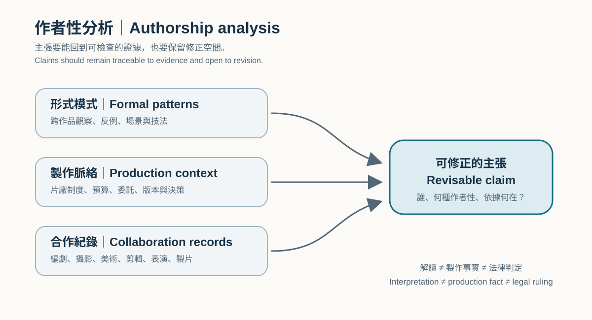

# Film Form, Style, and Authorship {#CH04-S00}

> Status: Traditional Chinese research draft paired with an English translation draft for human editing. The examples do not replace viewing a lawful edition and recording shots. This chapter has not been approved for publication.

## Learning Objectives {#CH04-S01}

By the end of this chapter, readers will be able to:

1. Explain how a film organizes audiovisual material through observable formal choices, without reducing style to a filter or adjective. [R031]
2. Distinguish film form, film style, auteurism, film authorship, and collective authorship, and identify the scope and limits of each concept. [R032–R036]
3. Develop a revisable claim about authorship using evidence from multiple works, production contexts, and collaborators. [R035, R036]
4. Translate an abstract creative intention into visual and sonic rules that can be shot, edited, and assessed, then compare live-action and generative workflows. [R031, R038]
5. Create an original style specification and quality checklist without copying a particular creator’s identifiable expression. [R038]

## Prerequisites {#CH04-S02}

Readers should be familiar with CH01’s audiovisual language, CH02’s basic units of shots and staging, and CH03’s shot scale and spectator position. The chapter does not require a choice of a “most important” auteur; claims should be supported by observable work and traceable sources. Film exercises require a lawfully accessible edition and edition details. Do not invent timecodes when a film has not been viewed.

## Key Terms {#CH04-S03}

| Term | 繁體中文 | Working definition | Qualification | Sources |
|---|---|---|---|---|
| Film form `TERM-CH04-FILM-FORM` | 電影形式 | The overall organization of audiovisual elements, narrative information, and their relations within a work. | Identify observable elements and relations; this is not a synonym for “good-looking form.” [R031] | R031 |
| Film style `TERM-CH04-FILM-STYLE` | 電影風格 | How a work uses medium-specific techniques and formal means, including composition, cinematography, staging, editing, and sound. | One technique or color palette alone cannot establish a stable authorial style. [R031] | R031 |
| Auteur theory / politique des auteurs `TERM-CH04-AUTEURISM` | 作者論／作者政策 | A critical approach that asks whether a director’s or another creator’s personal expression can be identified and compared across works. | It is a framework and critical position, not a copyright ruling or a claim that a director made a film alone. [R032, R033, R035] | R032, R033, R035 |
| Film authorship `TERM-CH04-FILM-AUTHORSHIP` | 作者性 | Claims about who created, organized, or should be regarded as the author of a film. | Specify whether the claim concerns production responsibility, interpretation, evaluation, or legal identity; these questions are not interchangeable. [R035, R036] | R035, R036 |
| Collective authorship `TERM-CH04-COLLECTIVE-AUTHORSHIP` | 集體作者性 | An account of creative contribution as the combined work of multiple people across a film’s production. | It does not imply equal influence; support claims with credits, production records, interviews, or formal analysis. [R035, R036] | R035, R036 |
| Recurring stylistic motif `TERM-CH04-STYLE-MOTIF` | 風格母題 | A repeated, concretely describable audiovisual choice or combination across works or a career. | Recurrence alone does not prove intention, causality, or a guaranteed audience response. [R031, R035] | R031, R035 |
| Style specification `TERM-CH04-STYLE-SPECIFICATION` | 風格規格表 | A translation of creative intention into visual, sonic, rhythmic, and constraint-based directions for a crew or generative tool. | It supports communication; it is not a technical protocol that guarantees a result. [R038] | R038 |
| Style drift `TERM-CH04-STYLE-DRIFT` | 風格漂移 | Unexpected inconsistency in visual or sonic rules among shots or clips in the same project. | Assessment requires a defined baseline, comparison conditions, and human review; prompt text alone cannot decide it. [R038] | R038 |

## History and Principles {#CH04-S04}

### Form is a relation, not decoration

Film-form analysis treats a work as a set of connected choices: narration organizes what viewers know; staging arranges performers and space; cinematography controls what is visible; editing shapes time and causality; and sound may extend or reinterpret an image. Analysis should describe what is present before explaining how elements reinforce or contrast with one another. The publisher’s table of contents for the thirteenth edition of *Film Art: An Introduction* places form, narration, mise-en-scène, cinematography, editing, sound, and critical analysis in a connected curriculum. This chapter adopts that analytical orientation without asserting a single correct interpretation of any film. [R031]

### From “policy of authors” to auteur theory

**Verified publication-history description:** The Cinémathèque française’s Truffaut retrospective states that Truffaut published an essay related to the “policy of authors” in issue 31 of *Cahiers du cinéma* in 1954. It quotes his later recollection: he then valued reading a director’s career as a whole, but later acknowledged moving toward a more nuanced and less categorical position. [R032]

Andrew Sarris’s “Notes on the Auteur Theory in 1962” brought this critical approach into English-language American film debate. This chapter treats it as a historically situated critical text, not a law accepted by all contemporary film scholars. [R033] Pauline Kael’s “Circles and Squares,” published in *Film Quarterly* in 1963, offered a critique and became part of a significant critical debate. The University of California Press journal record confirms its author, title, issue, and page range. [R034]

### An author is not the only creator

Authorship questions should first be separated: Who participated in production? Who had decision-making power over particular choices? Whose work does a critic compare? How do viewers interpret the film? How does law determine rights? Philosopher Berys Gaut distinguishes dimensions of authorship claims that can be considered independently and allows for single or multiple authors. C. Paul Sellors discusses film collaboration through collective authorship. These studies caution against treating “director as auteur” in criticism as a legal conclusion or erasing the concrete contributions of writers, cinematographers, production designers, editors, composers, performers, and producers. [R035, R036]

## Traditional Production Practice {#CH04-S05}

1. **Write the creative proposition first.** In one or two sentences, state what the audience should notice or feel in the scene and what information should be withheld or delayed. “Make it feel like Director X” is not an assessable direction.
2. **Translate it into audiovisual choices.** Specify framing and camera position, composition, camera movement, light and color, set elements, performance rhythm, editing density, ambience, and music placement. Give each choice a dramatic reason and an allowed range.
3. **Build references and counterexamples.** When studying a director, compare multiple works and different collaboration conditions; find examples that do not fit the initial hypothesis. Record directing, cinematography, editing, production design, music, and producing credits. Repeated visual features alone do not identify a single source.
4. **Previsualize.** Use text storyboards, original mood boards, editable technical diagrams, shot lists, and sound sketches to turn abstract rules into testable plans. Film references are for study; do not place movie stills directly into formal publication artwork.
5. **Shoot, edit, and review.** Shoot short tests of alternative formal approaches to the same scene. In the rough cut, review both individual shots and scene rhythm. Record which choices came from the director, which emerged through collaboration, and which changed because of budget or location.
6. **Revise the style specification.** Update rules from production and editing evidence, retaining versions and decisions. Consistency does not mean every shot is identical; variation should serve an explainable overall design. [R031, R035, R036]

## AI-Era Workflow and Limitations {#CH04-S06}

AI can help turn a creative proposition into shot variations, storyboard text, a visual-rules checklist, or a review sheet. A prompt alone cannot prove that a work has a consistent style or a particular authorship. Tools interpret “style” as natural-language conditions, and results may depart from the specification in subjects, settings, motion, color, or composition. Runway’s Gen-4 prompting guide recommends starting simply, then adding subject motion, camera motion, scene motion, and style descriptors iteratively. This is guidance for that product and is not a universal capability claim or guarantee. [R038]

**AI hypothesis (untested):** A small set of observable style rules may make generated variations easier for a team to compare than abstract adjectives alone. To test this, hold source material, model version, generation mode, and other parameters constant; change one rule at a time and preserve inputs, outputs, and human ratings. This project has no test data yet and makes no claim that the hypothesis is proven.

Keep “style consistency” separate from “imitation of a particular creator.” Describe original choices in camera distance, color relationships, editing rhythm, materials, and sound density. Avoid using a living creator’s name as the sole direction, and avoid recreating identifiable characters, sets, costumes, shots, or marks. This is the project’s creative and rights-risk rule, not legal advice.

## Step-by-Step Workflow {#CH04-S07}

| Stage | Inputs | Actions | Outputs and checks |
|---|---|---|---|
| 1. Define intention | Dramatic task, audience information, emotional turn | Write an observable creative proposition without relying on a creator’s name | One or two sentences with assessable outcomes |
| 2. Define style dimensions | Intention, scene conditions, production limits | Specify cinematography, composition, staging, light/color, editing, and sound; give each a reason and allowed variation | Bilingual style sheet connected to the scene’s task |
| 3. Study cases | Lawful edition, film records, credits | Record edition/release details; log observed shots and timecodes; compare works and seek counterexamples | Sourced observation log; mark BLOCKED and leave timecode blank if not viewed |
| 4. Design production | Style sheet, script, location, performers, equipment | Prepare shot list, storyboard, sound plan, and department handoffs | Shootable records with owners, continuity constraints, and alternatives |
| 5. Generate AI variations (optional) | Original text/image input, confirmed tool version | Iterate one variable at a time; log model, mode, parameters, prompt, seed if provided, and output hash | Reproducible record; if no service is configured, use paper planning only |
| 6. Review and revise | Live-action or generated output, style sheet | Assess intention, continuity, originality, and rights risks shot by shot | Selection record, revised specification, human-review queue |

**Suggested handoff fields:** `scene_id`, `shot_id`, `dramatic_intent`, `framing`, `camera_action`, `blocking`, `lighting_color`, `edit_rhythm`, `sound_intent`, `allowed_variation`, `continuity_constraints`, `source_ids`, and `review_status`. This is a practical suggestion, not an official schema for a particular tool.

## Prompt and Technical Parameters {#CH04-S08}

The following is a teaching demo prompt. It has not been tested locally or in a generation service. It does not imply that a service is installed, that a subscription includes generation credits, or that an output is publication-ready.

```text
Demo: An 8-second locked-off shot for the original short film “Last Bus Shelter.”
Subject: An adult night-shift nurse sits at an unbranded suburban bus shelter, holding a paper timetable with a dark screen.
Dramatic intention: Preserve uncertainty about whether she will leave; the audience notices the empty seat before seeing that she does not stand.
Composition: Medium-wide framing; subject on frame right; keep the empty space on the left legible; camera fixed at eye level.
Light and color: Cool white shelter light as key; a small warm streetlight in the distant background; natural skin tone.
Action: She looks toward the road, pauses, then folds the timetable; distant car lights recede; add no new people.
Rhythm and sound: No music; retain quiet rain and distant traffic; keep the gesture unhurried.
Constraints: Newly designed setting, person, wardrobe, and props; no named film, director, actor, brand, or existing shot.
Acceptance: Wardrobe and seat position stay consistent; action direction is clear; empty space remains visible; no garbled text or logos.
```

For Runway Gen-4, the official guide recommends starting simply and iterating with subject action, camera action, scene motion, and style. Check the current official documentation before use because interfaces, features, and output settings change. The eight seconds above are a story-design example, not a claim about any product’s output duration. [R038]

Do not fill technical parameter tables with guesses. Record the actual service and version, generation mode, aspect ratio, resolution, frame rate, duration, prompt, rights for any reference input, seed/job ID if provided, generation date, output hash, and human selection reason. Write `not provided/not tested` for unavailable data. Descriptive words are not verified camera-control values.

## Shot, Film, and Case Studies {#CH04-S09}

### Case A: Testing auteurism with *Vertigo*

The BFI’s 2026 educational event uses Alfred Hitchcock’s *Vertigo* (1958) to teach auteur analysis. It notes that Hitchcock had more autonomy than many studio-era directors when he worked as producer-director at Paramount. This is the BFI’s educational framing and historical summary; it does not prove that one person created the film, and this chapter does not claim to have verified a particular shot or timecode. [R037]

**Class exercise:** Use a lawful edition. Select at least three different passages and record edition details and actual timecodes. For each, note framing, color, staging, editing, sound, and narrative information. Compare another Hitchcock-directed work produced under different collaboration conditions, then consult screen credits and reliable production records. Separate direct audiovisual observations, source-documented production facts, and your own interpretation. Until viewing is completed, this chapter supplies no invented scene details or timecodes.

### Case B: Analyzing style through *Film Art* and production records

The publisher’s table of contents for the thirteenth edition of *Film Art: An Introduction* lists narration, mise-en-scène, cinematography, editing, sound, and critical analysis as core areas, providing a useful classification for a style-analysis sheet. [R031] Choose a film with lawful access, use the same table to log audiovisual choices, and consult credits for the director and department collaborators. **This is a method demonstration**; it does not present a subjective reading of a particular film shot as verified fact.

## Original Illustrative Diagrams {#CH04-S10}

{#CH04-FIG-001 fig-alt="Three evidence streams—formal patterns across works, production context, and collaborator roles and decision records—feed a revisable authorship claim."}

**Figure 4-1 | Three evidence streams for authorship analysis. Original editable SVG. Its framework draws on Gaut’s discussion of dimensions of authorial claims and single/multiple authors; it does not assert that this project has reached an authorship conclusion about any film. [R035, R036]**

{#CH04-FIG-002 fig-alt="Five-stage cycle: creative intention, observable style rules, production or generated variations, human clip review, and revision of a versioned specification."}

**Figure 4-2 | A workflow from creative intention to assessable style specification. Original editable SVG; this is a project workflow illustration, not an official process from any one tool. [R038]**

Both diagrams are hand-authored SVGs. They contain no film stills, third-party images, or AI-generated imagery. Creator attribution, accessibility, print rendering, technical accuracy, and publication rights still need human review; both assets remain drafts.

## Common Errors and Quality Checks {#CH04-S11}

| Common error | Why it matters | Check or correction |
|---|---|---|
| Treating film form as a camera filter | It ignores interaction among narration, performance, sound, editing, and staging. | Review how audiovisual elements reinforce or contradict each other within a shot and scene. [R031] |
| Using one film or shot to prove a director’s fixed style | The sample may be too small and may misattribute choices created through collaboration. | Compare multiple works, collaboration conditions, and counterexamples; limit the claim. [R035, R036] |
| Treating auteurism as a copyright conclusion | Critical concepts and legal rights determinations answer different questions. | Separate critical attribution, production roles, and rights status; refer legal questions to counsel. [R035] |
| Prompting only “in the style of Director X” | It does not describe audiovisual choices and raises imitation risk. | Specify original, observable composition, light, motion, and rhythm; conduct human similarity review. |
| Claiming a prompt guarantees consistency | Results vary with model, mode, input, and version. | Fix test conditions, log the version, and use human evaluation; vendor guidance is not independent performance evidence. [R038] |
| Treating every generated difference as a defect | A style specification may allow intentional variation. | Define which changes serve the story and which break continuity; review shot by shot. |

**Quick check:** Is the intention observable? Does the specification avoid reliance on imitating a named creator? Is each audiovisual choice tied to the scene’s task? Does each film case have lawful access and an actual locator? Is the generation record reproducible? Did a person assess differences against stated criteria? Record every “no” as an open task; a model’s self-assessment is not a substitute.

## Exercises, Assessment, and Further Research {#CH04-S12}

1. **Style observation:** Select two films by one director and one by another. Use a lawful edition and select three passages from each. Record edition, timecodes, direct observations, sourced production facts, and your own interpretations. Do not infer style from promotional copy alone.
2. **Counterexample exercise:** For a working claim (for example, “this director always uses a locked camera for conflict”), find at least one supporting example and one counterexample, then rewrite the claim with narrower conditions.
3. **Original style sheet:** Create a one-page bilingual specification for the demo scene “Last Bus Shelter,” including intention, composition, action, light/color, editing, sound, allowed variation, and continuity rules. Do not use a named creator as a style shortcut.
4. **Optional AI comparison:** Generate only after an authorized account, terms, and budget are confirmed. Keep the tool version and input fixed; change one audiovisual rule at a time; save prompts, parameters, and output hashes. Ask two readers to rate intention legibility, continuity, rule adherence, and originality from 0–4. Without an enabled tool, complete the experimental design with paper storyboards and do not fabricate results.

**Scoring rubric (0–4 each):** specificity of evidence; reliability of source and passage locator; recognition of collaboration and counterexamples; usability of the audiovisual specification; and clarity about rights risks and test limits. 0 = absent or misleading; 2 = present but incomplete in evidence or execution; 4 = traceable, carefully qualified, and reproducible. Aesthetic judgment still requires human review.

Further research: compare the contexts of Truffaut’s and Sarris’s authorship texts; study Kael’s reply and collective authorship models; investigate how studio systems shape individual decisions; and examine how generative systems affect directing and departmental collaboration. Connect the style sheet to CH11 Directing, CH13 Mise-en-scène, CH19 Camera Movement, and CH34 Editing Rhythm.

## References {#CH04-S13}

- [R031] Bordwell, David, Kristin Thompson, and Jeff Smith. *Film Art: An Introduction*. 13th ed., 2026 release. McGraw Hill. The publisher page verifies authors, edition, and contents; chapter-specific page locators remain to be checked against the project’s adopted copy.
- [R032] Truffaut, François. “Une certaine tendance du cinéma français” and later recollections. Cinémathèque française, *Truffaut par Truffaut*. Accessed 2026-10-20. The retrospective cites his recollection and identifies the original essay as appearing in *Cahiers du cinéma*, no. 31 (January 1954); this chapter does not present the retrospective as a verbatim copy of the original essay.
- [R033] Sarris, Andrew. “Notes on the Auteur Theory in 1962.” *Film Culture*, no. 27, Winter 1962–63. A scan of the primary text was consulted; original pagination remains to be checked against an adopted print or facsimile edition.
- [R034] Kael, Pauline. “Circles and Squares.” *Film Quarterly* 16, no. 3 (1963): 12–26. DOI: 10.2307/1210726.
- [R035] Gaut, Berys. “Film Authorship and Collaboration.” In *Film Theory and Philosophy*, edited by Richard Allen and Murray Smith, 149–172. Oxford University Press, 1997. DOI: 10.1093/acprof:oso/9780198159216.003.0007.
- [R036] Sellors, C. Paul. “Collective Authorship in Film.” *The Journal of Aesthetics and Art Criticism* 65, no. 3 (2007): 263–271. DOI: 10.1111/j.1540-594X.2007.00257.x.
- [R037] British Film Institute. “Vertigo and Auteur Theory for KS5 Film Studies.” Educational event page, accessed 2026-10-20. Used as an educational case entry; event and screening details are time-sensitive and must be rechecked before publication.
- [R038] Runway Help Center. “Gen-4 Video Prompting Guide.” Official product guide, accessed 2026-10-20. Supports only the guide’s own prompting recommendations; model name, features, and availability must be rechecked before publication.
