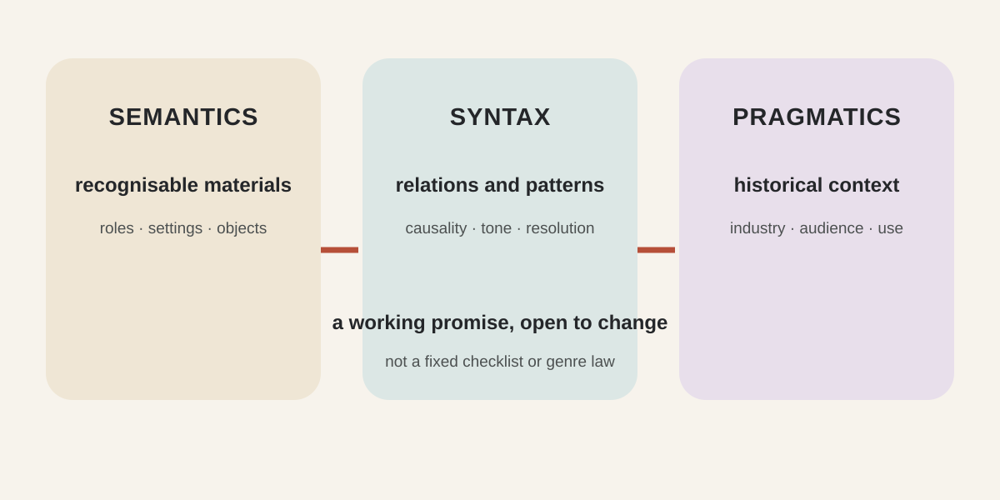
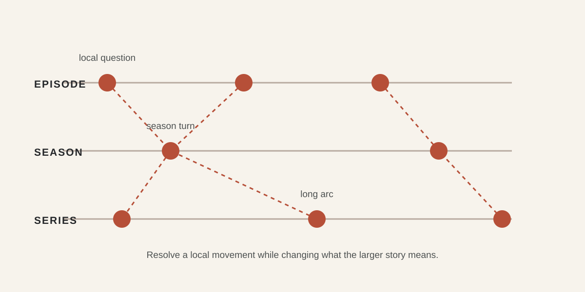
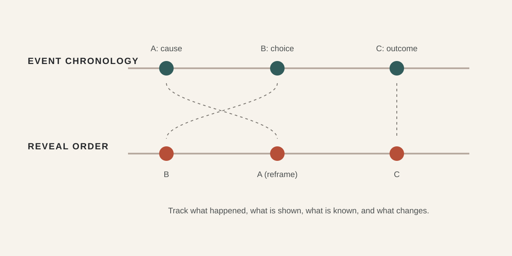

# Genre Writing, Serial Narrative, and Nonlinear Structure {#CH09-S00}

> Editorial status: Traditional Chinese research draft complete; this English text is a working translation. Film cases are bounded by traceable publisher, scholarly, or BFI sources. No project viewing edition or shot timecodes are claimed. Original vector diagrams remain pending rights and publication review.

## Learning Objectives {#CH09-S01}

After completing this chapter, readers will be able to:

1. Describe genre as a changing category used by industry, critics, authors, and audiences rather than a fixed formula, and explain a work’s genre promise through recognizable elements, narrative relations, and audience or market context. [R066]
2. Distinguish episodic, serialized, and hybrid serial storytelling, assigning different questions, changes, and payoffs to an episode, season, and whole series. [R067][R068]
3. Separate the chronological order of story events from the order in which a work presents them, and state the purpose of withholding, flashbacks, or parallel lines. [R051][R069]
4. Build a genre-promise sheet, series-arc matrix, event/reveal matrix, and continuity record, identifying which parts can be checked by software and which require human judgment.
5. Treat model output as a traceable story candidate; check sources, information states, character causality, genre stereotypes, and long-range continuity instead of treating generated text as a validated screenplay.

## Prerequisites {#CH09-S02}

Readers will benefit from prior work on story and plot, character goals and obstacles, scenes and beats, basic screenplay scene format, and Chapter 08’s dialogue and subtext analysis. Readers without that background can still complete the exercises by first listing events, character goals, and scene outcomes in brief form.

No particular screenwriting software, AI service, or fixed act count is required. A television episode, web short, feature, film franchise, and transmedia work differ in duration, production conditions, and audience access. The worksheets here support collaboration; they are not universal industry specifications.

## Key Terms {#CH09-S03}

| Term ID | 繁體中文 | English | Working definition / boundary |
|---|---|---|---|
| TERM-CH09-GENRE | 類型 | genre | A category formed through a changing relationship among textual features, industrial classification, critical discourse, and audience expectation; not a single plot formula. [R066] |
| TERM-CH09-GENRE-CONVENTION | 類型慣例 | genre convention | A recognizable element, narrative relation, or stylistic practice within a particular body of work or context; conventions are changeable agreements, not hard rules. |
| TERM-CH09-GENRE-MIX | 類型混合 | genre mixture | A work’s use of resources from multiple genres. Design should state the primary promise, secondary resources, and how they interact rather than merely stacking labels. [R066] |
| TERM-CH09-EPISODIC | 單集式敘事 | episodic narrative | A narrative form in which an episode establishes and addresses its main problem to some degree; characters and the story world may still develop across episodes. [R067] |
| TERM-CH09-SERIAL | 連續式敘事 | serialized narrative | A form in which storylines continue across episodes, seasons, or a series; an episode still needs an immediate change, information, or emotional payoff. [R067][R068] |
| TERM-CH09-HYBRID-SERIALITY | 混合式系列敘事 | hybrid seriality | A design that allocates narrative work between local episode closure and continuing long-form storylines; the degree of closure varies by format. |
| TERM-CH09-PLOTLINE | 故事線 | plotline | A narrative thread linking characters, goals, obstacles, and events. A/B/C labels are production conventions that a team must define for its own use. [R068] |
| TERM-CH09-NONLINEAR | 非線性敘事 | nonlinear narrative | A presentation order that does not follow the chronological order of story events; causality can remain legible when sufficient time, character, and viewpoint cues are provided. [R051][R069] |
| TERM-CH09-REVEAL-MAP | 揭露矩陣 | reveal map | A working document recording when events occur, when audiences learn about them, when characters learn about them, and how each reveal changes interpretation. |

“Genre convention,” “hybrid seriality,” and “reveal map” are working terms for this book. They are not presented as universal definitions used by every scholar or production team. Entries remain draft pending terminology review.

## History and Principles {#CH09-S04}

### Genre as a changing negotiation

Film genre does not reside only inside the film text. Rick Altman’s *Film/Genre* situates genre among industry, critics, audiences, and historical change. The publisher’s contents also explicitly address genre mixture, viewing, and semantic/syntactic/pragmatic approaches. [R066] This chapter borrows that framework as an analytical entry point:

- **Semantic layer:** recurring character positions, objects, settings, visual or sound materials.
- **Syntactic layer:** how relations among characters, goals, conflicts, and outcomes organize a narrative.
- **Pragmatic layer:** who uses genre labels, in what historical, industrial, and viewing contexts, and what expectations they create.

This is an analytical framework, not a universal algorithm for classifying scripts. A writer may borrow or revise conventions. The key is to understand what audiences recognize, what a work promises, and how its differences update those expectations.

### Serial narrative manages multiple scales

Serial works manage episode, season, and whole-series scales at once. Jason Mittell’s *Complex TV* discusses complex serial narratives, audience comprehension, character change, and serial authorship across a range of programs; analyzing long-form work therefore requires more than treating each episode as an isolated short film. [R067] Episodic and serialized forms are not a value ranking: a work can resolve a local task in one episode while advancing relationships or world states across episodes.

Terminology for serial storylines also changes across scholarly and production contexts. Borowiecki’s article abstract focuses on multi-plotline narratives and argues for reconsidering plotline terminology; A/B/C labels should therefore be treated as team conventions, not universal categories. [R068]

### Nonlinearity arranges events and reveals

When analyzing nonlinearity, first list events in “story-world chronological order,” then separately list the order in which the work presents them. David Bordwell’s film-narrative analysis is a theoretical reference for story, plot, and presentation; the event/reveal matrix in this chapter is a practical worksheet and should not be misattributed as an original term from a theorist. [R051]

Nonlinearity can change when audiences learn information, create comparisons, restrict viewpoint, or invite a re-evaluation of prior events; it can also make causality difficult to follow. Reordering alone does not automatically create suspense, depth, or originality. The work still needs enough cues about time, people, cause, and viewpoint for audiences to form and revise hypotheses. [R069]

## Traditional Production Practice {#CH09-S05}

1. **Define the promise:** Write one sentence about the intended audience experience, then list primary and secondary genres and what the work does not promise. Explain how each convention serves character goals or theme.
2. **Map convention and variation:** List familiar elements, how the work uses them, the expectations they may create, and why this work keeps, transforms, or rejects them. Do not reduce genre study to a prop checklist.
3. **Set series scales:** Define what an episode delivers, the season’s mid-range turns, and the whole series’ central question. Decide in advance whether the story can conclude if canceled, renewed, or shortened.
4. **Map plotlines:** For each A/B/C line, record characters, goals, obstacles, introduction, development, intersections, and temporary payoff. These labels describe local function; three lines are not a required quota.
5. **Check causality:** Connect scenes and episodes with “therefore” or “but.” Ask whether one event changes the conditions of the next, rather than merely preceding it. Use the scene/beat analysis from Chapter 08 as a reference; do not treat act breaks as a scene-count quota.
6. **Design reveals:** Track event chronology, presentation order, audience knowledge, character knowledge, setups, and payoffs. For every delayed reveal, ask who withholds the information, why it appears now, and what the audience should reinterpret.
7. **Control versions and continuity:** Maintain a series bible, timeline, relationships, character knowledge states, object/location rules, outstanding setups, locked facts, and flexible elements. Record the version and impact of every revision.
8. **Table-read and test comprehension:** Ask readers unfamiliar with the author’s explanation to annotate what they can predict, where they are confused, and when new information changes an inference. Confusion is not the same as depth; an explanation cannot necessarily repair a structural problem.

| Scale | Writing question | Working document |
|---|---|---|
| Scene / episode | What does this segment resolve or change? | Scene cards, episode beats, end state |
| Season / series | Which line continues, turns, or closes? | Season arc, plotline matrix, character-state table |
| Presentation order | When does the audience learn about event and cause? | Chronology, reveal map, setup/payoff record |

## AI-Era Workflow and Limits {#CH09-S06}

### Organizational tasks for tool assistance

Within material the author provides and is authorized to use, a tool may help extract characters, episodes, events, state changes, and setup candidates; compare continuity fields across versions; propose alternative ordering under explicit constraints; or convert human-approved material into tables and JSON. These are **workflow proposals to test**, not guarantees about any current AI product.

An industry-participant study of language-model screenplay co-writing documents experiences with a particular system, participant group, and task. It does not prove that a model can maintain a season-long causal structure, satisfy a genre, or detect every contradiction automatically. [R062] This chapter therefore labels AI output as `ai-hypothesis` or `demo`: a screenwriter must check each item against source text, the series bible, and explicit acceptance criteria.

### Suggested division of labor

- **Model candidates:** organize, classify, and compare possibilities; label every new story event as a candidate.
- **Code checks:** required fields, existence of character and location IDs, hard chronology constraints, bilingual alignment, and whether a storyline has a recorded update.
- **Human decisions:** whether a genre promise is compelling, whether a reveal is fair, whether a character choice is credible, whether cultural representation is appropriate, and whether a storyline should remain or be removed.

### Main limitations

Long context may exceed what a tool can see. Similar names, cross-season time jumps, mixed draft/final versions, or deliberate character deception may be misclassified as continuity errors. A model can also turn conventions into stereotypes or mistake details in an earlier candidate draft for canon. Do not upload an entire unreleased script or sensitive production material to an unauthorized service. First verify the current official terms, version, data-handling terms, and team policy for the selected tool.

## Step-by-Step Workflow {#CH09-S07}

| Step | Input and owner | Work | Output / acceptance evidence |
|---|---|---|---|
| 1. Define the format | Author/producer: medium, duration, episode count, audience, production constraints | Decide feature, short-form series, limited series, ongoing series, or film franchise; label assumptions. | Versioned format brief |
| 2. Write genre promise | Writer/director | Describe audience experience, genre resources, expectations, and variations; flag material requiring cultural review. | Genre promise sheet; labels do not replace the story description |
| 3. Define characters and engine | Writers’ room | State protagonist goals, recurring conflict mechanism, source of change, and immutable character facts. | Series premise, character states, and engine document |
| 4. Build the long arc | Head writer/showrunner | Set the season/series question, possible turns, and closure options without assuming renewal. | Long-arc map and closure points |
| 5. Allocate episodes | Writers’ room | Arrange each episode’s local problem, payoff, plotline movement, character-state change, and end state. | Episode cards and plotline matrix |
| 6. Build chronology | Writer / script coordinator | Order events in story-world time; record time, participant location, information state, and causal dependency. | Chronology with unique event IDs |
| 7. Design presentation | Writer/director/editorial consultant | Arrange audience-facing event order; state the function, cues, and delay cost of every flashback, repetition, or withholding. | Reveal map and audience-comprehension questions |
| 8. Run a narrow AI experiment | Author supplies minimum authorized data; tool operator | Request constrained candidates only; manually verify every new claim. | Original prompt/output, review labels, accept/reject rationale |
| 9. Check continuity and version | Script coordinator / code | Run schema, ID, dependency, and version-difference checks; send suspected problems for human interpretation. | Machine results and human disposition |
| 10. Table-read and lock | Author, actors, director, producer | Test comprehensibility, performance, pacing, genre promise, and closure; lock the version and revision authority. | Table-read changes, decisions, approved draft version |

## Prompt and Technical Parameters {#CH09-S08}

The following model-neutral prompt is illustrative. It specifies no provider, version, or untested parameter. Remove unauthorized scripts and personal data before use, and replace bracketed fields only with author-provided material.

```text
Role: You organize series-script data; you do not make story decisions for the author.
Task: Using only the [series brief, character list, and event data] I provide and am authorized to use,
      organize each episode's local question, cross-episode plotlines, chronological event order,
      and audience reveal order.
Constraints:
- Use only input data. If information is missing, output null and ask a question; do not invent canon.
- Separate source_fact, author_hypothesis, model_suggestion, and demo.
- Give every event a stable event_id; preserve what each character knows or does not know.
- Do not imitate a particular writer or work; do not copy third-party protected text.
- Treat genre labels as candidates; list supporting cues, counterexamples, and alternatives.
- For a candidate reveal order, state its purpose, event dependencies, and comprehension risks.
Output: Return only a JSON object with these fields:
{
  "project_id": "string",
  "evidence_status": "source_fact|author_hypothesis|model_suggestion|demo",
  "genre_promises": [{"label": "string", "evidence": ["string"], "risk": "string"}],
  "episodes": [{"episode_id": "string", "local_question": "string",
    "local_change": "string", "plotline_ids": ["string"], "end_state": "string"}],
  "events": [{"event_id": "string", "chronology_index": "integer|null",
    "reveal_index": "integer|null", "participants": ["string"],
    "who_knows": ["string"], "depends_on": ["string"], "source_ids": ["string"]}],
  "continuity_flags": [{"entity_id": "string", "issue": "string", "evidence": ["string"]}],
  "human_questions": ["string"]
}
```

The `chronology_index`, `reveal_index`, and `evidence_status` fields above are project-specific data conventions, not universal screenplay standards. For production use, define the types, required fields, ID references, and null handling in a JSON Schema. Valid JSON means only that the syntax can be read; it does not establish that the story works. Record token, temperature, context-window, or other provider-specific settings from the chosen tool’s current official documentation and reproducible tests; this chapter does not invent values.

**Fictional demo (`demo`):** In the fictional series *Coastal Post*, a character delivers an unsigned letter in episode one; episode two reveals that the recipient had already read a copy. This is a teaching hypothesis, not information about an existing screen work, and it does not imply that the reveal is effective.

## Film and Series Case Studies {#CH09-S09}

### *Memento* (2000): nonlinear order as audience-information design

James Mottram’s *Sight and Sound* article for the BFI describes *Memento* as alternating backward-moving color sequences with forward-moving black-and-white sequences, which converge later in the film. [R069] This source supports discussion of the difference between event order and viewing order; the article is not a substitute for shot-by-shot viewing, and this chapter does not claim that reverse order automatically makes audiences identify with the character.

**Analysis exercise:** List events in story chronology, then mark when the film presents each piece of information. Observe how audiences revise an earlier interpretation. For shot-level claims, the author must select a lawful viewing edition and record its version, subtitles, runtime, and timecodes.

### *Dunkirk* (2017): convergence across parallel time scales

The same BFI article summarizes three storylines as “one week, one day, one hour” and notes that they converge later; it also connects the thriller’s countdown mechanism to the film’s structure. [R069] This chapter uses the article to demonstrate how a traceable source can support a high-level structural description. Claims about music, editing points, or specific shots require viewing and more precise evidence.

**Analysis exercise:** Draw three parallel timelines, recording where they converge, what the audience knows before the convergence, and how it changes perceived risk. This is an analytical method, not the only interpretation of authorial intent.

### *The Wire*: a research entry point for long-form serial storytelling

NYU Press’s description of Jason Mittell’s *Complex TV* lists *The Wire* among the programs analyzed and states that the book discusses audience comprehension, transmedia storytelling, serial authorship, and character change. [R067] This supports using the series as an entry point to long-form serial narrative research. Claims about particular seasons, characters, or episodes require reading the relevant chapter and selecting a lawful viewing edition.

These cases do not supply invented runtimes, restoration details, or timecodes. High-level information from secondary sources must remain distinguishable from this book’s own teaching analysis.

{#CH09-FIG-001 fig-alt="An original vector diagram uses three connected analytical layers—recognizable elements, relations among people and events, and industrial/audience context—leading to a work's genre promise and variation."}

**Figure 9-1.** Semantic, syntactic, and pragmatic layers are analytical views for organizing genre cues, not an automatic classification formula. This is an original editable SVG illustration for this book, not a film still or a depiction of a specific work; rights and publication approval pending.

{#CH09-FIG-002 fig-alt="An original vector diagram presents episode, season, and series scales with local questions, continuing plotlines, and long-term change; arrows indicate documented causal handoffs, not a fixed episode formula."}

**Figure 9-2.** Episodes, seasons, and whole series can provide payoffs and continuations at different scales. This is an original editable SVG illustration for this book, not the layout or characters of an existing screen work; rights and publication approval pending.

{#CH09-FIG-003 fig-alt="An original vector matrix compares story-world chronology with the order in which audiences see events, while recording character knowledge and the interpretive effect of each reveal."}

**Figure 9-3.** Event chronology and reveal order should be recorded separately to audit the information dependencies of nonlinear storytelling. This is an original editable SVG illustration for this book, not a film timecode or still; rights and publication approval pending.

## Common Errors and Quality Checks {#CH09-S10}

| Error | Possible effect | Check and correction |
|---|---|---|
| Treating genre as a fixed formula | Characters and events become a checklist without causality or distinction | Connect every convention to character goals, audience expectation, or thematic function; remove elements present only as labels. |
| Mixing many genres without hierarchy | Tone and audience promises cancel each other out | State the timing, function, hierarchy, and intended effect of each resource; use blind readers to describe the primary experience. |
| Relying only on cliffhangers in a long-form series | Episodes lack local payoff; continuation becomes the only motivation | Check episode change, character choice, and long-term question separately; mark each unresolved issue as deliberate or missing. |
| Treating A/B/C plotlines as a fixed quota | Secondary lines become unnecessary and pacing formulaic | Define the team’s labels in the series bible; allow lines to merge, disappear, or change role. |
| Assuming a scrambled timeline is automatically complex | Audiences cannot distinguish deliberate withholding from missing information | Track chronology, reveal index, character knowledge, and setup/payoff; explain what each reveal reinterprets. |
| Treating multiple viewpoints as multiple truths about one event | Differences in testimony lack evidence and motivation | Separate verifiable facts, character claims, observable evidence, and unknowns; multiple viewpoints alone do not prove that anyone lies. |
| Letting AI invent story canon | Candidate details enter canon, causing cross-episode contradictions or stereotypes | Label each new item source/hypothesis/suggestion; compare against the locked series bible and record the human decision. |

### Automatically testable items

- Stable, unique IDs for chapters, episodes, characters, locations, and events.
- Existing reference and term IDs, valid JSON and schema fields.
- Resolvable character, event, episode, and dependency IDs in the plotline table; documented exceptions for intentional chronology violations.
- Aligned Chinese/English section IDs and figure IDs; existing image files with matching hashes, captions, and non-empty alt text.
- Website routes, unique HTML IDs, locally loading assets, and buildable/checkable DOCX, PDF, and EPUB structure.

### Items requiring human judgment

Whether a genre is fresh and fair, a series engine can sustain development, a character choice is credible, nonlinear structure creates the intended emotional or inferential effect, withholding is fair, cultural and industrial context is oversimplified, or a case interpretation is supported by viewing. Code tests cannot replace authors, performers, audiences, or specialist editors.

## Exercises, Assessment, and Further Research {#CH09-S11}

### Exercises

1. **Rewrite a genre promise:** Choose an original premise. List three genre conventions, two deliberate variations, and one convention you will not use. Explain how each changes audience expectation and character choice.
2. **Episode/season/series matrix:** Design a four-episode fictional series. Give every episode a local question and character-state change, then add one continuing season question and a version that could close the story in episode four.
3. **Nonlinear reordering:** Write six original events in chronological order, then design a different reveal order. Record the purpose, setup, audience knowledge, and possible confusion for every move.
4. **AI continuity test:** Provide a short fictional series bible and ask a tool for an event table. Use code to check IDs, dependencies, and knowledge states; then record false positives, omissions, stereotyped assumptions, and rejected candidates.

### Assessment rubric (0–2 points each)

- Genre promise is linked to character goals and audience expectations, with variations explained.
- Episode, season, and series scales each have a clear change or question instead of relying only on suspense.
- Story chronology, presentation order, character knowledge, and causal dependencies are traceable.
- AI or collaborator candidates have evidence labels, versions, and human acceptance/rejection reasons.
- Technical records are separated from narrative judgments; limitations and unknowns remain visible.

0 = missing or untraceable; 1 = partly supported with important gaps; 2 = evidence, decisions, and limits are clear. The rubric evaluates process traceability, not artistic value.

### Further research

- Compare Altman’s semantic/syntactic/pragmatic analysis of film genre with local genre classifications in different language industries. [R066]
- Following Mittell’s work on serial storytelling, compare how audiences track cross-episode information, character change, and serial authorship; cite the adopted edition and chapter. [R067]
- Read Borowiecki’s full article to examine how multi-plotline terms change across scholarship and writers’ rooms; do not adopt a classification from the abstract alone. [R068]
- Use audience studies to measure how reveal order affects comprehension, recall, suspense, and character evaluation, while distinguishing research design from judgments of quality.

## References {#CH09-S12}

- [R051] Bordwell, David. “Three Dimensions of Film Narrative.” In *Poetics of Cinema*. Routledge, 2007. Author-hosted chapter; edition and page locators require editorial confirmation. https://www.davidbordwell.net/books/poetics_03narrative.pdf
- [R062] Mirowski, Piotr, Kory W. Mathewson, Jaylen Pittman, and Richard Evans. “Co-Writing Screenplays and Theatre Scripts with Language Models: Evaluation by Industry Professionals.” *Proceedings of the 2023 CHI Conference on Human Factors in Computing Systems*, Article 355. ACM, 2023. DOI: https://doi.org/10.1145/3544548.3581225. Do not generalize its system and sample to all current AI tools.
- [R066] Altman, Rick. *Film/Genre*. 1st ed. British Film Institute, 1999. ISBN 978-0-85170-717-4. This chapter checked the publisher’s bibliographic record, description, and contents; page-specific claims require the adopted edition. https://www.bloomsbury.com/uk/filmgenre-9780851707174/
- [R067] Mittell, Jason. *Complex TV: The Poetics of Contemporary Television Storytelling*. NYU Press, 2015. Publisher description and bibliographic record checked 2026-10-21; specific chapter/page claims require adopted-edition review. https://nyupress.org/9780814769607/complex-tv/
- [R068] Borowiecki, Artur. “Main plot, parallel plot or episodic? Storyline A, B or C? The question of plots in serial narratives.” *Media – Culture – Social Communication*, no. 20 (2024). DOI: https://doi.org/10.31648/mcsc.9162. This chapter checked the journal page’s abstract, bibliography, and license; full-text terminology and page locators require editorial review.
- [R069] Mottram, James. “Non-linear Nolan.” *Sight and Sound*, British Film Institute, 2020-08-28. This chapter uses the article’s high-level account of time structure in *Memento* and *Dunkirk*; it does not claim shot-by-shot viewing. https://www.bfi.org.uk/sight-and-sound/features/christopher-nolan-time-games

Web sources accessed 2026-10-21. Publisher records support bibliographic details and publisher-described scope, not claims from unread full texts. The BFI essay supports its stated high-level case descriptions, not a claim that this book’s author watched the films or verified timecodes.
