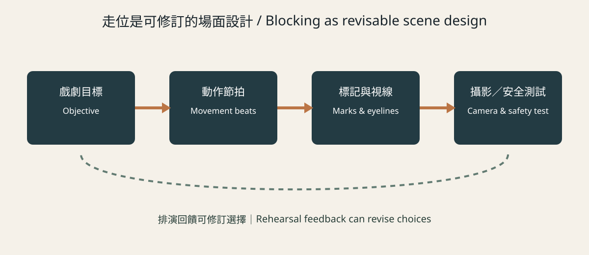
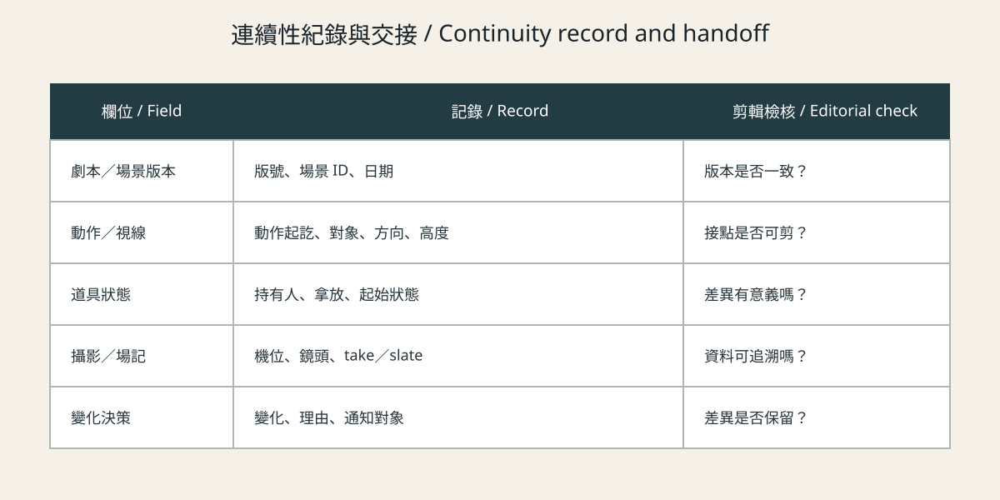

# Actor Blocking, Movement, and Performance Continuity {#CH12-S00}

> Working translation. Source locators, bilingual editing, film-viewing records, figure rights, and publication approval require human review.

This chapter examines how a director and performers can explore a scene’s actions, then communicate production choices to camera, lighting, design, props, sound, assistant directing, and script supervision. It also considers how to preserve the movement and performance continuity needed for editing when scenes are shot out of story order. **Blocking is not a single correct route imposed on a performer.** It is revisable staging shaped by character objectives, the performer’s work, the camera, location, safety, and time. Continuity need not always be identical: a deliberate variation may serve story, performance, or editing, provided the decision is recorded. [R087][R088][R089]

The chapter distinguishes five kinds of statements: **verified fact** (supported by a cited source), **theory/analysis** (an interpretation rather than a sole meaning), **practice** (a recommendation to adapt to context), **AI hypothesis** (unvalidated pending tool- and scene-specific tests), and **demonstration** (a fictional exercise). Industry roles and standards apply only within the jurisdictions and scopes stated by their sources.

## Learning Objectives and Audience {#CH12-S01}

By the end of this chapter, readers should be able to:

1. Break down a scene through objectives, obstacles, choices, and changes in relationships without reducing action to “hit the mark.”
2. Explore movement beats with performers and design blocking that is safe, shootable, and adjustable.
3. Translate blocking into actionable movement, eyeline, camera, and departmental handoffs while distinguishing fixed constraints from flexible choices.
4. Record performance, props, eyelines, movement rhythm, and screen direction to support matching across takes and non-linear shooting schedules.
5. Decide when continuity should be matched and when it should intentionally vary, explaining the consequences for story, editing, safety, and resources.
6. Use AI cautiously to organize anonymized scene information while recognizing that it cannot replace performers, directors, script supervisors, or safety professionals.

The intended audience includes directors, performers, cinematography and art students, assistant directors, script supervisors, and editors. Job scopes vary with region, collective agreements, contracts, budget, and crew configuration.

## Prerequisites {#CH12-S02}

Readers should be familiar with scene objectives, shot scale, and basic continuity editing. A phone, a floor plan, and two people are enough for the exercises; they do not constitute stunt or intimacy-safety training. Touch, falls, weapons, vehicles, intimate content, or physical limitations require qualified planning, explicit consent, a clear stop/pause procedure, and compliance with local safety rules.

## Core Terms {#CH12-S03}

| Term ID | Traditional Chinese | English | Working definition |
|---|---|---|---|
| TERM-CH12-BLOCKING | 演員調度／走位設計 | actor blocking | Arranging performers, objects, and camera movement in scene space for dramatic and photographic purposes; it is more than floor marks. |
| TERM-CH12-MOVEMENT-BEAT | 動作節拍 | movement beat | An observable action change with dramatic function, such as approaching, blocking, or yielding. |
| TERM-CH12-MARK | 走位標記點 | mark | A reference position for focus, framing, lighting, or movement, used in service of a performance task. |
| TERM-CH12-EYELINE | 視線方向 | eyeline | The target and direction/height of a performer’s gaze, affecting interpersonal space and shot matching. |
| TERM-CH12-SCREEN-DIRECTION | 畫面方向 | screen direction | A character’s direction of movement in the frame; maintaining or changing it should account for space and editorial intent. |
| TERM-CH12-ACTION-MATCH | 動作銜接 | match on action | Connecting adjacent shots through continuous portions of the same action to establish temporal and spatial flow. |
| TERM-CH12-PERFORMANCE-CONTINUITY | 表演連續性 | performance continuity | Comparing performance, movement, pace, eyelines, and prop interaction across shots, takes, or scenes shot out of order. |
| TERM-CH12-SCRIPT-SUPERVISOR | 劇本監督 | script supervisor | A role that tracks script, action, eyelines, props, and production details and communicates them to the crew; staffing varies by production. |
| TERM-CH12-CONSENT-BOUNDARY | 同意界線 | consent boundary | An informed, negotiable, and revocable boundary for physical contact or content during rehearsal and filming. |

These are working definitions for this book and require review by performance, directing, and bilingual editors. They do not claim to represent every established or union term. [R087][R088][R089]

## History and Basic Principles {#CH12-S04}

Theatre and cinema both organize performers, space, objects, and action to direct attention. In cinema, camera position, framing, focus, movement, and editing redistribute what the viewer can see. An Oxford University Press chapter abstract describes blocking as a way for directors to connect performer movement and camera design in a dramatic shot, noting that movement, angles, and rhythm can create different narrative effects. This draft consulted the abstract only and does not claim to have checked the chapter’s examples or page-specific arguments. [R087]

ScreenSkills notes that film and television drama are often shot out of story order because of locations and cast schedules. Its description of script supervision includes tracking action, eyelines, dialogue, costume, props, and camera details to support production and editing. A UK occupational standard also covers action timing, eyelines, screen direction, camera movement, and the judgment of whether strict continuity is necessary. These are UK role and standards descriptions, not universal rules. [R088][R089]

**Theory/analysis:** Distance between people, who moves first, who yields, who occupies the frame, who is obscured, and whom the camera follows can make power, intimacy, or constraint visible. This is an analytical proposition to test against a scene, not a claim that every audience interprets a composition identically. [R093] A performer’s subtle action may prompt a camera adjustment, while framing and camera movement also constrain available space. The departments should adapt together instead of treating every discovery on set as a continuity error. [R091][R092]

## Traditional Production Method {#CH12-S05}

1. **Analyze the action:** identify objectives, obstacles, strategy changes, responses, and the scene’s ending state before assigning a route.
2. **Establish collaboration:** explain the scene, schedule, and boundaries; ask about limitations or needs and invite workable options.
3. **Explore in rehearsal:** use playable tasks (for example, “try to get the other person to stay”) rather than emotion labels or imposed personal memories. Observe when action changes a relationship or the information available.
4. **Design blocking together:** add marks only where useful; record entrances, exits, pauses, turns, sitting/standing, prop interaction, and necessary eyelines. Use a flexible zone when the action should not be locked to one point.
5. **Coordinate departments:** confirm framing, focus, lighting, art, props, sound, assistant directing, and script supervision needs, including floor conditions, noise, transitions, safety, and schedule. Script-supervisor duties vary by production. [R088]
6. **Rehearse for camera and safety:** walk the route at real speed and check obstacles, cables, equipment, focus, contact, and exits. Qualified professionals plan stunt or intimacy content.
7. **Record the shoot:** confirm key actions and performance intentions; record action starts/ends, eyelines, hand props, rhythm, dialogue variations, screen direction, and useful editorial overlap. Communicate significant changes promptly. [R089]
8. **Review and decide:** test in an edit whether continuity supports comprehension. Record intentional variation so it is not later mistaken for an oversight.

| Item | Record | Check |
|---|---|---|
| Principal action | Order and overlap across cut points | Is causality legible? Is there an editable cut point? |
| Eyeline/direction | Target, direction, height, entrance/exit | Is a change intentional? Does the space remain clear? |
| Prop state | Holder, pickup/put-down timing, liquid or switch state | Is a difference a story choice or an undocumented mismatch? |
| Performance state | Pace, breath, volume, movement scale, turning point | What affects the edit? What should remain a genuine response? |
| Marks | Critical focus, framing, or lighting positions | Can the performer complete the task naturally? |
| Contact/risk | Boundaries, action, stop signal, responsible person | Are participants informed and able to refuse or pause? |

{#CH12-FIG-001 fig-alt="Four stages run from dramatic objective through movement beats and marks/eyelines to camera and safety tests; the dashed return path indicates rehearsal feedback can revise choices."}

**Figure 12-1. Collaborative blocking: explore movement beats, marks, and eyelines from a dramatic objective, then test camera, safety, and editorial constraints. This is an original editable SVG illustration for this book, not a film still. Attribution, rights, and publication approval are pending.**

## Technical Shifts and Limits in the AI Era {#CH12-S06}

**AI hypothesis; not a product-capability claim:** A language model might extract characters, props, action verbs, and unresolved spatial questions from an authorized script, or organize human continuity notes. Accuracy and usefulness must be tested with a specified tool, version, and data terms. No AI product was tested for this chapter. It does not claim that a model can understand performance, infer a performer’s intention, maintain editorial continuity, or predict audience response. Do not send unauthorized scripts, rehearsal footage, likenesses, voices, personal data, or health information to an external model. Do not prompt a model to imitate a real performer. Keep model output separate from source material and human records, and have performers, directors, script supervisors, and appropriate safety personnel review it. It cannot substitute for consent or safety approval.

## Detailed Workflow {#CH12-S07}

| Stage | Action | Output and acceptance |
|---|---|---|
| Script breakdown | Mark objectives, obstacles, actions, props, and turns | Breakdown with explicit script version and scene ID |
| Performance exploration | Rehearse playable tasks and record choices | Blocking sketch, performer boundaries, and viable options |
| Formal design | Compare distance, occlusion, and moving/static camera | At least two options and reasons for trade-offs |
| Safety/technical check | Confirm location, route, stop signal, focus, and equipment | Safety check, departmental confirmations, and named owner |
| Coverage planning | Plan principal shots, action joins, and eyelines | Shot list and continuity notes; obtain consent before photos |
| On-set record | Track action, performance variations, prop states, and usable takes | Daily report, version, issues, and owners |
| Editorial feedback | Test pace, performance, continuity, and information clarity | Traceable keep/change decisions and pickup gaps |

For each revision, record script version, scene ID, date, editor, reason, affected shots, and departments notified. Continuity notes should help reproduce critical conditions, not demand mechanical repetition of accidental reactions.

{#CH12-FIG-002 fig-alt="The table lists script/scene version, action/eyelines, prop state, camera/slate, and variation decisions with an editorial check for each."}

**Figure 12-2. Continuity handoff: record script version, movement and eyelines, prop state, camera/slate data, and intentional variations for editorial review. This is an original editable SVG illustration for this book, not a film still. Attribution, rights, and publication approval are pending.**

## Prompt Template and Technical Parameters {#CH12-S08}

The following untested, model-neutral template is for information organization. An authorized person must remove names, identifying information, and unconsented material before use. Its output is not a blocking instruction, performance rating, safety finding, or filming approval.

**Prompt template: scene action and continuity questions**

    Role: organize records only; do not act as director, performer, script supervisor, or safety lead.
    Input: use only authorized, anonymized scene text and human-entered fields.
    Do not infer emotion, personal traits, intention, or facts not supplied.
    Scene ID: [ID]; script version: [version]; permitted use: [scope]
    Character objective: [character code / observable action]
    Space: [entrances, exits, obstacles, usable area]
    Props: [object, initial state, holder]
    Rehearsal record: [movement beats, eyelines, take differences]
    Task: organize explicit information and unresolved questions; make no blocking decisions.
    Separate source text, candidate action order, state differences, and questions.
    Label each item “source text” or “human confirmation needed”; do not fill gaps.
    For safety, consent, or likeness issues, stop inference and flag professional review.
    Output UTF-8 Markdown/JSON and end by requesting review by an authorized person.

Only record a tool/model version, date, input hash, data terms, output hash, human edits, and error cases after an actual test. Record temperature, seed, or other parameters only if the service exposes them and they were tested; otherwise state “not tested.”

## Film Case Studies {#CH12-S09}

### *The Graduate* (1967)

An *American Cinematographer* article from 2023 recounts a 1968 article and memories from cinematographer Robert Surtees: Mike Nichols held several weeks of pre-rehearsal on an empty stage, the art department taped out the set configuration, and performers learned the script, discussed and blocked scenes, and planned cuts and camera positions in advance. [R090] This is a production recollection about one film, not a rule that every production must lock blocking. The account also says Surtees continued looking for ways to strengthen emotional meaning during filming, showing that advance planning and responsiveness can coexist.

A transferable method is to establish spatial understanding early so performers, director, cinematography, and design can discuss dependencies between movement and frame. Risks include compressing performance discovery, increasing rehearsal costs, or reducing flexibility on location. This chapter supplies no first-hand timecode for a particular release. Do not reproduce the film’s characters, setting, wardrobe, or shots.

### *Lola Montès* (1955)

An article in BFI’s *Sight and Sound* analyzes Lola’s movement within the CinemaScope frame and a hotel scene in which the circus master orders her to stop and the camera shifts to follow him, interpreting spatial control as a power relationship. [R093] This is a critic’s formal analysis drawing on information about the 2008 restoration; it is not the chapter author’s viewing record or the only possible interpretation.

**Original transformation exercise:** create two strangers in a narrow waiting room. One crosses the space; the pair yield to one another; the camera follows neither. Borrow only the abstract question “who controls shared space and attention.” Invent new people, dialogue, setting, and composition.

### *A Clockwork Orange* (1971)

An *American Cinematographer* reprint of Vincent LoBrutto’s article recounts actor Warren Clarke’s memory that he struggled to reproduce a laugh eight months later during additional filming. The article also describes Kubrick and Malcolm McDowell finding a performance idea while rehearsing a violent scene. [R091] These are later-published recollections, not frame-by-frame viewing evidence or instructions for dangerous action. The practical point is to record important actions and states while recognizing that subtle human responses cannot always be mechanically repeated. Safety, performer agency, and story purpose take priority.

## Common Errors and Quality Checks {#CH12-S10}

| Error | Observable sign | Correction and acceptance |
|---|---|---|
| Marks without an action rationale | The performer knows where to stand but not what they are doing | Rehearse a playable objective and confirm a beat change |
| Locking the scene after one rehearsal | New discoveries are treated as mistakes | Separate safety/technical constraints from optional choices and retest camera impact |
| Continuity becomes performance duplication | Every take is required to repeat the same emotion or micro-expression | Record editorial joins and actions without requiring mechanical replication; let editorial assess |
| Missing overlap or eyeline notes | Eyelines, props, or shot/reverse-shot space jump | Check adjacent shots’ action starts/ends and eyeline references |
| Notes do not reach departments | Changes are not communicated to props, camera, or editorial | Assign communication responsibility and confirm version and recipients |
| Safety or consent is overlooked | The route is obstructed or contact is unconfirmed | Pause; have qualified personnel clear the area and confirm boundaries/procedure |
| AI output is treated as performance fact | Unsourced emotion or intention enters the record | Compare against input, remove inference, and identify the human reviewer |

For each scene, check script version, scene ID, action/eyelines, initial prop states, take variations, performance turns, communication records, editorial joins, and safety/consent status. Record a narrative reason for any continuity difference intentionally retained.

## Exercise, Assessment, and Further Research {#CH12-S11}

### One Chair, Two Objectives

Write an original 30–60 second exchange: A wants B to stay; B wants to leave; there is one chair and one exit. (1) List objectives, obstacles, choices, and three movement beats. (2) Draw two blocking options and mark eyelines, props, audience information, and camera constraints. (3) Shoot two static-camera versions, then one two-shot version with action overlap. (4) Record take differences without requiring personal disclosure or unplanned contact. (5) Edit the material in a randomized order; ask viewers when they noticed a change in objective and which continuity differences affected comprehension.

| Assessment dimension | 0 | 1 | 2 |
|---|---|---|---|
| Action beats | No objective/obstacle | Beats exist but the turn is unclear | Choices respond to an objective or relationship change |
| Performer collaboration | Task/boundaries not explained | Negotiation or records are incomplete | Playable task; boundaries and pause procedure are clear |
| Audio-visual design | Camera conflicts with movement | Shootable but information is occasionally unclear | Camera, eyeline, action, and story support one another |
| Continuity record | Takes cannot be traced | Some states recorded | Movement, eyelines, props, version, and intentional variation recorded |
| Editorial reflection | No review or rationale | Can identify an issue | Explains choices through audience comprehension and performance effect |

Further research: compare script-supervisor role standards across jurisdictions; study screen performance and camera distance; design an anonymized, consent-based AI document-organization test that evaluates source retention, error, and sensitive-data risk. Research does not replace participant consent.

## References {#CH12-S12}

- [R087] Brine, Kelly Gordon. “Blocking for Cinematic Storytelling.” In *The Art of Cinematic Storytelling*. Oxford University Press, 2020, pp. 306–324. DOI: 10.1093/oso/9780190054328.003.0020. Abstract consulted only; chapter locators not verified.
- [R088] ScreenSkills. “Script supervisor (Film and TV Drama).” Undated webpage, accessed 2026-10-22. UK industry role description; staffing varies by production.
- [R089] ScreenSkills. *Monitor script coverage, continuity and technical camera details during shooting*, UK National Occupational Standard SKSC32 v3, approved 2020; accessed 2026-10-22.
- [R090] Williams, David E. “Wrap Shot: The Graduate.” *American Cinematographer*, 2023-11-26; recounts a 1968 article by Herb A. Lightman and memories of Robert Surtees.
- [R091] LoBrutto, Vincent. “The Old Ultra-Violence: A Clockwork Orange.” *American Cinematographer*, 2018-01-30; originally published 1999-10; recollections are attributed as such.
- [R092] McCarthy, Terry. “Cinematic Instincts: Phedon Papamichael, ASC, GSC.” *American Cinematographer*, 2023-09-12; interview example, not a general rule.
- [R093] Stevens, Brad. “Masters of space: mise en scène in Ophuls and Hitchcock.” *Sight and Sound*, BFI, updated 2018-07-11; discusses *Lola Montès* and its 2008 restoration; not a first-hand viewing record by this chapter’s author.

## Conclusion {#CH12-S13}

Blocking connects dramatic action, performance, space, and cinematography; continuity records support the interpretation and selection of footage shot out of order. The workflow should distinguish what must match, what may vary, and which intentional changes need explanation, while protecting performer collaboration and safety. The next chapter examines space, movement paths, and eyelines in mise-en-scène.
