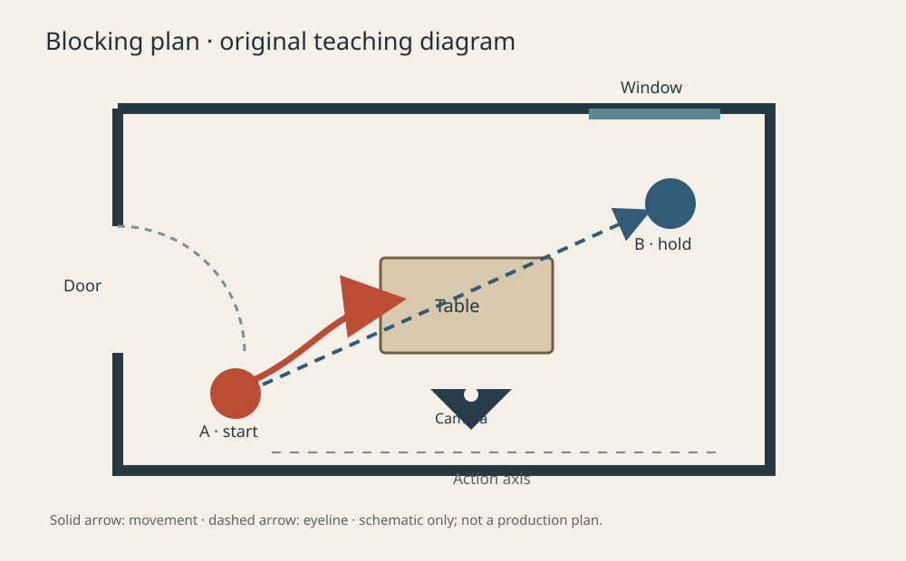
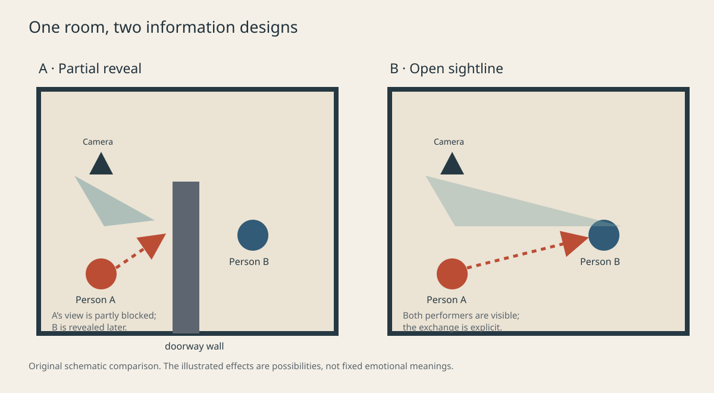

<!-- V2 working copy. V1 source remains immutable under legacy/2026-v1. -->

# Mise-en-scène: Space, Blocking, and Eyelines

> Editorial state: research draft; this English text is a working translation. The title, terminology, source locators, film cases, and figures require human review and are not publication approval.

## Chapter Overview {#CH13-S00}

This chapter treats mise-en-scène as spatial design that can be analyzed, rehearsed, and handed off. Starting from dramatic intent, it arranges performers, objects, eyelines, and camera, then revises through continuity, safety, and feasibility checks. AI offers proposals for review; it does not replace set decisions.

## Learning Objectives and Audience {#CH13-S01}

After this chapter, readers should be able to: (1) break mise-en-scène into setting, props, costume, lighting, performance, and visible space; (2) draw a floor plan showing performer paths, eyelines, camera positions, and occlusion; (3) explain how spatial arrangement supports or changes narrative information and character relations; (4) use continuity notes to check direction and position across shots; and (5) translate a staging objective into an AI visual prompt that can be checked. The chapter is for directors, cinematographers, production designers, storyboard artists, editors, and learners in generative imaging. Prerequisites: shot scale, composition, the axis of action, and basic storyboarding (see CH02–CH04).

## Prerequisites {#CH13-S02}

Readers should distinguish a scene from a shot, on-screen from off-screen space, eyeline direction, action continuity, and basic script-supervision notes. If the 180-degree axis is unfamiliar, begin with one doorway, two performers, and one camera position before attempting complex blocking. These are working definitions that still need review by Traditional Chinese editors and film specialists.

## Core Terms {#CH13-S03}

| Term | Traditional Chinese | Working definition in this chapter |
|---|---|---|
| mise-en-scène | 場面調度 | Visible elements in a shot and their arrangement; theoretical traditions define its scope differently. |
| blocking | 走位／調度 | Performers’ positions, paths, and relationships in a space. |
| eyeline | 視線軸 | The visual relation formed by a character’s direction of gaze, made legible in relation to camera position. |
| on-screen / off-screen space | 畫面內／外空間 | The visible frame and the area implied beyond it by sound, gaze, entrances, or editing. |
| occlusion | 遮擋 | A foreground or other object partly conceals a person or space, delaying, limiting, or layering information. |
| spatial continuity | 空間連戲 | An intelligible relation across adjacent shots in direction, movement, props, eyelines, and related spatial details. |

Draft term IDs: TERM-CH13-MISE-EN-SCENE, TERM-CH13-BLOCKING, TERM-CH13-EYELINE, TERM-CH13-OFFSCREEN-SPACE, TERM-CH13-OCCLUSION, and TERM-CH13-SPATIAL-CONTINUITY.

## History and Basic Principles {#CH13-S04}

The phrase *mise-en-scène* comes from theatrical staging. Film studies often uses it to discuss how performers, sets, props, costume, lighting, and space compose an image. Whether camera movement, framing, and focus belong within the term or should be treated as related choices depends on the author’s framework. Here it is an analytical tool, not a single fixed checklist. Dix discusses what viewers see on screen alongside, but distinguishable from, camera and framing choices; Gibbs emphasizes style and interpretation, reminding us to read elements in context (R094, R095; only publisher pages and chapter summaries have been checked so far, and detailed locators remain open).

The central question is not simply “what is in the frame?” but “who can see what, when do they see it, what blocks it, and how might viewers infer relationships?” Entrances, windows, stairs, tabletops, and foreground/background layers can organize power, intimacy, isolation, or uncertainty. These are possible formal effects, not universal meanings automatically carried by a prop or setting. Analysis should first identify observable evidence and then label interpretation as a reading or theory.

## Traditional Production Practice {#CH13-S05}

In pre-production, the director and writer clarify dramatic intent, then work with cinematography, art, costume, lighting, and producing departments to turn abstract aims into a shootable space and a feasible plan. Production design coordinates sets, locations, budgets, schedules, and technical feasibility with the director and producer; responsibilities vary by production scale (R096). In rehearsal, directors and performers explore credible and safe action. Assistant directors, script supervisors, camera, and art departments record positions, camera setups, eyelines, and continuity according to the production’s division of labor. A UK occupational standard can inform discussion of roles and process, but should not be treated as a legal staffing rule for every country or production (R097).

A basic floor plan should include a north arrow or other direction reference; walls, entrances, and windows; fixed furniture; performer start and end points; path arrows; camera and shot identifiers; eyeline arrows; and any axis that should not be crossed without intent. Use a shared coordinate system and orientation across a scene’s shots, noting time, version, and changes. After rehearsal, check whether each shot serves the dramatic objective rather than first dividing the scene into coverage and hoping to discover its relationships in the edit.

{#CH13-FIG-001 fig-alt="Original plan: performer A moves from the doorway to the table; performer B stays by the window; dashed arrows show eyelines, and the camera remains on one side of the axis."}

**Figure 13-1 | Minimum information in a blocking map.** This is an original illustrative image informed by methods for analyzing mise-en-scène and blocking. It is not an official film still or a recreation of a film set. Production provenance and rights review remain pending.

## Technical Shifts and Limits in the AI Era {#CH13-S06}

AI may help turn a clearly stated staging objective into storyboard proposals, alternative compositions, prop lists, or visual-continuity checklists. It may also propose alternate performer paths on a shared floor plan for discussion. It cannot reliably replace negotiation among directors and performers, location scouting, camera-access checks, performance safety, shot-continuity judgment, or rights review. Generative models may alter doors, windows, performer orientation, hand-held props, and room proportions; a text prompt does not guarantee consistency across shots.

Separate inputs into dramatic objective, spatial geometry, performer start/end points, eyelines, camera constraints, invariants, and output format. Store fixed geometry as structured JSON, and treat generated images as unapproved proposals. Capabilities, prompt parameters, and reproducibility that have not been tested must be labeled unverified; do not claim that a tool offers locking or continuity features without evidence. Do not submit unlicensed scripts, performer personal data, or confidential set information to an unapproved service.

## Detailed Workflow {#CH13-S07}

1. **State the dramatic question.** For example: whether a character is willing to enter a room, or who controls the pace of a conversation. “Make it cinematic” is not a usable objective.
2. **List spatial facts.** Record entrances, windows, obstacles, movable furniture, camera access, and safety limits; mark anything unknown for a location check.
3. **Define performer actions.** For each person, note the start, goal, path, stop, eyeline target, and triggering event; have the director and performers confirm them.
4. **Choose what viewers know.** Decide what to reveal, conceal, or delay, and whether to use a doorway, foreground occlusion, depth of field, or off-screen sound.
5. **Draw the floor plan and shot options.** Mark camera positions, shot scale, eyelines, and the axis. Alternatives should change the narrative effect, not merely the angle.
6. **Rehearse and test feasibility.** Check that action is credible, camera placement is possible, lighting and sound are workable, and movement is safe. Art, camera, and producing teams assess cost and time.
7. **Create a continuity record.** For each shot, note start/end positions, gestures, prop hand, eyelines, focus, and set version; the script supervisor maintains records according to the production workflow.
8. **Check after filming.** Confirm that the edit preserves intelligible direction and action. If continuity is intentionally broken, record the formal purpose.
9. **Isolate AI proposals.** Compare every proposal with the spatial data, performer consent, filming conditions, and rights. Reject mismatches; after human selection, update the version record. Never treat model output as the set’s official continuity record.

{#CH13-FIG-002 fig-alt="Comparison of doorway occlusion in option A and an open sightline in option B; performer positions, visible area, and camera direction indicate different information."}

**Figure 13-2 | How spatial choices change the information visible to viewers.** This is an original illustrative image informed by spatial analysis of mise-en-scène. It is not an official film still or a recreation of a film composition. Production provenance and rights review remain pending.

## Prompt Template and Technical Parameters {#CH13-S08}

The following is a **text-planning prompt template**, not verified syntax for any particular generation tool:

```text
Task: Propose a [shot / mise-en-scène] plan. Do not generate or imitate an existing film image.
Dramatic objective: [character relationship / what viewers should know or not yet know]
Spatial geometry: [describe doors, windows, walls, fixed objects with coordinates or a plan]
Performers: [role IDs, start, end, action, eyeline, stopping point]
Camera constraints: [camera positions, shot scale, axis, permitted movement]
Continuity invariants: [spatial direction, prop hand, entrance/exit direction]
Safety and rights limits: [performer boundaries, confidential data, third-party material to exclude]
Output: 1) two narratively distinct options; 2) floor-plan data for each;
        3) a continuity risk list; 4) assumptions requiring director/camera/art confirmation.
Do not invent set dimensions, lens specifications, or tool capabilities. Label all assumptions.
```

Possible JSON fields: `scene_id`, `revision`, `coordinate_units`, `room_bounds`, `openings[]`, `props[]`, `performers[]`, `camera_positions[]`, `eyelines[]`, `axis_id`, `constraints[]`, `source_notes[]`, and `review_status`. The project schema is not finalized; this list is not a published standard. If an image model is used, separately record provider, model version, date, prompt, seed (if available), output hash, and human edits. No image-generation service was called for this chapter.

## Film Case Studies {#CH13-S09}

### *Parasite* (2019): vertical space and visibility

The Criterion Collection essay discusses the semi-basement and modern home’s relative elevation, views through windows, stairs, and underground space, interpreting how spatial arrangements participate in social hierarchy and character action (R098). This is a critic’s interpretation, not the only intention of the filmmakers or a universal law about class. For a teaching exercise, map the relations “street—semi-basement—uphill house—underground space,” then ask: who can see the street through a window? Who controls entrances? How do stairs change movement and information? No lawful viewing source or shot-level timecode was obtained for this chapter, so none is supplied and no first-hand viewing is claimed.

### Chantal Akerman’s spatial cinema: off-screen space and time

A BFI essay discusses *La Chambre* (1972) and *Hotel Monterey* (1972), considering camera movement through interiors and corridors and the relation between off-screen space and the experience of time (R099). This is critical analysis. A film historian should verify the film metadata and viewing versions. A useful comparison asks how a performer leaving a fixed frame differs from a camera moving through a doorway in shaping the imagined space beyond the room. Do not present the essay’s interpretation as a universal rule.

For classic-film examples, describe observable spatial relations first, then offer a sourced interpretation. Viewing source, edition, and timecode remain for human verification. Analysis and original teaching diagrams must stay separate; do not reproduce or trace a film composition.

## Common Errors and Quality Checks {#CH13-S10}

| Error | Observable effect | Check or improvement |
|---|---|---|
| Giving only a symbolic direction (“make it oppressive”) | The proposed design cannot be executed or assessed | Specify distance, occlusion, entrances, eyelines, and viewer information; treat mood as an intended effect, not a guarantee. |
| Floor plan, storyboard, and set blocking diverge | Direction, props, or camera positions contradict each other | Share a scene version; assign an owner to log and propagate changes. |
| Treating eyeline as sufficient proof of character psychology | Viewers may infer motives unsupported by the text | Separate image facts from interpretation; check performance, editing, sound, and context. |
| Hiding so much that action becomes unreadable | Viewers cannot tell who did what | Test key action in rehearsal or rough cut and add a reveal shot if needed. |
| AI images change the room or performer continuity | Doors, left/right orientation, or props drift | Compare output with structured space data and continuity notes; reject mismatches. |
| Equating continuity with never breaking continuity | Intentional jump cuts or subjective views are mislabeled as errors | Confirm the formal choice, then assess its purpose and viewer comprehension. |

Minimum checks: each subject has a clear start/end; each plan has a direction reference, camera, eyelines, and entrances; performer/prop states can be traced across shots; theory claims distinguish source facts from analysis; prompts label assumptions and human decisions. Production feasibility and safety must be checked against the actual location, camera, and set procedures; a document alone cannot pass those checks.

## Exercise, Assessment, and Further Research {#CH13-S11}

**Exercise:** Design a 20–40 second indoor scene in which two people exchange an object and one does not want to be seen. Submit a floor plan with dimensions or scale notes, two blocking options, written storyboards of 4–6 shots for each option, a continuity sheet, and one structured prompt for an AI proposal. Do not use existing film characters, set images, or stills.

**Assessment (0–2 each):** executable spatial plan; clear link between performer paths and dramatic objective; legible eyelines/axis; deliberate viewer information; documented safety and continuity changes. 0 = missing or contradictory; 1 = partly legible but needs major revision; 2 = another group can stage from the document and identify risks. This is a teaching proposal and should be adjusted after classroom use.

**Further research:** Compare off-screen space in locked-off and moving-camera shots; study how domestic thresholds are read across cultural contexts; test generative-image consistency in performer count, room geometry, and eyelines while publishing model versions, failures, and evaluation methods. Do not generalize tool reliability from a few successful prompts.

## References {#CH13-S12}

- **R094** John Gibbs, *Mise-en-scène: Film Style and Interpretation*. Wallflower Press, 2002. Publisher page and contents summary checked; page-specific locators in the full book remain unverified.
- **R095** Andrew Dix, “Seeing film: Mise-en-scène,” in *Beginning Film Studies*, 2nd ed., Manchester University Press, pp. 12–45, DOI: 10.7765/9781784997304.00008. Publisher summary checked only; detailed page locators remain open.
- **R096** ScreenSkills, “Production designer skills.” UK industry role profile; undated, accessed 2026-10-22. Supports role collaboration and scope only.
- **R097** Skillset, “Direct the actors (drama),” UK National Occupational Standard SKSDIRD8, v1, approved 2003. Historical role standard, not a current universal regulation; check later versions and jurisdiction.
- **R098** Inkoo Kang, “Parasite: Notes from the Underground,” Criterion Collection, 2020-10-30. Critical formal analysis, not the only interpretation; accessed 2026-10-22.
- **R099** Brad Stevens, “Keeping a distance: Chantal Akerman’s Jeanne Dielman,” *Sight and Sound*, BFI. Critical analysis; publication/page update metadata and viewing edition need verification; accessed 2026-10-22.
- **R100** Brad Stevens, “Reflections on style: what became of classical Hollywood mise en scène?” *Sight and Sound*, BFI. Argumentative criticism, not a universal rule; accessed 2026-10-22.

Before formal use, add page or section locators from accessible editions, verify BFI article metadata and film editions/timecodes, and obtain review from a film-theory editor. Source URLs and evidence scope are listed in `data/references.yaml` and `assets/chapters/CH13/CH13-SOURCE-AND-CASE-NOTES.md`.
