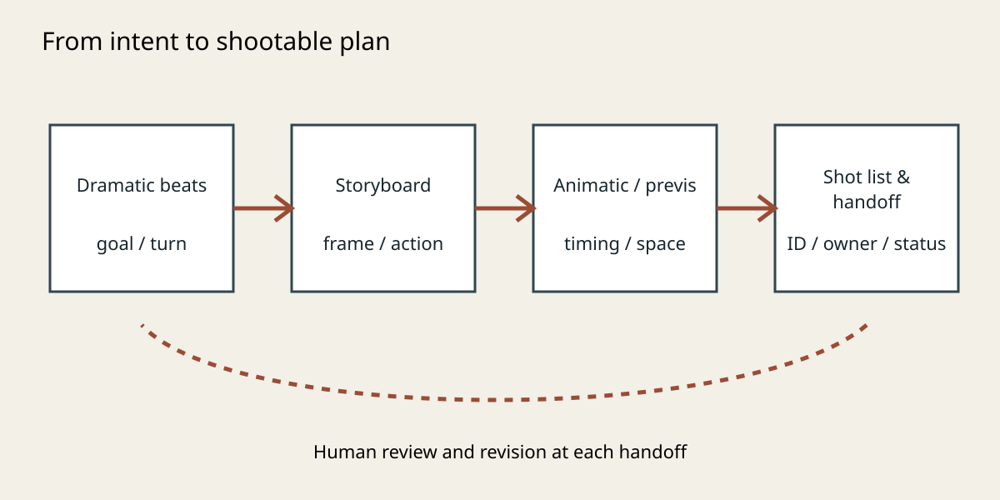
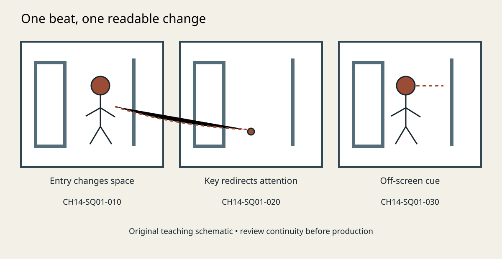

# Storyboards, Previsualization, and Shot Lists

> Bilingual research draft; source locators, copyedit, film viewing, figure rights, and author approval require human review.

## Chapter Overview {#CH14-S00}

Storyboards, previs, and shot lists translate dramatic intent into visual plans. Boards show images and action; previs tests timing, space, and technical conditions; shot lists record planned units and needs. They support collaboration, not fixed commands. [R101][R102]

## Learning Objectives and Audience {#CH14-S01}

Readers learn to select a visualization method, break beats into shots, prepare a shot list, compare effects on audience information and resources, and review AI proposals for continuity and feasibility. For production learners and practitioners.

## Prerequisites {#CH14-S02}

Familiarity with scene goals, shot scale, point of view, axis, blocking, and continuity is useful (CH03, CH12, CH13). Drawing is optional; sketches, plans, photo boards, and text cards work.

## Core Terms {#CH14-S03}

Storyboard: sequential panels communicating framing, action, and information. Previsualization/previs: pre-shoot testing of image and action. Techvis: planning camera, location, equipment, and feasibility. Shot list: updateable IDs, content, needs, status. Animatic: rough timed edit of panels. [R102][R103]

## History and Basic Principles {#CH14-S04}

Film teams use sketches, plans, written breakdowns, camera drawings, and edit tests; no universal workflow exists. Digital tools help test and share plans but do not replace narrative judgment. Boards help inspect information, rhythm, space, and resources; they do not guarantee every panel will be shot. [R101]

## Traditional Production Practice {#CH14-S05}

The director and writer define purpose, goals, turns, and audience information. Artists draw key beats and annotate scale, movement, action, eyelines, and sound. Departments review constraints. Thumbnails may suffice; complex scenes may need animatics, 3D previs, or techvis. Interviews show boards can aid communication without binding the set. [R104][R105]

## Technical Shifts and Limits in the AI Era {#CH14-S06}

Models can draft compositions, organize descriptions, suggest shots, or structure tables; 3D tools help inspect space and camera paths. [R102][R103] Generated images cannot guarantee continuity or prove safety. Mark them proposals for human review. Do not submit unlicensed scripts, personal data, or confidential material.

## Detailed Workflow {#CH14-S07}

1. State scene intention and audience goal. 2. Mark beats and actions. 3. List constraints, continuity risks, coverage. 4. Draw key panels, not every line. 5. Annotate people, eyelines, camera, direction, sound. 6. Use an animatic to test timing. 7. Use previs/techvis for complex space. 8. Record IDs, scene, scale, movement, content, gear, VFX, risk, owner, status, version. 9. Confirm across departments. 10. Revise for safety, performance, weather, budget; log why. [R102][R106]

{#CH14-FIG-001 fig-alt="Dramatic beats move through storyboard and previs into a shot list, with human review at handoffs."}
**Figure 14-1 | From intention to a shoot plan.** This is an original hand-authored schematic. It is not an official film still or a recreation of a specific work. Rights and publication approval are pending.

## Prompt Template and Technical Parameters {#CH14-S08}

Specify purpose, positions, action, camera, aspect ratio, eyelines, movement, continuity locks, exclusions, and output. Example: “Six-panel monochrome storyboard for an original corridor conversation; keep wardrobe, doors, and 180-degree axis consistent; label ID, scale, action, eyeline, movement, beat purpose; do not imitate a film or logo; include editable JSON.” Log tested tool/version parameters only.

## Film Case Studies {#CH14-S09}

**Three Billboards Outside Ebbing, Missouri**: cinematographer Ben Davis said McDonagh drew rough boards; they were not necessarily followed on set, but built shared understanding. Boards communicate rather than command. [R104] **Indiana Jones and the Temple of Doom**: Spielberg’s ASC interview discusses boards for communication and assessing shot information in editing. This specific case is not a universal panel-count rule. Lawful edition and timecodes remain to be logged. [R105]

{#CH14-FIG-002 fig-alt="Three panels show a person entering, noticing a key, and looking off-screen; each maps to a shot-list ID."}
**Figure 14-2 | Tracking beats as shots.** This is an original hand-authored schematic with fictional content. It is not an official film still or a recreation of a film scene. Rights and publication approval are pending.

## Common Errors and Quality Checks {#CH14-S10}

Errors include mechanical dialogue coverage, unclear purpose, mismatched IDs, continuity breaks, impossible moves, substituting previs for safety review, and AI changing scene details. Check purpose, rhythm, axis, IDs, versions, feasibility with department leads, and revision reasons. [R102][R103]

## Exercises, Assessment, and Further Research {#CH14-S11}

Create two versions of an original 30–60 second dialogue scene: fewer shots with stable space, and reactions that shift audience information. Submit 6–10 panels, short animatic, shot list, revision log. Assess clarity, continuity, feasibility, handoff. Human review judges creativity. Compare costs of 2D, animatic, and 3D previs.

## References {#CH14-S12}

Sources prioritize publishers, practitioner interviews, professional societies, and official documentation. Publisher summaries are not full books; articles do not replace lawful viewing or edition/timecode logs. See R101–R106.

### References

- [R101] Bruce Block, The Visual Story, 3rd ed., Routledge (publisher page; full text not consulted) — https://www.routledge.com/The-Visual-Story-Creating-the-Visual-Structure-of-Film-TV-and-Digital-Media/Block/p/book/9781315794839
- [R102] Epic Games / Unreal Engine official virtual production explainer — https://www.unrealengine.com/explainers/virtual-production/what-is-virtual-production?lang=en
- [R103] Blender Manual official Storyboarding documentation — https://docs.blender.org/manual/en/latest/video_editing/storyboarding/index.html
- [R104] American Cinematographer: Ben Davis interview — https://theasc.com/article/three-billboards-interview-ben-davis/
- [R105] American Cinematographer: Spielberg interview, republished — https://theasc.com/article/spielberg-temple-of-doom/
- [R106] Blender Studio Storyboard workflow — https://studio.blender.org/tools/artist-guide/pre-production/storyboard
