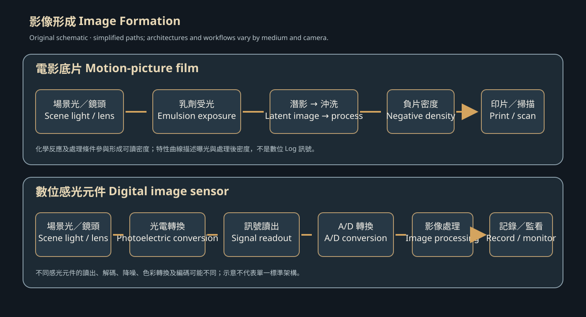
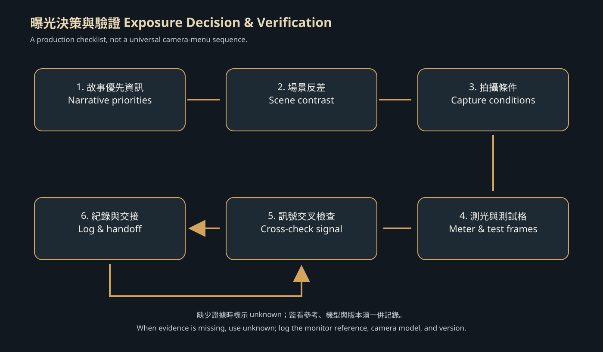

<!-- CH16 V2.1.0 English working translation. Bilingual, technical, source-locator, rights, and author reviews remain open. -->

# Exposure, Image Sensors, and Image Formation

## Scope and status

This chapter explains how scene light becomes a recordable image on motion-picture film or a digital image sensor, and how a cinematography team turns exposure intent into settings that can be checked. It focuses on exposure, the response of a photosensitive medium, sensor readout, exposure index, dynamic range, monitoring, and documentation. Perspective, focal length, depth-of-field effects, and full color management are covered in CH17, CH18, and CH20; they appear here only where needed to explain exposure control. This is a source-supported teaching draft, not a camera manual, calibration procedure, or device recommendation. Confirm every value and feature against the actual camera model, firmware, recording format, and test results.

## Learning objectives {#CH16-S01}

By the end of this chapter, readers should be able to:

1. Distinguish exposure, exposure index (EI), ISO ratings, monitor brightness, and post-production adjustments.
2. Describe the major stages by which motion-picture film and digital image sensors form images, and explain why their response curves and workflows are not physically identical.
3. Plan a checkable exposure approach using scene luminance, aperture, shutter/exposure time, ND, lighting, and EI.
4. Cross-check exposure with meters, gray cards, waveforms, zebras, or false color without treating one monitoring cue as a universal safety threshold.
5. Record exposure decisions, frame rate, shutter angle, EI, ND, lighting, and monitoring conditions so camera, DIT, and post-production teams can trace the material.
6. Recognize that “exposure” in AI-generated imagery is a visual description, not a measurable sensor exposure, and treat model output as a visual hypothesis requiring human verification.

Prerequisites: Familiarity with aperture, shutter, frame rate, metering, grayscale, image signals, and basic camera operation is recommended. Readers who need an introduction to lens optics may start with CH17. Terminology and translation remain subject to cinematography and bilingual editorial review.

## Prerequisites {#CH16-S02}

Read CH02 (camera shots and point of view), CH17 (composition, perspective, focal length, and depth of field), and CH20 (color management and camera workflow) for related topics. “Exposure” here concerns light recorded by a medium and the resulting signal; it does not mean turning up a monitor. When using a meter or waveform, confirm meter calibration, camera EI/ISO, recording curve, LUT, monitor brightness, and signal-range settings. Film EI involves the film’s sensitivity, exposure method, and processing conditions. A digital camera’s EI, ISO, gain, and RAW or encoded formats interact according to the manufacturer’s design. Never transfer one camera’s base EI or false-color zones to another model without verification.

## Key terms {#CH16-S03}

| Chinese | English | Working definition | Status |
|---|---|---|---|
| 曝光 | exposure | The recording condition produced when light acts on a photosensitive material or sensor for a period of time. In cinematography, specify scene illumination, exposure time, and the imaging system’s metering/sensitivity settings. | Draft |
| 曝光指數 | exposure index (EI) | A setting or rating used as an exposure/sensitivity reference. Film EI and digital-camera EI are not automatically equivalent in implementation or meaning. | Draft |
| 感光度標示 | speed rating / ISO rating | A rating describing the response of a photosensitive material or system under a stated standard or manufacturer method; increasing the number does not itself deliver more photons to the sensor. | Draft |
| 感光元件 | image sensor | A device that converts incident light into charge or an electronic signal, then into image data through readout and image-processing stages. | Draft |
| 光電二極體 | photodiode | A photosensitive structure in an image sensor that absorbs light and produces charge; actual pixel circuits vary by architecture. | Draft |
| 動態範圍 | dynamic range | The range from dark to bright that an imaging system can record at an acceptable quality level; values vary with definition, noise threshold, recording format, and test method. | Draft |
| 飽和／剪裁 | saturation / clipping | A condition in which a signal reaches the system’s representable or distinguishable upper limit, so additional incident light no longer yields separable highlight information. Display clipping may differ from sensor saturation. | Draft |
| 訊噪比 | signal-to-noise ratio (SNR) | The ratio of useful image signal to noise; state measurement conditions rather than using one number to characterize different luminance levels, color channels, and processing stages. | Draft |
| 感光測定 | sensitometry | The study of how photographic emulsions or materials respond to controlled exposure; a film characteristic curve relates exposure to density after processing. | Draft |
| 特性曲線 | characteristic curve | A curve showing the relationship between exposure of a photosensitive material and image density after processing; a digital Log encoding is not the same physical quantity as film density. | Draft |
| 快門角度 | shutter angle | An angle used to express exposure time per frame. In the ARRI ALEXA LF manual, exposure time in seconds = angle ÷ (360 × sensor frame rate). | Draft |
| 曝光寬容度 | exposure latitude | The range over which an image remains acceptable after exposure departs from a reference. Specify the film or digital camera, grading/viewing conditions, and acceptance criteria. | Draft |

These working definitions link to R112–R118. Their scope, Traditional Chinese wording, and English consistency still need human review.

## History and principles {#CH16-S04}

Motion-picture cinematography first relied on photosensitive film: the optical image formed by a lens changes the emulsion chemically, leaving a latent image that cannot be viewed directly. Processing creates negative density, which can then be printed or scanned into material for viewing and editing. Kodak’s motion-picture reference guide treats film history, film structure, sensitometry, exposure tools, processing, and digital workflow as connected but distinct subjects [R112]. Kodak’s glossary describes exposure in terms of light amount and duration and defines a characteristic curve as the relation between exposure and density after processing [R115]. These are manufacturer teaching definitions and still require review by cinematography and imaging-science specialists.

Electronic image sensors convert light into electrical signals. The Nobel Prize’s illustrated information about CCDs dates Boyle and Smith’s imaging-sensor technology to 1969 and outlines photoelectric conversion and readout [R117]. Sony Semiconductor describes differences between CCD and CMOS readout architectures and records milestones in its own CMOS technology; this is Sony’s account of its technology and products, not a complete history of the industry [R118]. Sony also explains how column-parallel A/D conversion can support fast readout and reduce analog-transmission noise in the specific sensor architecture described on its page [R114].

A film characteristic curve describes processed density in relation to exposure. A digital sensor’s output passes through readout, analog-to-digital conversion, color-filter-array demosaicing where applicable, noise reduction, color transforms, or Log encoding. The two pipelines may share visual language, but they are not the same chemical or electronic mechanism. ARRI’s image-science FAQ notes that Log C encoding has similarities to a film-negative scan while also stating that color characteristics differ because the underlying digital-camera and negative-film processes are fundamentally different [R119]. The teaching boundary in this chapter is: similarities can aid visual communication; they do not make the sensing mechanisms identical.

## Traditional production practice {#CH16-S05}

### Define the information to preserve

Begin with the scene’s needs: which shadow details must remain visible? Should the image retain information outside a window, in a reflection, or around a practical light? Are faces, backgrounds, or practicals the exposure reference? Exposure is not an attempt to make every region equally bright, and it does not require every highlight to remain unclipped. It places intended tonal information within a range that the medium can record, grading can manage, and the intended presentation can show. If scene contrast exceeds the usable range, the team must choose among lighting, bounce or negative fill, ND, staging, shooting time, and post-production expectations.

### Cross-check with tools

- **Incident meters** estimate light falling on a subject; **reflected meters** read light reflected from a restricted part of a subject or scene. They measure different things. Follow the meter’s instructions and calibration, then interpret the result for the intended tonal placement.
- A **gray card** can provide an exposure, white-balance, or post-production reference, but record the card, lighting, and lens/filter conditions. Do not assume the card represents the whole scene.
- **Waveforms and histograms** help inspect the recorded signal distribution. A monitoring LUT, color space, range setting, or external device may change what is displayed. Check the camera recording signal and a calibrated monitor.
- **Zebras and false color** are configurable monitoring aids. The color zones and 18% gray reference described in ARRI’s dynamic-range white paper apply to the ARRI ALEXA/Log C system discussed there [R113]; they are not universal color codes or saturation thresholds.
- An **exposure report** should include at least scene/shot ID, camera and firmware, frame rate, shutter angle or time, EI/ISO/gain, aperture, ND, white balance, recording format/curve, monitoring LUT, metering method, gray-card/reference target, special lighting, and reasons for changes.

{#CH16-FIG-001 fig-alt="A two-column flow diagram compares light capture, signal formation, processing, and delivery for motion-picture film and digital sensors, noting that the processes are not directly equivalent."}

**Figure 16-1 | Film and digital image-formation paths.** This original hand-authored technical schematic was drawn for this project from the textual sources R112, R114, R117, and R118. It uses no third-party image and is not a film still; it does not represent every camera architecture. Technical, accessibility, similarity, attribution, and publication-rights reviews remain pending.

## AI-era workflow and limits {#CH16-S06}

AI imaging tools may treat words such as “overexposed,” “low-key,” or “cinematic highlights” as text conditions or generation controls. The same phrase does not mean that a defined quantity of light reached a sensor, nor does it guarantee that the output follows a camera’s EI, Log curve, exposure time, or noise behavior. Different models, versions, and interfaces may turn a prompt into different visual results. Without official documentation or reproducible tests, label such behavior as a generation hypothesis rather than a tool feature.

AI can help draft an exposure-report form, list testable options from user-provided scene conditions, organize metadata into JSON, compare exposure-test frames, or flag areas that might need highlight/shadow inspection. It cannot supply missing camera metadata, determine film-processing results, replace metering with a generated frame, or treat a vision model’s clipping assessment as evidence from the camera original. Before using a service with actor images or unreleased footage, check data rights, privacy, and service terms.

The data format in this chapter is an internal example, not an official camera metadata schema. Preserve the model and version, date, prompt, input rights, human edits, and test evidence. If a value cannot be confirmed, enter `unknown`; do not infer it.

## Step-by-step workflow {#CH16-S07}

1. **State the image intent:** identify highlights, shadows, skin tones, and scene references to preserve; specify which regions may intentionally clip.
2. **Assess scene contrast:** use metering, a gray card, waveform, or camera tests to estimate the darkest and brightest important details. Record the measurement method and monitoring transform.
3. **Lock motion conditions:** set frame rate, shutter angle/time, and motion-blur intent. Change shutter only when tests and the shot design allow it; check lighting flicker and motion rendering.
4. **Select the medium and recording format:** record film stock, EI, and processing plan, or the digital camera, firmware, recording format, Log/RAW option, and applicable manufacturer guidance.
5. **Control light:** choose aperture for lens and depth-of-field needs; use ND, lighting, flags, bounce, and staging to control light reaching the imaging medium. See CH17 for aperture/depth-of-field trade-offs.
6. **Establish EI and metering references:** compare meter settings with the camera’s documentation. If testing an EI offset, record the gray reference and highlight/shadow effects. An EI setting is not itself additional light.
7. **Shoot test frames:** make bracketed or gray/color-chart tests for uncertain subjects and key sources. The cinematographer chooses the scene, exposure increments, and format; there is no universal fixed bracket interval.
8. **Monitor and verify:** inspect waveform, zebras/false color, clipping warnings, and recording tests. Confirm with the camera original or a trustworthy monitoring output, not screen appearance alone.
9. **Synchronize records:** update camera reports and metadata, and communicate special exposure changes to the DIT, script supervisor, and post-production. Manage RAW metadata according to the applicable camera format and manufacturer workflow.
10. **Check at wrap and in post:** verify source media, proxies, LUTs, color-space tags, and exposure notes. Inspect highlights, shadows, noise, and shot matching on a calibrated display under consistent conditions.

## Prompt and technical parameters {#CH16-S08}

### Exposure-test planning prompt (illustrative, non-tool-specific)

```text
Task: Organize a draft exposure-test plan from the shooting conditions I provide and have the right to use. Do not claim to have metered the scene or verified a camera feature.
Project / scene / shot ID: {identifier}
Camera, firmware, and recording format: {measured or official data; use unknown if unavailable}
Film stock / batch / processing plan, if applicable: {data}
Frame rate and shutter angle / time: {value and unit}
EI / ISO / gain: {value, setting location, and source}
Important highlights and shadows: {defined by cinematographer}
Meter, calibration / gray reference, and monitoring LUT: {data}
Output: (1) known facts and sources; (2) untested assumptions; (3) test-frame plan;
(4) fields to record; (5) clipping / noise / flicker / continuity risks to inspect;
(6) handoff questions for DIT and post-production.
Limits: Do not assume universal EI, false-color thresholds, sensitivity, or optimal exposure.
Do not invent metadata. Mark every model suggestion “to be tested.”
```

### Generic camera-report JSON example (illustrative schema, not native camera metadata)

```json
{
  "schema_version": "1.0-draft",
  "chapter_id": "CH16",
  "shot_id": "SCENE-SHOT",
  "camera_model": "unknown",
  "firmware": "unknown",
  "recording_format": "unknown",
  "frame_rate_fps": null,
  "shutter_angle_degrees": null,
  "exposure_time_seconds": null,
  "ei_or_iso": null,
  "aperture_t_stop": null,
  "nd_filter": "unknown",
  "metering_method": "unknown",
  "reference_card": "unknown",
  "monitor_transform_lut": "unknown",
  "highlight_priority": "operator-defined",
  "notes": "Fill with measured data; do not infer missing camera metadata."
}
```

For a shutter angle, the ARRI ALEXA LF SUP 4.0 user manual gives the relationship exposure time = angle ÷ (360 × sensor frame rate) [R116]. At 24 fps and 180°, the equation yields 1/48 second. This is a calculation example, not a recommended setting; cameras may differ in available angles, electronic-shutter readout, or anti-flicker limits. The ALEXA LF manual’s EI-in-ASA rating, base sensitivity, and ARRIRAW EI behavior are specific to that model and manual version [R116].

{#CH16-FIG-002 fig-alt="A workflow begins with narrative priorities, moves through scene contrast and capture conditions, then metering, testing, signal verification, and camera-report documentation."}

**Figure 16-2 | Exposure decision and verification workflow.** This original hand-authored schematic follows the chapter’s practical recommendations. It is not a film image and does not prescribe the control order for a specific camera. Technical, accessibility, rights, and publication approval remain pending.

## Shot / film case study {#CH16-S09}

### Technical case 1: Kodak film sensitometry and characteristic curves

Kodak’s *Essential Reference Guide for Filmmakers* places “Basic Sensitometry and Characteristics of Film” in its film-principles section and separately covers exposure, metering tools, and processing [R112]. Kodak’s glossary defines the characteristic curve as the relationship between exposure and density after processing, and defines the toe, straight-line region, and shoulder [R115]. For teaching, the curve helps explain how additional exposure changes a film’s latent image and processed density, and how the highlight shoulder should be read with the stock, processing, and printing/scanning conditions. It must not be used as though it were a digital camera’s Log waveform.

**Analysis exercise:** Draw an original schematic curve—not a copy of a manufacturer’s figure—and label toe, straight-line region, and shoulder. Beside it, identify the measured quantity, experimental conditions, and conclusions the curve supports. Before comparing a film shoulder with digital-sensor saturation, state that the measured quantities differ. This is a teaching translation based on Kodak technical material, not an analysis of a particular film shot.

### Technical case 2: ARRI ALEXA exposure-index and dynamic-range guidance

ARRI’s *Dynamic Range – White Paper* explains how exposure, ND, aperture, and shutter time affect sensor signal in the ALEXA system. It states that, in the Log C image and monitor image, EI selects which sensor signal is treated as middle gray, and describes using false color and a gray card as monitoring aids [R113]. The same document says that when scene contrast exceeds the camera’s dynamic range, the cinematographer must choose whether to retain more highlights or shadows. Its statements about changing EI metadata in ARRIRAW apply only to the format and camera contexts specified in that white paper [R113]. This is a manufacturer system document and technical case, not a universal description of camera EI.

**Analysis exercise:** Design three testable approaches for a hypothetical person beside a bright window: leave lighting unchanged, add fill to the shadows, or lower exposure to protect highlights. For each, predict changes in sensor signal, monitor brightness, shadow noise, and highlight saturation, then test them. The scene is an illustrative exercise, not a film case.

**Film-viewing case pending:** No specific film case has been documented with a legally viewed version, shot timecode, and production-source locator. This chapter does not invent a title, version, timecode, or cinematographer’s intent. The author or research editor may select a legally accessible scene about exposure strategy and add a viewing log before this case is considered complete.

## Common errors and quality checks {#CH16-S10}

| Common error | Possible result | Check or correction |
|---|---|---|
| Saying that raising EI/ISO means more light reached the sensor | Confuses light quantity with monitoring/exposure reference and misstates noise or highlight headroom | Record aperture, ND, shutter, lighting, and format; compare camera documentation and tests |
| Judging source exposure from monitor brightness | LUT, display brightness, and signal-range differences cause errors | Check the recording signal, calibrated display, and color management; retain LUT metadata |
| Applying one camera’s EI, gray-card placement, or false-color thresholds to another | Incorrect exposure or clipped highlights | Record model, firmware, Log version, and monitor settings; verify against the relevant manual |
| Using only an average meter reading and ignoring important highlights/shadows | Story information may disappear or tonal hierarchy may miss intent | State priorities, measure important regions, and shoot test frames |
| Treating a film characteristic curve as a digital Log curve | Confuses density, electronic signal, and encoded values | Identify the physical quantity, stage, and medium; explain curves separately |
| Ignoring exposure time and lighting flicker | Brightness/color bands or unintended motion rendering | Test with local mains frequency, fixture dimming method, shutter, and frame rate |
| Letting AI fill in missing camera, EI, or aperture data | False metadata misleads the handoff | Mark missing values `unknown`; verify originals, reports, and official documentation |

Automatable or human-checkable acceptance: every technical claim has a source or is explicitly labeled as practical advice; bilingual sections and terms align; device specifications name the model/version; JSON parses and unknown values are not invented; images and hashes match and have captions/alt text; website and draft formats can be rebuilt. Exposure intent, skin-tone appearance, film/digital matching, and rights status require human judgment.

## Exercises, assessment, and research {#CH16-S11}

1. Diagram the image-formation paths for film and a digital sensor, marking capture, conversion, processing, recording, and display. Explain which stages belong only to one medium.
2. Design three exposure tests for one scene, prioritizing highlights, shadows, and a middle-gray reference in turn. Describe the settings changed and the variables that should not change simultaneously.
3. Use the actual camera manual to identify the meaning and available settings for frame rate, shutter angle, EI, and recording format. Cite its version and page/section; do not substitute forum discussion for official specifications.
4. Create a camera report using the JSON fields in this chapter. Leave any unprovided shooting or research conditions as `unknown`.
5. For legally accessed film or self-shot footage, record source/version and timecode, then analyze how exposure supports narrative information. Do not infer cinematographer intent from image brightness alone.
6. Research extension: compare film-density sensitometry with digital-camera measurement methods. State test conditions, noise definition, color channel, and the range that can legitimately be compared.

Assessment focuses on distinguishing media, traceable sources, complete technical conditions, separation of measurement from observation, and clear reasoning. Visual-style preferences are subjective and should be reviewed by a cinematography specialist rather than scored automatically.

## References {#CH16-S12}

- [R112] Eastman Kodak Company, *The Essential Reference Guide for Filmmakers*. Kodak, “Basic Sensitometry and Characteristics of Film,” pp. 49–55; “Exposing Film,” pp. 109–114; “Exposure Tools,” pp. 115–122. Official PDF; accessed 2026-10-23. <https://www.kodak.com/content/products-brochures/Film/kodak-essential-reference-guide-for-filmmakers.pdf>
- [R113] ARRI, *Dynamic Range – White Paper*, 2022-09-28, PDF pp. 13–18 (exposure, EI, false color, dynamic range, and exposure latitude); scope limited to the ALEXA/Log C system discussed in the document. Accessed 2026-10-23. <https://www.arri.com/resource/blob/295460/e10ff8a5b3abf26c33f8754379b57442/2022-09-28-arri-dynamic-range-whitepaper-data.pdf>
- [R114] Sony Semiconductor Solutions Group, “Column-Parallel A/D Conversion Circuit,” overview and technical features; manufacturer explanation limited to the architecture described on that page. Accessed 2026-10-23. <https://www.sony-semicon.com/en/technology/is/columnad.html>
- [R115] Eastman Kodak Company, “Glossary of Motion Picture Terms,” entries “Exposure,” “Exposure Index,” “Characteristic Curve,” “Toe,” “Straight-Line Region,” “Shoulder,” and “Sensitometry.” Official glossary; accessed 2026-10-23. <https://www.kodak.com/en/motion/page/glossary-of-motion-picture-terms/>
- [R116] ARRI, *ALEXA LF User Manual, Software Update Package 4.0*, “Camera Controls,” p. 59; “Shutter,” pp. 66–67. Model- and manual-version-specific; do not generalize its shutter-angle formula, ASA/EI settings, or ARRIRAW limits to every camera. Accessed 2026-10-23. <https://www.arri.com/resource/blob/147832/ccb47e7386f7e1f9161a885bf42781a0/arri-alexa-lf-user-manual-sup-4-0-data.pdf>
- [R117] Nobel Prize Outreach, “The Nobel Prize in Physics 2009 — Illustrated Information,” CCD image-sensor description and Boyle/Smith chronology; Nobel Prize 2009 background. Accessed 2026-10-23. <https://www.nobelprize.org/prizes/physics/2009/illustrated-information/?print=1>
- [R118] Sony Semiconductor Solutions Group, “Common Technology of Image Sensors,” CCD/CMOS descriptions and Sony technology chronology. Company-authored account limited to the Sony technologies and products named on the page. Accessed 2026-10-23. <https://www.sony-semicon.com/en/technology/is/index.html>

## Chapter status

A Traditional Chinese research draft and an English working translation now share the S01–S12 structure. Eight sources, twelve bilingual terms, and two original editable SVGs are registered. Author, cinematography/imaging-science, English copy-edit, source-locator, film-viewing/timecode, technical/accessibility/similarity, and rights reviews remain open. This is not a publication-ready chapter.
