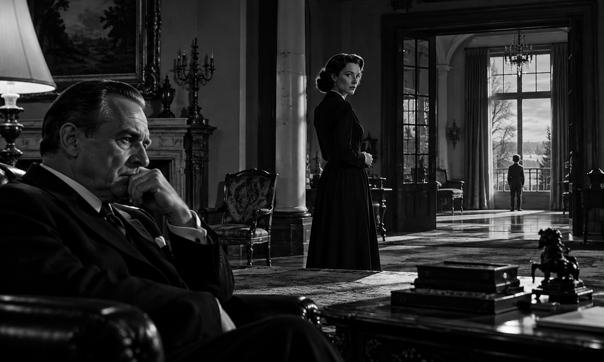
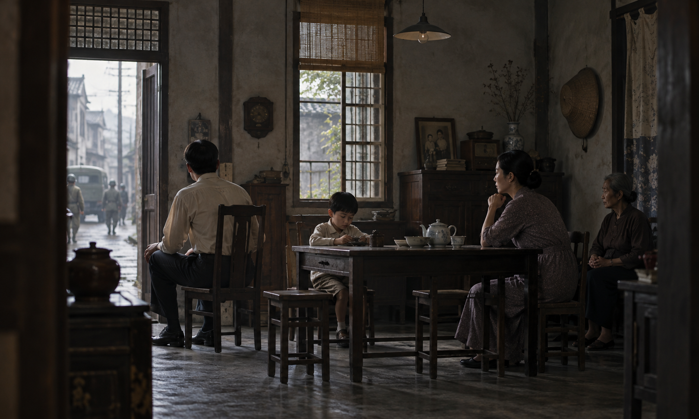
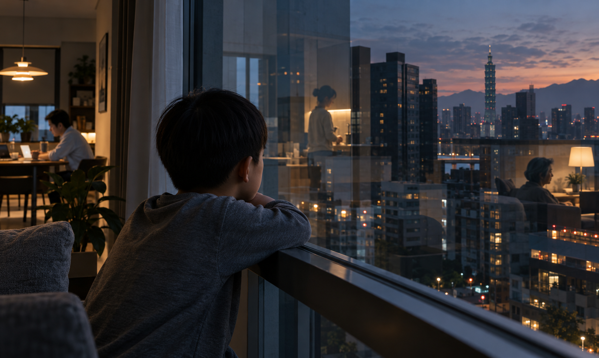

<!-- V2 editorial draft. V1 source remains immutable under legacy/2026-v1. -->

# 電影視聽語言：從單一鏡頭到完整敘事

> 電影不是把許多漂亮畫面接起來，而是有意識地安排觀眾在什麼時間看見什麼、聽見什麼，以及因此如何理解事件。

> **稿件狀態：** 本版補齊章節正文並與英文稿建立結構對照，仍是待專業編輯與電影研究者審閱的稿件。來源可支持範圍、示範內容與生成工具實測狀態分別標示；案例片段時間碼尚未由作者依合法觀看版本記錄。

## 學習目標 {#CH01-S01}

完成本章後，讀者應能：

1. 區分影格（frame）、鏡頭（shot）、拍攝次數（take）、場景（scene）與敘事段落（sequence），並說明這些詞在片場與成片分析中可能有不同用法。
2. 以視覺、時間、空間、聲音和剪輯五個互相作用的面向，描述一段短片如何引導觀眾注意與推論。這是本書的教學分類，不宣稱為唯一電影理論模型。
3. 把導演意圖轉寫成可觀察的鏡頭規格，至少列出主體、動作、構圖、時長、攝影機運動、聲音及驗收條件。
4. 比較實拍與生成式影像在可控性、重複性、素材治理及連續性檢查上的工作差異。
5. 對案例電影提出一項可由片段、版本與時間碼核對的形式觀察，並將其轉化為不複製原片表現的原創練習。

**可觀察的學習證據：** 學習者提交 4–8 鏡頭的短片方案、逐鏡規格、候選版本紀錄、聲音計畫及連續性檢查表；能以具體鏡頭描述支持自己的分析，而非只使用「很電影感」等評語。

## 先備知識 {#CH01-S02}

不需先有電影製作經驗。建議先熟悉時間碼、基本檔案管理及一般影片播放／剪輯操作。閱讀者若已學過劇本或攝影，可將本章鏡頭規格與自己的分鏡、拍攝日誌比較。

**必要設備：** 可播放影片的裝置；實作可使用手機攝影機或任何可輸出短片的剪輯工具。AI 生成工具不是完成本章練習的必要條件。若使用線上 AI 工具，先確認其當日官方文件、帳號方案、資料使用條款及輸出授權；本稿沒有驗證任何特定工具版本的功能。


> **圖像觀察：** 先比較前景、中景與窗邊遠景各自提供的資訊，再回到後文的深度與場面調度概念。

{#CH01-HOMAGE-FIG-001 fig-alt="黑白室內場景中，前景男子坐在桌旁，中景女子站在門邊，遠景人物面向明亮窗戶。"}

**圖 1-3A｜本圖為原創示意圖，參考《公民凱恩》（*Citizen Kane*, 1941）中可供討論的深度與畫面多層資訊，安排前景、中景及窗邊遠景人物；並非電影原劇照。人物、場景與構圖相似性及出版權利仍待人工審查。**

## 核心術語 {#CH01-S03}

本章詞條亦登錄於 `metadata/terminology.yaml`。定義是教學用工作版本，尚待編輯核准；引用來源只在其實際能支持的範圍內使用。

| 繁體中文／English | 本章工作定義 |
|---|---|
| 影格 (*Frame*) | 時間序列中的單幅影像。輸出影格數不能直接證明生成模型如何形成影像。 |
| 鏡頭 (*Shot*) | 成片中兩個剪接點之間的連續影像；片場也可能用來指一次攝影機設置或鏡頭設計，須看語境。 |
| 拍攝次數 (*Take*) | 對同一拍攝設計進行的一次錄製。生成候選版本可作工作類比，但不是實拍 take 的同義詞。 |
| 場景／一場戲 (*Scene*) | 以相對一致的戲劇時空組織的行動單元；不同劇本與分析傳統的界定可能不同。 |
| 敘事段落 (*Sequence*) | 由場景或鏡頭組成、完成相對完整敘事工作的段落；本書以教學用途使用。 |
| 場面調度 (*Mise-en-scène*) | 畫面中人物、表演、場景、服裝、道具、光線及其安排。 |
| 演員走位／調度 (*Blocking*) | 演員的位置、移動路徑與動作安排。 |
| 取景／框取 (*Framing*) | 決定畫框納入及排除哪些可見資訊，並安排其在畫面中的位置。 |
| 景別 (*Shot size*) | 以主體在畫面內所佔尺度描述取景範圍；實際分類須依採用的教材規格。 |
| 攝影角度 (*Camera angle*) | 攝影機相對主體的觀察方向與高度關係。 |
| 攝影機運動／運鏡 (*Camera movement*) | 攝影機位置或朝向隨時間改變的方式。 |
| 拍攝涵蓋素材 (*Coverage*) | 為一場行動拍攝或生成多種可供剪輯選擇的景別、角度及補充素材。 |
| 主鏡頭 (*Master shot*) | 涵蓋場景主要行動或空間關係的鏡頭；其定義依製作習慣而異。 |
| 反應鏡頭 (*Reaction shot*) | 呈現人物對事件、話語或畫外資訊反應的鏡頭。 |
| 插入鏡頭 (*Insert shot*) | 突出物件或局部動作細節的鏡頭。 |
| 切出鏡頭 (*Cutaway*) | 暫時切離主要行動，呈現相關人物、物件或環境資訊的鏡頭。 |
| 連續性 (*Continuity*) | 鏡頭間人物、物件、動作、方向、聲音與時空關係的可理解銜接。 |
| 動作接剪 (*Match on action*) | 在動作進行中跨鏡頭剪接，利用動作延續建立銜接。 |
| 蒙太奇 (*Montage*) | 以鏡頭的選擇、順序、時長或對比組織時間與意義；不同理論傳統對此詞的用法不完全相同。 |
| 故事世界內聲音 (*Diegetic sound*) | 被設定為來自故事世界內的聲音來源；角色是否聽得到須依情境判斷。 |
| 深焦攝影 (*Deep focus*) | 讓不同距離的畫面元素同時保持可辨識清晰度的影像效果；不能化約為一項固定鏡頭或光圈參數。 |
| 多重觀點敘事 (*Multiple perspectives*) | 透過不同人物或資訊範圍呈現同一事件；觀點差異本身不證明任何敘述者說謊。 |
| 畫外空間 (*Offscreen space*) | 畫框外、可由聲音、視線、動作或剪輯關係推知的空間。 |
| 長鏡頭 (*Long take*) | 持續時間較長且內部未剪接的單一鏡頭；本章不設定跨作品通用秒數門檻。 |
| 框中框構圖 (*Frame within a frame*) | 以門窗等畫面內邊界形成次級框景，改變可見範圍、遮擋或空間層次。 |
| 層次構圖 (*Layered composition*) | 以景深、前後景、反射或遮擋安排多組可見資訊；不代表固定心理效果。 |

相鄰概念不可混為一談：shot 不等於 take；主鏡頭只是 coverage 的一種可能形式；insert 依鏡頭功能分類，B-roll 則常指主要行動之外的補充素材，兩者可能重疊。正式採用前，術語編輯須對照指定版本教材並補頁碼或章節定位。

## 歷史與基本原理 {#CH01-S04}

### 電影語言不是固定字典

電影語言由畫面、聲音、表演、時間與剪接共同形成。單一景別或運鏡不會在所有作品和觀眾之間產生同一含義；分析須把形式選擇放回場景、類型、文化脈絡與前後鏡頭中。本書將「視覺、時間、空間、聲音、剪輯」作為入門檢視表，而非普遍定律。正式電影教材可提供更完整的形式分析框架；本章尚未逐頁核對《Film Art》特定版本的頁碼，因此不把未查頁碼的概念寫成逐字引述。[R001](#ref-R001)

### 早期電影與觀看位置

美國國會圖書館收錄的 Ned Thanhouser 文章把美國電影約 1907–1913 年稱為轉型期，並以單一全景視點、鏡頭銜接、不同視點及交叉剪接說明部分敘事技法的變化。[R023](#ref-R023) 這是對特定美國電影時段的概括，不代表各地電影同步發展，也不應把剪接史歸因於單一創作者。正式史述仍需與指定電影史教材及其他地區史料對讀。本章先把「攝影機可以選擇觀看位置」視為分析問題：攝影機在哪裡、看向何處、何時移動、哪些資訊被留在畫外？開放教材與美國國會圖書館保存的早期電影文獻可作進一步研究入口，但本文不據此斷言單一路徑的全球發展史。[R022](#ref-R022)[R023](#ref-R023)

### 剪接、並置與觀眾推論

鏡頭先後可以建立時間、空間或因果關係，也可藉對比促成觀眾推論。庫里肖夫效應常被用來教學說明並置如何影響解讀，但研究結果不宜簡化成「同一張臉必然被看成不同情緒」的固定法則。Barratt 等人 2016 年以 36 名參與者和 24 組片段進行重檢，研究者報告部分情緒脈絡效果，但眼動結果未呈現預期的情緒條件差異。[R005](#ref-R005) Cao 等人 2024 年以真實電影序列進行行為與神經影像實驗，摘要報告其設計下出現脈絡效果；樣本、刺激材料與研究設計限制仍須一併討論。[R024](#ref-R024) 兩篇研究都不能單獨建立適用所有剪輯與觀眾的固定心理定律。[R005](#ref-R005)[R024](#ref-R024)

{#CH01-HOMAGE-FIG-002 fig-alt="霧林中三格連續畫面呈現一名女子在持刀人物附近伸手求生，左右前景各有旁觀者。"}

**圖 1-4A｜本圖為原創示意圖，參考《羅生門》（*Rashomon*, 1950）對事件敘述與觀點差異的討論，以霧林中的三格求生情境呈現資訊分配；並非電影原劇照。此圖不是對電影場面的重建，人物、服裝、武器及構圖相似性仍待人工審查。**

### 場面調度與深度

畫面設計不只來自攝影機。人物走位、場景、道具、服裝、光線及其相對位置共同構成可見空間。深焦、前後景遮擋、門窗框景與反射都能提供多層資訊，但不保證觀眾依照作者預期解讀。應描述畫面可觀察的特徵，再提出有限度的解讀，避免把評論推論冒充製作者意圖或實驗證明。

{#CH01-HOMAGE-FIG-003 fig-alt="老屋室內的一家人圍坐桌邊，左側門外可見雨濕街道、車輛與行人。"}

**圖 1-4B｜本圖為原創示意圖，參考《悲情城市》（*A City of Sadness*, 1989）以家庭生活連結公共歷史的討論，安排室內家庭與門外街景並置；並非電影原劇照，也不宣稱是特定歷史事件的寫實重建。街景、人物、服裝及歷史語境均待人工審查。**

**色彩與人物距離觀察：** 門框、色彩對比與人物相對位置可共同形成可見的空間關係；本圖是原創練習情境，不代表對任何電影鏡頭的重建。

{#CH01-HOMAGE-FIG-004 fig-alt="紅色與綠色門框圍住狹長走道，一名穿紅色服裝的女子與一名男子背向而行。"}

**圖 1-4C｜本圖為原創示意圖，參考《花樣年華》（*In the Mood for Love*, 2000）對門框、色彩、人物距離與反覆相遇的形式討論，呈現兩人在紅綠走道擦肩的原創情境；並非電影原劇照。服裝、場景及構圖是否過度接近特定電影表現，仍待人工權利與編輯審查。**

## 傳統製作方法 {#CH01-S05}

傳統實拍通常從劇本與導演意圖開始，再將戲拆成場景、鏡頭及拍攝計畫。導演、攝影指導、美術、燈光、錄音和剪輯等部門以分鏡、場景配置、鏡頭清單、通告與現場溝通協作。每項工具的格式依劇組規模、工會與製作制度而不同，本節列的是可調整的通用工作順序。

1. **界定場景任務：** 寫明人物此刻要做什麼、觀眾需要知道什麼、場景如何改變故事狀態。
2. **規劃空間與視線：** 標示攝影機、人物、主要道具、出入口、光源與動線；確認軸線選擇及可能的反打位置。
3. **設計 coverage：** 決定是否以主鏡頭涵蓋全場，再補對話雙人鏡頭、單人鏡頭、反應、插入與切出。不要只為「多拍幾個角度」而拍攝，需說明每個鏡頭的剪輯用途。
4. **排演並記錄連續性：** 記錄動作起訖、道具狀態、視線方向、服裝、光線與聲音；必要時由場記保存 take、鏡頭和場次資訊。
5. **現場檢查素材：** 確認焦點、曝光、收音、表演覆蓋與備份；對關鍵動作檢視頭尾是否足以剪接。
6. **剪輯與聲音設計：** 先整理同步素材及選取，再建立節奏、空間關係、J-cut／L-cut、環境聲、音效、旁白與音樂。成片可由剪輯重組，不必假設拍攝順序即敘事順序。

每個鏡頭至少記錄：鏡頭 ID、場次、景別、攝影機位置／高度、焦段或視角描述（如已知）、運動、主體行動、預估時長、聲音、剪接目的、連續性依賴、拍攝方式和驗收結果。沒有測量或紀錄的焦段、光圈、曝光與焦點不可事後猜填。


**窗面與城市層次觀察：** 玻璃可能同時呈現室內反射與室外景觀；拍攝或生成時應分別檢查反射、遮擋和人物位置。

{#CH01-HOMAGE-FIG-005 fig-alt="一名少年倚在室內窗邊望向暮色城市，玻璃上映出室內人物，遠處有高樓天際線。"}

**圖 1-5A｜本圖為原創示意圖，參考《一一》（*Yi Yi*, 2000）對日常觀看、城市景觀、窗面反射及前後景層次的形式討論，呈現少年隔窗凝望城市的原創情境；並非電影原劇照。人物、地標、反射與構圖相似性及出版權利仍待人工審查。**

## AI 時代的技術轉換與限制 {#CH01-S06}

生成式影像把部分素材製作從現場轉為模型生成或局部合成，但導演仍需決定鏡頭的敘事用途、選擇素材並驗收成品。提示詞是需求描述，不是保證；文字中的鏡頭術語也不證明模型以真實攝影機、鏡頭或光學方式運作。

| 傳統工作 | AI 協作轉換 | 必須驗收的成品證據 |
|---|---|---|
| 導演說明與分鏡 | 文字規格、參考圖、結構化 shot record | 生成畫面是否呈現指定主體、動作和敘事焦點 |
| 實景、佈景與美術 | 文字／圖像生成、3D 場景、實拍與合成混用 | 人物、道具、光源和空間關係是否穩定且權利可追溯 |
| 演員排演與攝影機排練 | 生成候選動作或參考動態 | 表演、肢體、方向、手部和物件互動是否可用 |
| 多 take 選擇 | 不同生成候選、種子或設定（若工具提供） | 候選可否重現、差異來自何種設定、是否符合條款 |
| 現場連續性 | 角色／場景參考、鏡頭狀態表、人工比對 | 跨鏡頭身份、服飾、道具、時間、視線及動作是否連貫 |
| 剪輯補拍 | 重生成、局部修補、實拍補鏡或改剪 | 成本、瑕疵、敘事必要性和輸出規格是否可接受 |

應明確保留模型、版本、帳號方案、日期、提示詞、參考素材來源、可用參數、候選輸出與人工修改紀錄。Seed、相機控制、首末影格等功能是否存在，必須查該工具官方文件與當時版本；若沒有實測紀錄，標為「未測」，不能稱為支援或穩定。

生成影像常需檢查人物身份漂移、手指與道具變形、空間拓樸改變、運動方向不連續、反射不一致、文字亂碼、光線跳變、幀間閃爍、聲畫不同步及素材授權。不能通過的鏡頭可改用實拍、動畫、合成、靜態畫面或重新剪接；不應為了維持 AI 使用比例而保留不合格輸出。

## 詳細工作流程 {#CH01-S07}

下列流程用於一支短片的鏡頭級規劃。各工具欄位可依專案調整；需保留人工作出決策的節點。

1. **寫意圖：** 用一句話說明觀眾應注意或理解什麼，將情緒詞轉成可見／可聽證據。
2. **拆解鏡頭：** 建立 shot ID，記錄前後鏡頭關係、時長範圍、畫面內外資訊及聲音來源。
3. **設計空間：** 產生自行繪製的平面圖或向量示意，標註主體、攝影機、光源、動線、軸線與畫外聲源。
4. **建立連續性參考：** 記錄角色外觀、服裝、道具狀態、場景佈置、光線方向、運動起訖及鏡頭方向；參考素材須有來源和權利狀態。
5. **選擇製作方式：** 對每個鏡頭選擇實拍、AI 生成、動畫、合成或混合方式，列成本、風險和預期交付物。
6. **製作候選素材：** 一次只改一項主要變因；以日期、工具版本、提示詞 revision 和候選 ID 命名，不覆寫原始輸出。
7. **逐鏡驗收：** 依 S10 檢查敘事、畫面、動作、音訊、連續性、技術規格及來源；缺陷記錄到 shot log。
8. **剪輯與聲音：** 先用可讀的粗剪測試順序和時長，再修剪節奏、J/L cut、環境聲、旁白與音樂。標記需要重新生成或另製的素材。
9. **版本封存：** 保存來源檔、工程檔、輸出、字幕、授權、工具／參數日誌及檢核報告，建立可追溯版本號。
10. **交付前複核：** 對照目標解析度、畫幅、影格率、音訊、字幕、平台規格與權利清單；本章不預設任何平台規格永久不變。

## 提示詞與技術參數 {#CH01-S08}

以下是模型中立的需求範本，不代表已在特定工具測試，也不代表所有工具提供相同控制欄位。

```text
專案／鏡頭 ID：
敘事目的（觀眾要注意什麼）：
主體與可見特徵：
動作（開始狀態 → 結束狀態）：
場景與空間關係：
構圖／景別／觀察角度：
攝影機運動（如未支援，標記未測）：
時間與節奏：
光線與色彩：
故事世界內聲音／非故事世界聲音：
相鄰鏡頭的連續性條件：
禁止或需避免的變化：
輸出設定（僅填工具明確支援且已選定者）：
參考素材 ID 與權利狀態：
驗收條件（可觀察、可判定）：
工具／模型／版本／日期／方案：
實際提示詞與候選輸出 ID：
```

### 虛構教學示範：玻璃杯鏡頭

**創作意圖：** 讓觀眾注意一個普通教室物件如何引發觀察。**畫面規格：** 虛構教室，玻璃杯置於桌面，窗外晨光在桌面形成可見亮區；鏡頭緩慢靠近，杯子保持穩定；畫面不顯示可讀文字。**驗收：** 杯子形狀與位置不跳變、光線方向合理、運動平滑、無多餘物件、與前後鏡頭方向一致。以上是新創示範，不是模型輸出或工具實測；未指定影格率、焦段、種子或時長，因為尚無選定工具及可驗證版本。

生成後補記：工具及模型版本、測試日期、實際支援的解析度／比例／時長／影格率／控制項、參考影像來源、提示詞全文、候選數、輸出檔雜湊、選用理由、失敗樣態及後製。所有時效性參數須以官方文件及實測紀錄為準。

## 鏡頭／影片案例 {#CH01-S09}

> **證據標示：** 作品年份與創作者以機構影片條目為書目事實；形式主張依明列的影評／機構分析，仍需作者對照合法觀看版本；AI 轉譯是實務練習建議；教室、餐廳、走道及校園皆為虛構情境。五張原創 AI 插圖已匯入章稿指定位置，全部為 draft-generated；圖說、圖片相似性、權利、技術及編輯審查仍待完成，未核准出版。

### 案例一：《公民凱恩》（*Citizen Kane*, 1941）——單一畫面中的多層資訊 {#CH01-P001}

BFI 的影片介紹列出深焦攝影、抽象攝影角度、非線性敘事和重疊對白等形式觀察；另一篇 BFI 文章以片中一個深焦鏡頭作分析，並說明攝影師 Gregg Toland 的署名情況。[R013](#ref-R013)[R020](#ref-R020) 這些資料支持「可從深度與畫面內多重資訊分析特定鏡頭」，不支持「全片每一鏡皆為深焦」，也不能推定觀眾必然先看哪個平面。

**原創轉譯練習：** 在虛構教室安排前景教師、中景學生及遠處門邊人物。畫出焦點與遮擋關係，再逐一說明各平面的資訊用途；如實拍，記錄光圈、焦距、對焦距離及照明條件；如生成，記錄實際可用控制及失敗輸出。不得重製原片構圖或宣稱複製其攝影技術。

**插圖索引（待審）：** 本案例對應[圖 1-3A](#CH01-HOMAGE-FIG-001)；圖檔、雙語圖說與權利狀態集中登錄於 `assets/chapters/CH01/figures/figure-captions.md`。

### 案例二：《羅生門》（*Rashomon*, 1950）——觀點與資訊分配 {#CH01-P002}

BFI 對黑澤明作品的介紹將《羅生門》與相互不完全一致的事件陳述連結，可作為觀點、證詞及資訊安排的分析入口。[R014](#ref-R014) 本章不據此宣稱所有觀點同樣可信，也不把敘事形式轉成普遍心理定律。

**原創轉譯練習：** 設計「教室器材意外掉落」的虛構事件。分別列出教師、學生與走廊觀察者看見的事實、看不見的資訊及可能誤解；剪接時保持事件核心不變，再比較不同資訊順序如何改變觀眾的暫時判斷。

**插圖索引（待審）：** 本案例對應[圖 1-4A](#CH01-HOMAGE-FIG-002)；圖檔、雙語圖說與權利狀態集中登錄於 `assets/chapters/CH01/figures/figure-captions.md`。

### 案例三：《悲情城市》（*A City of Sadness*, 1989）——家庭場景、畫外聲音與歷史 {#CH01-P003}

BFI 條目記錄本片為侯孝賢 1989 年作品，背景為戰後臺灣並透過家族故事接觸政治歷史。[R015](#ref-R015) Criterion 的一篇《海上花》評論提及《悲情城市》餐館聚會段落中的畫外歌聲、開窗和歷史情勢；它可作特定評論觀點的線索，但該文主題不是本片的完整研究。[R016](#ref-R016) 本稿刪除未能取得足夠可核對片段證據的長鏡頭／門框主張。

**原創轉譯練習：** 在全新家庭餐廳安排角色對話及一個畫外聲源。先不改畫面，分別測試畫內聲、隔壁聲與遠處公共聲音，記錄每版新增的故事資訊。不要把新場景稱為歷史重建；若討論本片歷史背景，需由作者以可靠臺灣史料及影片版本另行審查。

**插圖索引（待審）：** 本案例對應[圖 1-4B](#CH01-HOMAGE-FIG-003)；圖檔、雙語圖說與權利狀態集中登錄於 `assets/chapters/CH01/figures/figure-captions.md`。

### 案例四：《花樣年華》（*In the Mood for Love*, 2000）——框景、重複與時間感 {#CH01-P004}

Criterion 條目提供本片年份、導演與主要製作人員資料；另一篇評論討論色彩、沉默、對稱、反覆音樂及時間感，這些是評論者的形式觀察，不等於對所有場景的客觀測量。[R018](#ref-R018)[R021](#ref-R021) 本章將框景、重複與省略作為待看片段驗證的分析問題，不推定特定鏡頭的攝影器材或製作意圖。

**原創轉譯練習：** 以現代公共圖書館走道與全新人物測試框中框。重複呈現一次行走，分別只改時長、聲音或畫面遮擋之一，記錄差異。避免複製原片可識別人物、服裝、場景設計或具體構圖。

**插圖索引（待審）：** 本案例對應[圖 1-4C](#CH01-HOMAGE-FIG-004)；圖檔、雙語圖說與權利狀態集中登錄於 `assets/chapters/CH01/figures/figure-captions.md`。

### 案例五：《一一》（*Yi Yi*, 2000）——反射與觀看層次 {#CH01-P005}

Kent Jones 在 Criterion 的文章以臺北城市生活、窗面、反射和前後景視覺關係解讀本片。[R019](#ref-R019) 這是具名評論者對作品的形式分析；不代表每一處反射都有同一含義，也不應在未看片核對前擴大成全片技術規則。

**原創轉譯練習：** 在虛構校園走廊以玻璃窗同時呈現室內人物與室外活動。先畫出攝影機、玻璃、主體、反射與光源位置；實拍時檢查反射方向與曝光，生成或合成時逐幀檢查反射、遮擋和人物身份是否穩定。生成模型若不能維持幾何關係，改用實拍、可編輯向量圖或分層合成。

**插圖索引（待審）：** 本案例對應[圖 1-5A](#CH01-HOMAGE-FIG-005)；圖檔、雙語圖說與權利狀態集中登錄於 `assets/chapters/CH01/figures/figure-captions.md`。

### 完整鏡頭示範：《窗邊的第一道光》

**狀態：** 依 V1 原稿保留的虛構教學案例，不是已拍攝或已生成作品。設定為 45 秒、16:9、無人物對白，以旁白、配樂及環境聲呈現晨間教室觀察；科學光學效果只作敘事示意，若作科學教學必須另由學科專家驗證。

| 鏡頭 ID | 示範時間 | 鏡頭設計 | 敘事目的 | 聲音設計 |
|---|---|---|---|---|
| S01 | 00:00–00:06 | 教室遠景，固定視點，晨光入室 | 建立空間與時間 | 鳥鳴及低音量室內環境聲 |
| S02 | 00:06–00:13 | 教師中景，緩慢跟隨 | 引入人物與行動 | 腳步、衣物摩擦 |
| S03 | 00:13–00:20 | 桌上玻璃杯特寫，緩慢靠近 | 將注意力移向觀察物 | 配樂單音或安靜留白 |
| S04 | 00:20–00:27 | 教師反應特寫，固定鏡頭 | 呈現停頓與思考 | 配樂短暫留白 |
| S05 | 00:27–00:37 | 越肩畫面與筆記細節 | 把觀察轉成提問 | 旁白示範句：「有時候，最好的課程，從一道光開始。」 |
| S06 | 00:37–00:45 | 教室遠景，緩慢拉遠 | 收束主題 | 旁白示範句：「每一個發現，都從一個問題開始。」 |

時間碼是腳本規劃值，不是成片量測值；實作須依表演、旁白、音樂和鏡頭長度重排。完整中英案例對照及所有圖說狀態見 `metadata/translations/CH01-alignment.yaml` 與 `assets/chapters/CH01/figure-manifest.yaml`。

## 常見錯誤與品質檢查 {#CH01-S10}

| 錯誤 | 檢查方法 | 修正或判定 |
|---|---|---|
| 把鏡頭／拍攝次數／場景當作同義詞 | 檢查 shot list、場次表與剪接點是否分欄記錄 | 依文件用途寫明術語；保留教材定義來源 |
| 只寫「電影感」或情緒詞 | 問能否指出畫面、聲音、表演、時間或剪接的證據 | 改寫為可觀察構圖、動作、光線或聲音條件 |
| 把提示詞當成模型保證 | 比對提示詞、官方文件、實際輸出和候選差異 | 將未支援或未測參數標示，不宣稱控制成功 |
| 跨鏡頭人物、道具、視線或空間漂移 | 並排或逐鏡比對角色表、場景圖及輸出 | 重生成、局部修復、實拍補鏡或改剪並記錄理由 |
| 反射、影子或光線方向錯誤 | 先畫幾何／光源圖，再檢查連續影格 | 用實拍／向量圖／合成替代不能驗收的生成結果 |
| 聲音存在但沒有敘事角色 | 逐軌標記來源、故事世界屬性、進出點與音量 | 調整聲畫關係，確認權利和混音交付規格 |
| 案例解讀沒有看片證據 | 登記合法版本、播放來源、時間碼與描述 | 將未核對分析維持 NEEDS HUMAN REVIEW |
| 將計畫圖說當成實際圖檔 | 檢查資產路徑、雜湊、提示詞／製作檔及三種審核狀態 | 無檔案即保持 pending，不放入出版版 |
| 候選素材或參考圖權利不明 | 查素材 ID、作者、來源、條款、用途和日期 | 隔離待核素材，不匯出正式版本 |

**逐鏡驗收表：** (a) 敘事目的能否用一句可觀察結果表達；(b) 人物、道具、視線、軸線及運動起訖是否連續；(c) 畫面有無閃爍、變形、重影、亂碼或無意義運動；(d) 對白、旁白、環境聲、音效、音樂及字幕是否同步且可理解；(e) 輸出是否符合專案指定技術規格；(f) 圖片、音樂、人物肖像及模型輸出是否完成權利審查。每項記錄 PASS／FAIL／NEEDS HUMAN REVIEW、證據位置、審查者與日期。

## 練習、評量與延伸研究 {#CH01-S11}

### 個人或小組作品

製作一支 30–60 秒、4–8 個鏡頭的短片《一個小小的發現》，題材自選。可全程實拍，不要求使用 AI。提交影片或 animatic、故事摘要、shot list、聲音計畫、來源／權利清單、版本紀錄與一頁反思。

1. 用不超過 100 字寫故事概念、主要行動及觀眾需理解的改變。
2. 為每個鏡頭寫明 ID、目的、景別、構圖、主體動作、時長、聲音、連續性條件及製作方式。
3. 先以手繪或原創向量草圖規劃人物、道具、攝影機及光源。
4. 拍攝或生成候選素材，保存來源檔，不覆寫失敗候選；使用 AI 時補齊工具、模型、版本、日期和實測設定。
5. 剪出可理解的版本，逐鏡完成 S10 驗收；將無法修復的缺陷標出並說明取捨。
6. 反思哪些鏡頭提供了必要資訊、哪些聲音改變了畫面解讀，以及一次具體改版如何改善作品。

### 評量規準（100 分）

| 面向 | 權重 | 觀察證據 |
|---|---:|---|
| 敘事清晰度 | 25 | 觀眾能否指出主要行動、資訊變化及片尾狀態 |
| 電影語言選擇 | 25 | 景別、構圖、時長、運鏡與剪接有可說明的用途 |
| 視聽連續性 | 20 | 人物、道具、空間、動作及聲音銜接可理解 |
| 製作與版本治理 | 20 | 鏡頭規格、候選紀錄、來源／權利及品質修正可追溯 |
| 反思與溝通 | 10 | 能以作品證據說明取捨、限制與下一次改進 |

可用 0–4 級評分（0 未呈現、1 初步、2 基礎、3 良好、4 成熟），再依權重換算。教師應向全班提供同一份評分錨點，並允許學習者以純實拍或非生成方案完成，避免把工具熟練度等同電影語言能力。

### 延伸研究問題

- 景別、鏡頭時長與聲音線索如何共同影響觀眾對同一表演的解讀？如何設計可重複的比較？
- 傳統剪輯概念應如何轉化成可檢查的生成影片連續性指標？哪些指標需要人工判斷？
- 不同語言與文化脈絡中，畫外聲音或沉默的敘事功能有何差異？
- Kuleshov effect 的早期史料、後續實驗與近年神經／行為研究，哪些結論相互支持、哪些仍有爭議？需對照原始研究方法與材料，不能只比較摘要。
- 生成模型的參考影像、種子與相機控制在不同版本中是否可重現？應預先定義候選選擇與失敗標記方式。

## 參考文獻與來源 {#CH01-S12}

- <span id="ref-R001"></span> **R001** — David Bordwell, Kristin Thompson, and Jeff Smith, *Film Art: An Introduction*, 13th edition / 2026 release. McGraw Hill 書目頁：<https://www.mheducation.com/highered/product/Film-Art-An-Introduction-Bordwell.html>。書目版本可查；本章未取得可逐頁核對的全文，不能假稱具體頁碼已核實。
- <span id="ref-R022"></span> **R022** — Graig Uhlin, *Introduction to Film & TV*, Oklahoma State University Open Library, 2024, CC BY 4.0. <https://open.library.okstate.edu/introfilmtv/>；攝影、場面調度等章可供開放教材對照。個別頁面可存取性不一，定稿前需由編輯確認引用章節及定位。
- <span id="ref-R023"></span> **R023** — Library of Congress, “The Evidence of the Film,” National Film Preservation Board resource: <https://lcweb2.loc.gov/static/programs/national-film-preservation-board/documents/evidence.pdf>。作早期電影原始／檔案研究入口；本章未以此支持單一全球電影史分期。
- <span id="ref-R005"></span> **R005** — Daniel Barratt, Anna Cabak Rédei, Åse Innes-Ker, and Joost van de Weijer, “Does the Kuleshov Effect Really Exist? Revisiting a Classic Film Experiment on Facial Expressions and Emotional Contexts,” *Perception* 45, no. 8 (2016): 847–874. DOI: <https://doi.org/10.1177/0301006616638595>。研究重檢效應；本文僅作審慎研究入口，不將其簡化為定律。
- <span id="ref-R024"></span> **R024** — Zhengcao Cao, Yashu Wang, Liangyu Wu, Yapei Xie, Zhichen Shi, Yiren Zhong, and Yiwen Wang, “Reexamining the Kuleshov effect: Behavioral and neural evidence from authentic film experiments,” *PLOS ONE* 19, no. 8 (2024), e0308295. DOI: <https://doi.org/10.1371/journal.pone.0308295>。需由研究編輯核對完整作者資料、實驗設計與結果後再採用。
- <span id="ref-R013"></span> **R013** — British Film Institute, “Citizen Kane (1941),” film record. <https://www.bfi.org.uk/film/f4c92833-af39-5cd6-a41e-8df5933d0dc1/citizen-kane>，查閱 2026-10-18。
- <span id="ref-R014"></span> **R014** — British Film Institute, “Where to Begin with Akira Kurosawa.” <https://www.bfi.org.uk/features/where-begin-with-akira-kurosawa>，查閱 2026-10-18。
- <span id="ref-R015"></span> **R015** — British Film Institute, “A City of Sadness (1989),” film record. <https://www.bfi.org.uk/film/989a6349-4d1c-54da-8ea1-0abd2a558d8a/a-city-of-sadness>，查閱 2026-10-18。
- <span id="ref-R016"></span> **R016** — Criterion Collection, “Flowers of Shanghai: Inside the Dream.” <https://www.criterion.com/current/posts/7395-flowers-of-shanghai-inside-the-dream>，查閱 2026-10-18；評論特定提及《悲情城市》一幕，非該片完整研究。
- <span id="ref-R018"></span> **R018** — Criterion Collection, “In the Mood for Love (2000),” film record. <https://www.criterion.com/films/198-in-the-mood-for-love>，查閱 2026-10-18。
- <span id="ref-R019"></span> **R019** — Kent Jones, “Yi Yi: Time and Space,” Criterion Current (2011). <https://www.criterion.com/current/posts/429-yi-yi-time-and-space>，查閱 2026-10-18；評論性形式分析。
- <span id="ref-R020"></span> **R020** — Leigh Singer, “20 Inspired Visual Moments in Citizen Kane,” British Film Institute (2016). <https://www.bfi.org.uk/features/20-inspired-visual-moments-citizen-kane>，查閱 2026-10-18。
- <span id="ref-R021"></span> **R021** — Charles Yu, “Notes on In the Mood for Love,” Criterion Current (2022). <https://www.criterion.com/current/posts/7976-notes-on-in-the-mood-for-love>，查閱 2026-10-18；評論性形式分析。

R017《紐約客》頁面在本輪未作為正文證據，相關長鏡頭／門框具體主張已從案例刪除。來源 registry、逐節中英對照及引用待辦分別見 `metadata/references.bib`、`metadata/translations/CH01-alignment.yaml` 和本報告。任何外部連結及工具版本均可能變動；正式出版日須重新查核並保存查閱日期、版本和支持的具體主張。

**案例看片待辦：** 作者選定合法觀看版本，記錄每片至少一段觀察的片名、發行／修復版本、播放來源、時間碼、逐鏡描述及審閱者；若無法取得版本，維持 NEEDS HUMAN REVIEW，不虛構時間碼。

## 結語 {#CH01-S13}

鏡頭是敘事決策，電影則由跨鏡頭、跨時間與跨感官的安排組成。AI 可協助生成或轉換素材，但創作者仍須定義每個鏡頭存在的理由，保留製作紀錄，並以可觀察證據驗收。讀者可先從生活場景練習辨認畫面如何分配資訊，再逐步把觀察轉成可執行、可檢查的製作選擇。下一章將從鏡頭、場面與剪接的基本單位，延伸到攝影機位置、取景與連續性。
