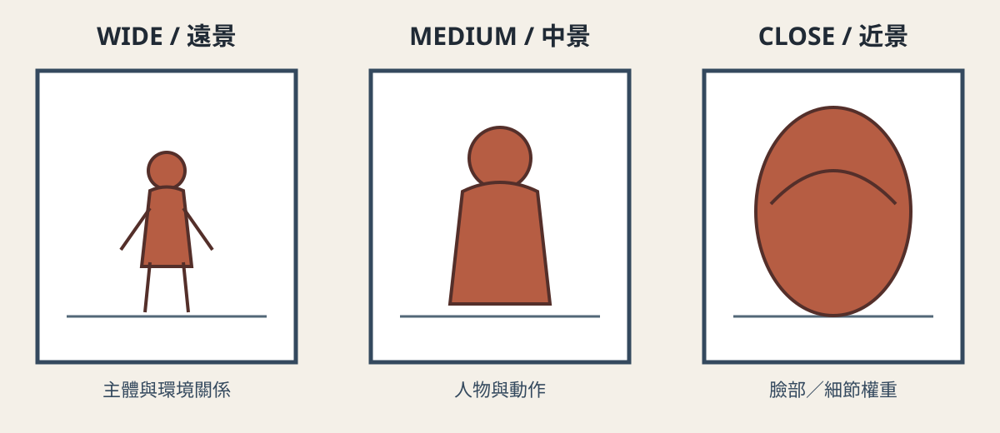
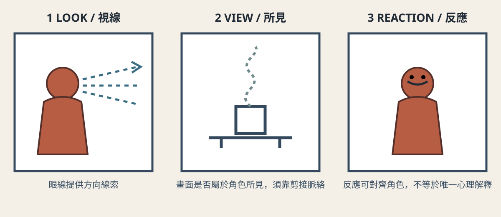

# 景別、視點與觀看位置 {#CH03-S00}

> 狀態：繁中研究草稿；英文為對照譯稿。尚未經全書統一人工審稿，不是出版定稿。史料與電影段落均不提供未核看的精確時間碼。

## 學習目標 {#CH03-S01}

完成本章後，讀者能：

1. 區分景別（被攝主體在畫框中的尺度）、攝影機距離、角度與高度，並說明這些概念彼此相關但不可混為一談。[R022]
2. 以敘事資訊、人物關係和觀眾注意力為理由，選擇景別與觀看位置，而非只套用「特寫代表情緒」等固定公式。[R022]
3. 區分客觀呈現、受限／貼近人物的敘事，以及主觀視點鏡頭（POV），用視線匹配和上下文說明判斷依據。[R022, R030]
4. 規劃一組從建立空間到呈現主觀資訊的鏡頭，維持軸線、視線、螢幕方向及動作連續性。
5. 將鏡頭意圖轉成可由真人劇組或 AI 影像流程檢查的 shot specification，並以可觀察的驗收條件評估結果。

## 先備知識 {#CH03-S02}

建議先熟悉 CH01 的電影視聽語言，以及 CH02 的鏡頭、場面與剪接基本單位。讀者不需要攝影器材或特定生成式 AI 訂閱；練習可用手機、紙上分鏡或下方虛構情境完成。

## 核心術語 {#CH03-S03}

| 詞條 | English | 本章工作定義 | 限制／辨析 |
|---|---|---|---|
| 景別 `TERM-CH03-SHOT-SCALE` | Shot scale | 以主體相對畫框的呈現大小描述鏡頭，例如遠景、中景、近景。 | 各片場對中間級距名稱與裁切界線可能不同；記錄可見身體範圍比只寫縮寫可靠。[R022] |
| 攝影機距離 `TERM-CH03-CAMERA-DISTANCE` | Camera distance | 攝影機與主要被攝對象的空間距離。 | 景別不等於焦距；相同景別可以用不同距離／焦距組合取得，透視效果須另外檢查。[R022] |
| 攝影角度 `TERM-CH03-CAMERA-ANGLE` | Camera angle | 攝影機朝向主體的方向關係，如平視、高角度、低角度或俯視。 | 不能把角度直接解讀成固定情緒或權力意義；須看場面與前後鏡頭。[R022] |
| 攝影機高度 `TERM-CH03-CAMERA-HEIGHT` | Camera height | 攝影機相對地面或人物的位置高度。 | 高度與俯仰角相關但不是同一參數；低機位仍可保持水平拍攝。[R022] |
| 主觀視點鏡頭 `TERM-CH03-POV-SHOT` | Point-of-view (POV) shot | 透過前置視線或動作線索，使觀眾將此鏡頭理解為某角色當下所見。 | 單一鏡頭未必足以確立 POV；視線鏡頭、主觀聲音及剪接上下文共同建立關係。[R030] |
| 視線匹配 `TERM-CH03-EYELINE-MATCH` | Eyeline match | 先呈現人物看向畫外，再切至與視線方向相連的對象或空間。 | 方向和軸線不連貫會讓觀眾誤判對象位置。[R030] |
| 反應鏡頭 `TERM-CH03-REACTION-SHOT` | Reaction shot | 呈現人物觀看／聆聽事件時的反應，藉此引導觀眾注意其立場或感受。 | 觀眾可由反應推論立場，但不應把推論寫成角色明說的事實。[R022] |
| 觀看位置 `TERM-CH03-SPECTATOR-POSITION` | Spectator position | 作品透過取景、剪接和敘事資訊安排觀眾看見、知道或暫時不知道什麼。 | 不等於攝影機的物理位置，也不必等於任一角色視點。[R022] |

## 歷史與基本原理 {#CH03-S04}

### 從固定展示到可移動觀看

**已查證的教材描述**：Uhlin 將早期電影的 tableau staging 描述為較遠距離、人物多在空間中橫向排列的呈現方式，並指出隨著長片敘事發展，電影逐漸運用不同距離、方向和角度移動觀眾的觀看位置。這是對電影敘事形式變化的教學概述，不應解讀為所有早期電影都固定採單一構圖，也不是唯一線性的電影史因果解釋。[R022]

### 取景如何管理資訊

畫框選擇可見範圍，也決定觀眾暫時看不到什麼。鏡頭可以隔離關鍵動作、保留環境線索，或讓重要事件留在畫外；後續剪接再修正、延遲或擴大觀眾理解。因而，景別的功能不是固定情緒標籤，而是與人物行動、場景空間、敘事資訊及鏡頭長度共同運作。[R022]

### 景別、距離、角度與高度

景別常以人物身體在畫框中的範圍作溝通基準，但界線具有慣例彈性。極遠景／遠景較容易交代環境和人物相對位置；中景通常保留一定身體動作與互動；近景／特寫會提高臉部或物件細節的視覺權重。這些只是構圖上的可供選擇性，不保證觀眾必然產生某種情緒。[R022]

分析鏡頭時分別記錄：①主體在畫框中的大小；②攝影機到主體的距離；③鏡頭視角／焦距與透視觀感；④攝影機角度；⑤攝影機高度。教材明確將距離、角度和高度作為不同取景維度，也指出分類界線可浮動。[R022]

### 主觀鏡頭與敘事主觀性

典型 POV 鏡頭通常以「角色看向畫外」建立視線，再切到近似角色位置所見的畫面。可是電影敘事的主觀程度不是二分法：攝影機不必精確放在角色眼睛位置，作品也能透過反應鏡頭、資訊限制、聲音或剪接偏向某角色。反過來，模仿人眼高度的畫面也不自動成為角色 POV；必須由情境建立觀看歸屬。[R022, R030]

## 傳統製作方法 {#CH03-S05}

1. **由戲劇任務決定觀看位置**：先寫出觀眾此刻要知道什麼、角色知道什麼、希望觀眾注意哪個細節，再定鏡頭，而不是先選「漂亮角度」。
2. **建立空間基準**：用全景／雙人鏡頭呈現人物、出入口與主要道具；記下攝影機軸線、人物移動方向和視線方向。
3. **選景別並試演**：用人物走位和畫框邊界測試不同景別；特寫只在細節、表情或資訊確有敘事任務時使用。
4. **建立主觀關係**：拍角色視線、主觀鏡頭及反應／回看鏡頭，檢查切接方向、眼線高度和主觀聲音是否一致。
5. **覆蓋與剪輯測試**：依場景需要拍主鏡頭、對切、反應與細節；剪接時確認觀眾能推知空間和動作。反應鏡頭可以改變觀眾重視的角色，但不能單獨證明角色內心的唯一解釋。[R022, R030]

## AI 時代的技術轉換與限制 {#CH03-S06}

文字／圖像生成影片可以用提示描述畫面尺度、攝影機高度、人物視線和觀眾資訊，但自然語言不是具備一致座標系的攝影機控制協定。相同提示可能產生不同裁切、人物位置、鏡頭運動或視線方向；不同模型、版本及模式也可能有不同支援。除非有指定工具、版本及可重現測試，本章不宣稱某提示詞能精確控制鏡頭。

可將生成結果分成兩層驗收：

- **語意層**：主體、觀看者位置、畫面內外資訊、景別意圖是否符合分鏡。
- **幾何／連續性層**：主體大小、鏡頭高度、視線方向、畫面方向、人物外觀與前後鏡頭是否穩定。

若畫面內容已知但構圖錯誤，應先修訂 shot specification 或改用可控的分鏡／參考畫面工具；若鏡頭視點和角色視線互相矛盾，應視為生成失敗，而不是以提示文字自稱成功。工具能力必須依實際官方文件和實測版本另行補記；本章尚未連接或呼叫付費生成服務。

## 詳細工作流程 {#CH03-S07}

| 步驟 | 輸入／決策 | 製作動作 | 交付與驗收 |
|---|---|---|---|
| 1. 定義資訊 | 觀眾要知道／不知道什麼；角色當下知道什麼 | 寫一行鏡頭敘事任務 | 不含純形容詞；明確描述資訊增減 |
| 2. 標記空間 | 人物、道具、出口、視線與動線 | 畫俯視場面圖並定軸線 | 人物／機位／方向有標記 |
| 3. 選觀看規格 | 景別、距離、角度、高度、主觀程度 | 填下方 Shot Specification | 每項可觀察，未知光學量不捏造 |
| 4. 排列鏡頭 | 建立、視線、所見、反應、揭示 | 寫 shot list／分鏡 | 每一切點有資訊或節奏理由 |
| 5. 拍攝或生成 | 劇組設備或已確認工具／版本 | 拍 take 或生成測試 | 保留參數、版本、take ID 和失敗結果 |
| 6. 粗剪與檢核 | 畫面和聲音素材 | 依資訊順序組接 | 無意外跳軸；觀眾能理解誰看什麼 |
| 7. 記錄修訂 | 目標與偏差 | 修改規格、再測 | 不以抽象「更電影感」代替差異說明 |

## 提示詞與技術參數 {#CH03-S08}

### Shot Specification（模型中立範本）

```yaml
shot_id: CH03-DEMO-S01
status: fictional-teaching-demo
story_beat: "一名旅人發現桌上剛熄滅的燈仍冒著細煙。"
audience_information: "觀眾先看到煙，旅人稍後才注意到。"
subject_and_action: "旅人停在門口，視線轉向桌面。"
shot_scale: "medium-wide; full body and doorway visible"
camera_distance: "document physical distance after blocking; do not infer from lens label"
camera_angle: "eye-level"
camera_height: "approximately chest height; measure on set"
viewpoint_relation: "observer framing, not character POV"
eyeline_direction: "screen-right toward table"
screen_direction: "旅人由畫面左側停下，朝右看"
frame_aspect_ratio: "由交付規格指定；生成前記錄"
camera_movement: "locked-off for this demonstrative take"
continuity_constraints:
  - "door remains behind the traveler"
  - "smoke is visible before the traveler reacts"
acceptance_checks:
  - "audience can identify the room layout"
  - "smoke is visible before the reaction shot"
  - "shot is not labeled POV"
```

以上是虛構教學示範，不代表任何工具或模型已實測。落地時記錄工具名稱／版本、模式、畫幅、影格率、時長、輸入素材 hash、提示詞版本、seed（若工具提供）、take ID 和失敗原因。若平台沒有提供某參數，填 `not-exposed`，不要自行補值。

### 對照練習

同一個「旅人發現燈煙」節拍，製作三個方案：A. 遠景先交代門與桌；B. 旅人視線後接桌面細節；C. 先給煙，再切人物反應。比較觀眾何時得到資訊、是否將桌面理解為旅人所見，以及人物與空間關係是否清楚。這是可檢驗的剪輯假設，不是普遍心理定律。

## 鏡頭／影片／電影案例 {#CH03-S09}

### 案例 A：框取本身就是敘事選擇

Uhlin 以 1905 年 Biograph 短片《Tom, Tom, the Piper’s Son》描述擁擠 tableau 中偷豬動作容易被觀眾漏看，並指出景框／近景能隔離敘事關鍵資訊；Ken Jacobs 1969 年同名實驗電影則透過重拍、重複與放慢，讓觀眾重新注意原片畫面細節。[R022]

**教學轉譯**：不複製原片人物或畫面，使用一個新創、擁擠的車站情境：先以全景呈現多個同步行動，再切近景揭示一個被遮擋的遺失票卡。比較兩種版本各自要求觀眾做什麼。此為本章虛構示範，不是電影史新事實。

### 案例 B：視線與 POV 的配對

Columbia Film Language Glossary 將 POV 說明為近似眼線匹配的變化：人物先看向畫外，後鏡頭讓觀眾彷彿透過其眼睛觀看；其示例資料列出《殺手一號》（Branded to Kill, 1967）、《星塵往事》（Stardust Memories, 1980）及《迷魂記》（Vertigo, 1958）的片段索引。[R030]

此處引用的是術語解說和該機構所列片段索引，不代表本章作者已核看特定發行版。正式出版前須選定合法版本、記錄實際播放時間碼與鏡頭觀察；目前不提供時間碼，也不以片名索引代替逐鏡分析。

## 原創技術圖 {#CH03-S10}

下列圖為專案原創 SVG 教學圖，不是電影截圖或模型生成畫面；原始 SVG、hash、雙語圖說及權利待審狀態見 CH03 figure manifest。圖稿仍須人工檢查技術正確性、縮放、對比及可及性。

{#CH03-FIG-001 fig-alt="在相同畫框中示意遠景、中景與近景的主體尺度差異。"}

**圖 3-1｜景別改變主體在畫框中的尺度**。本圖為原創可編輯 SVG 示意圖，僅呈現構圖尺度差異，不代表固定情緒效果。

{#CH03-FIG-002 fig-alt="以人物看向畫外、再切至所見、最後回到反應的三鏡頭示意。"}

**圖 3-2｜視線鏡頭、所見鏡頭與反應鏡頭的敘事配對**。本圖為原創可編輯 SVG 示意圖；是否構成 POV 仍須由上下文判讀。

## 錯誤與品質檢查 {#CH03-S11}

| 常見錯誤 | 可觀察症狀 | 修正方法 | 驗收方式 |
|---|---|---|---|
| 把景別當成情緒公式 | 註解只寫「特寫所以緊張」 | 指明細節、資訊或人物反應的戲劇功能 | 觀眾能指出特寫新增的具體資訊 |
| 把焦距等同距離 | 只改焦距就宣稱透視一定改變 | 記錄攝影機位置，再比較視角／景深／背景佔比 | 相機位置、焦距、畫幅分欄記錄 |
| 把高角度等同弱勢 | 不看情境便作單義解讀 | 比較人物走位、視線、聲音和前後鏡頭 | 至少提出一種替代解讀及依據 |
| POV 沒有建立 | 觀眾不知畫面屬於誰的所見 | 加入可讀的視線、聲音或剪接線索 | 盲測觀眾指出可能觀看者；記錄歧義 |
| 景別變化造成跳接 | 同一動作或眼線突然跳位 | 重拍連續動作、調整軸線或加入中介鏡頭 | 逐格檢查視線、螢幕方向和動作接點 |
| AI 生成誤把語句當確定控制 | 構圖、角色視點或比例漂移 | 用分鏡／參考幀、逐鏡生成與人工選片；保留失敗 take | 逐項核對鏡頭規格；不以提示詞文本判定通過 |

## 練習與評量 {#CH03-S12}

### 練習：同一事件，三種觀看位置

以「學生在教室發現窗外有人舉起一張空白告示」為虛構情境，製作 6–8 格分鏡：

1. 版本一先交代教室與窗外空間；版本二先限制觀眾資訊於學生視線；版本三讓觀眾先於學生看見告示。
2. 每格標記景別、攝影機距離（估值或待現場測量）、角度、高度、觀看關係、視線方向和敘事資訊。
3. 標註哪些格是 POV、哪些只是貼近角色或反應鏡頭，並說明理由。
4. 以手機拍無聲預演或紙上分鏡測試；不需要生成 AI 影片。

### 評量規準（每項 0–2 分，共 10 分）

- 景別、距離、角度、高度有區分，且標示可理解。
- 每個鏡頭具有具體敘事資訊任務。
- POV／視線匹配有可見的建立線索。
- 畫面方向、空間、視線及動作連續性可追蹤。
- 能指出方案如何改變觀眾何時知道什麼，並承認至少一項歧義。

0＝未呈現或互相矛盾；1＝部分成立但缺少可觀察證據；2＝標示完整且能由分鏡／預演驗證。評量的是作業證據，不是對作品藝術價值的自動判決。

## 延伸研究與參考資料 {#CH03-S13}

- 比較不同電影教材如何命名 shot scale，記錄術語差異而非強行統一。
- 對同一片段做三份觀看筆記：畫框內資訊、畫外空間、敘事對某人物的資訊偏向。記錄實際觀看版本和時間碼。
- 以低成本預演測試主觀視點如何受聲音、景深和剪接影響；這些是個案觀察，不應外推成普遍觀眾心理定律。
- R022 的 2024 開放教材頁面以 CC BY 4.0 標示；本章採摘要與改寫並附來源，不複製其圖像或影音素材。詳細書目、查閱日期和 locator 狀態見 `data/references.yaml` 與 `metadata/references.bib`。[R022, R030]

## 結語 {#CH03-S14}

景別和觀看位置把敘事資訊轉成可見安排。先決定觀眾何時看到什麼，再選擇距離、畫框、角度、人物視線與剪接；如此，鏡頭選擇才能成為可討論、可拍攝、可檢查的創作決策。下一章將從單一鏡頭的觀看安排，延伸至風格、形式與作者性。
