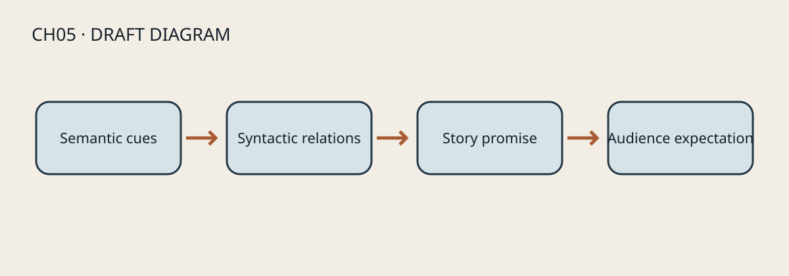
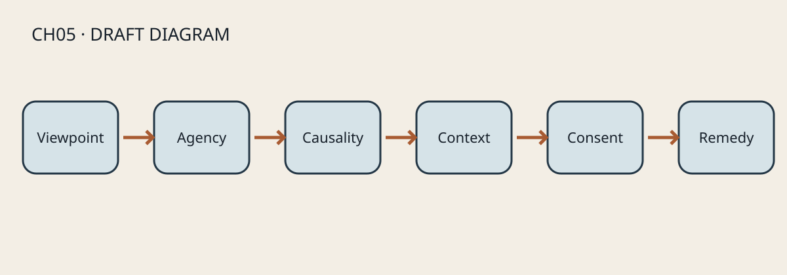

# CH05｜類型、再現與影視倫理 {#CH05-S00}

> 狀態：研究草稿；繁中主稿。理論解讀、案例觀片、權利與雙語稿均待全書完稿後集中人工審查。

## 學習目標 {#CH05-S01}

完成本章後，讀者能辨識類型慣例與變體、分析影像如何建構人物和群體的意義、以製作流程檢查再現風險，並把倫理要求轉成可追蹤的創作決策。適用於編劇、導演、製片、剪輯、影像研究者與生成式影片創作者。

## 先備知識 {#CH05-S02}

建議先理解鏡頭、場面、剪輯和電影形式（CH01–CH04）。不要求預先採用特定政治立場；分析時須能區分可觀察的形式證據、理論解釋與個人價值判斷。

## 核心術語 {#CH05-S03}

| TERM ID | 中文 | English | 工作定義 |
|---|---|---|---|
| TERM-CH05-GENRE | 類型 | genre | 由文本特徵、產業分類及觀眾期待共同形成、會隨歷史變動的分類方式。 |
| TERM-CH05-SEMANTIC | 語義元素 | semantic elements | 可辨識的題材、角色、道具、場景、聲音或視覺母題。 |
| TERM-CH05-SYNTACTIC | 結構關係 | syntactic relations | 類型元素彼此形成的衝突、因果、價值或敘事關係。 |
| TERM-CH05-REPRESENTATION | 再現 | representation | 影像與聲音透過選擇、編碼和脈絡，使人物、群體或事件獲得可被解讀的意義。 |
| TERM-CH05-STEREOTYPE | 刻板印象 | stereotype | 將群體差異簡化為固定、重複且容易辨認的特徵組合；需分析其形式與情境，不能只以詞彙標籤代替論證。 |
| TERM-CH05-AGENCY | 行動能動性 | agency | 角色在敘事中設定目標、採取行動、造成後果或改變局勢的空間。 |
| TERM-CH05-ETHICAL-REVIEW | 倫理審查 | ethical review | 在開發、拍攝、生成、剪輯與發行各階段辨識受影響者、權力差異、同意、傷害及補救方式的流程。 |
| TERM-CH05-CONTEXTUALIZATION | 脈絡化 | contextualization | 提供理解影像來源、創作條件、觀點與限制所需資訊，避免把局部描寫當成群體全貌。 |

## 歷史與基本原理 {#CH05-S04}

### 類型是動態契約，不是固定清單

類型研究可同時觀察可辨認的元素和元素之間的敘事關係。Altman 提出的語義／句法分析，有助於避免只靠服裝、道具或場景替電影貼標籤：例如「西部片」可有荒野、馬匹等語義線索，也可由法律秩序、暴力與共同體的關係構成句法模式。此模型是分析工具，不代表所有作品都能被一個類型完整收納；分類也會受產業行銷、歷史語境與觀眾使用影響。[R039] 下文以西部片作為本章的示意套用，不是 Altman 原文例證；在未核讀全文前，不將該例歸於 Altman。

### 再現涉及選擇與意義生產

Hall 編著的《Representation》以再現作為文化意義形成的系統為核心議題，並涵蓋影像、語言與論述；Google Books 目錄列出 Hall 的〈The Work of Representation〉自第 13 頁開始，下一章自第 75 頁開始。[R040] 本章以下「誰擁有視點、誰能說明自身、誰推動因果、誰被觀看或被解釋、哪些制度脈絡缺席」是供創作者使用的分析提問，不是 Hall 的逐字分類，也不是對單一作品作道德判決的量表；採用版本的逐頁論證仍須核對。

### 影視倫理是製作決策的持續管理

本章採取實務原則：倫理不是片尾聲明，而是反覆檢視同意、權力、隱私、傷害、可近用性、文化脈絡與問責的製作活動。BFI 的多元標準提供影視產業中改善機會與再現的機構框架；適用對象、資助條件與地方法規各異，不能直接當作所有地區的法律規範。[R041] UNESCO AI 倫理建議強調人權、尊嚴、多元包容、透明與人類監督；本章將它用作 AI 影像流程的高層原則，不把建議文件誤稱為個別司法管轄區的法律。[R042]

{#CH05-FIG-001 fig-alt="類型分析圖：語義線索經由結構關係連到故事承諾及觀眾期待。"}

**圖 5-1｜類型語義與敘事結構。** 本圖為專案原創示意圖，非電影劇照；待人工編輯、技術與出版權利審查。

## 傳統製作方法 {#CH05-S05}

開發時先寫出故事承諾與類型期待，再列出作品要沿用、混合或反轉的慣例；人物設定以具體目標、選擇和後果取代身分標籤。前期研究可邀請相關社群顧問或當事人參與，明確說明角色、報酬、使用範圍和退出方式。拍攝需管理知情同意、未成年人保護、私密場景、危險行為與敏感資料；剪輯和宣傳再檢查是否抽離脈絡、誤導觀眾或違反原先承諾。不同製作規模與法域的程序不同，應向當地專業人員核實。

## AI 時代的技術轉換與限制 {#CH05-S06}

生成模型能依提示生成角色、場景、台詞或影像變體，但不能自行證明呈現公平、代表性充分、同意有效或權利清楚。訓練資料與模型行為未必對創作者透明；一次生成結果也不是群體經驗的代表性樣本。把生成式模型視為需要監督的製作工具：限制輸入個資及未授權肖像，記錄模型／版本／提示詞／挑選理由，對不同角色做對照檢查，並由知情的人類審查者評估。這些是風險控制建議，不是任何模型能力的保證。[R042]

## 逐步工作流程 {#CH05-S07}

1. **界定作品與受影響者**：說明類型、受眾、角色群體、拍攝／生成方式及發行場景。
2. **建立慣例圖**：分列語義元素、敘事關係、觀眾期待、採用慣例及刻意變形；避免把市場標籤當成美學定論。
3. **建立角色證據表**：記錄角色目標、選擇、能力、因果影響、視點、對白權限與故事結局；按情節功能比較，不只計算出場次數。
4. **標示風險與未知**：評估刻板化、挪用、隱私、創傷再現、錯誤暗示、合成肖像與授權缺口；逐項標明可能傷害、受影響者和可採取的補救。
5. **設置協作與同意**：指定顧問／社群參與的範圍、報酬、決策權、撤回條件及資料保存期限；參與不等於替整個群體背書。
6. **製作與版本記錄**：保存劇本、提示詞、生成或拍攝素材來源、修改理由、審查意見和版本差異。
7. **剪輯與發布前複核**：以完整情境檢視畫面、聲音、字幕、預告和縮圖；確認同意範圍、權利鏈、揭露與補救機制。
8. **發布後回應**：建立觀眾回饋和更正渠道，記錄可處理及不可處理事項，必要時修訂或撤下素材。

## 提示詞與技術參數 {#CH05-S08}

模型中立的分析提示詞範本（示範，不是已驗證工具指令）：

```text
任務：分析以下虛構場景草稿的類型慣例與角色能動性，不替任何真實群體下代表性結論。
輸入：{以去識別化方式描述場景；不輸入未授權肖像或敏感個資}
輸出欄位：可觀察形式證據｜推論｜不確定性｜可能傷害｜需諮詢對象｜修訂方案。
限制：每項推論標示依據；不得由單一角色推及整個群體；不得宣稱法律合規或權利已清除。
版本：記錄實際模型、版本、日期、參數、提示詞雜湊與人工修改；未實測欄位填「未測」。
```

不提供虛構的溫度、種子或影像模型參數；應依所用工具官方文件和實測記錄。提示詞輸出只能作審查線索，不能代替社群諮詢、法律意見或作者責任。

## 電影案例與觀察練習 {#CH05-S09}

### 類型案例：*Get Out*（2017）—觀片待辦

BFI《Sight and Sound》影評作者 Trevor Johnston 將本片描述為以恐怖敘事承載社會諷刺與當代議題；這裡引用的是具名評論者的二手解讀，不是本書作者的獨立鏡頭分析。[R045] BFI 片目可核對片名、年份、導演與片長，但不能代替看片或支持本書作者的鏡頭層級主張。[R044] 作者選定合法版次實際看片後，應另記版本、觀看日期及可重現的片段 locator，並區分觀察與解讀；在此之前不填時間碼或聲稱已看片。

### 再現案例：BFI 的影視再現教學框架

BFI 教育活動頁說明其 2026 年 11 月 27 日的 KS5 影視研究活動將討論性別、種族、族裔、身心障礙、地域性與年齡如何和類型及作者性互動。[R043] 這是特定日期的機構教育活動說明，不代表活動已舉行，也不是普遍評量標準或對單一作品／社群的實證結論。

## 常見錯誤與品質檢查 {#CH05-S10}

- 以一種視覺符號判定類型：改為同時記錄元素、關係與觀眾期待。
- 以出場人數代表平等：補查視點、行動、因果、對白與角色結局。
- 將顧問意見當成群體同意：限定其專業與參與範圍，保留異議並給予報酬。
- 把生成影像當成無偏或可自由使用：保存 provenance，檢查相似性、同意、資料與授權。
- 把模型的倫理評分當作合規證明：只當作需人工核查的提示，不產生自動 PASS。
- 把批判性解讀寫成可驗證史實：分開可觀察證據、理論推論和價值判斷，為每種主張標示證據類型。

品質紀錄至少包含：作品範圍、分析者、場景版本／locator、角色證據、風險項目、諮詢紀錄、同意與權利狀態、未解問題、責任人及複核日期。法律合規、代表性與傷害判斷須由適任專業人士及相關參與者審核。

{#CH05-FIG-002 fig-alt="六項審查面向：視點、能動性、因果、脈絡、同意與補救。"}

**圖 5-2｜影視再現與倫理審查。** 本圖為專案原創示意圖，非電影劇照；待人工編輯、技術與出版權利審查。

## 練習、評量與延伸研究 {#CH05-S11}

**練習 A｜類型慣例轉化**：選一段自創場景，列出三個語義元素、兩個句法關係、一項觀眾期待及一項反轉。不得複製現成電影鏡頭。

**練習 B｜角色能動性審查**：挑選一部可合法觀看的作品，選定三個角色，依目標、選擇、因果、視點、對白與結局做證據表。引用時間碼前先核對同一版次。

**評量規準（0–2 分，各項）**：形式證據具體；事實與推論分開；類型元素／關係均有分析；角色因果與視點有證據；提出可執行倫理補救。總分 8–10 為可進入同儕複核，5–7 需補證據，0–4 重做。分數不等同倫理認證。

延伸研究：類型混合與串流平台分類的關係；不同文化脈絡中再現研究的適用限制；AI 生成訓練資料透明度、同意與聲音／肖像合成治理。研究問題應限定語料、時間、平台和方法。

## 參考資料 {#CH05-S12}

- [R039] Altman, Rick. “A Semantic/Syntactic Approach to Film Genre.” *Cinema Journal* 23(3), 1984, 6–18. DOI: 10.2307/1225093. 本次核對 JSTOR 書目與摘要；全文及頁碼論證需人工核讀。
- [R040] Hall, Stuart, ed. *Representation: Cultural Representations and Signifying Practices*. SAGE, 1997. 本次核對出版者／書目資料；指定章節頁碼未核。
- [R041] British Film Institute, “BFI Diversity Standards.” 官方說明頁；查閱 2026-10-20。標準適用資格與現行版本需按專案再核。
- [R042] UNESCO. *Recommendation on the Ethics of Artificial Intelligence*. 2021. 官方原則與文件；本章不作法律意見。
- [R043] British Film Institute, “Representation for KS5 Film and Media Studies.” 官方教育活動頁，查閱 2026-10-20；頁面時效及完整教學材料待核。
