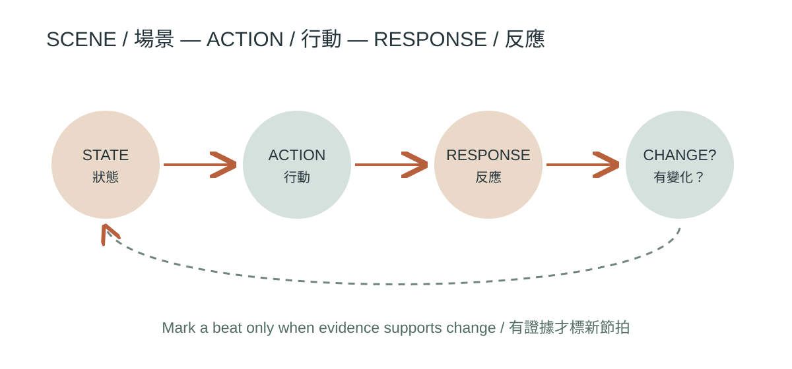
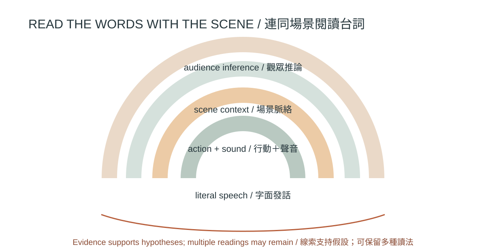

# 場景、節拍、對白與潛台詞

> 編輯狀態：研究草稿；英文稿為工作譯稿。案例以可追溯評論與片目為依據，尚未記錄作者觀看片版次或鏡頭時間碼；圖像權利待審。

## 學習目標 {#CH08-S01}

完成本章後，讀者能夠：

1. 把一場戲拆成可觀察的行動、反應與策略變化，而不把「節拍」誤當固定長度或標點符號。
2. 區分角色說出的字面內容、當下目的、對手收到的訊息與觀眾可能推論的潛台詞。
3. 以人物目標、阻礙、權力關係、場景轉變和可拍攝行為診斷場景。
4. 修訂對白，使語氣、停頓、動作、空間與聲音共同承載資訊，避免讓角色逐字解說畫面已經表達的內容。
5. 使用 AI 協助提出替代方案與一致性問題，並由編劇、導演及演員判斷哪些選擇符合人物、文化脈絡和全片形式。

## 先備知識 {#CH08-S02}

建議先熟悉 CH06 的事件因果與敘事資訊，以及 CH07 的人物目標、阻力、選擇和角色行動。本章以場景為工作單位，假設讀者知道場次標頭、動作描述、角色名、對白和括號提示等基本劇本格式；不同地區、媒介與製作流程的格式慣例可能不同。

## 核心術語 {#CH08-S03}

| TERM ID | 繁體中文 | English | 本章工作定義 |
|---|---|---|---|
| TERM-CH08-SCENE | 場景 | scene | 在劇本分析中，以相對連續的時空與戲劇行動為單位的工作段落；剪輯後電影的場景界線可由敘事分析者另行判定。 |
| TERM-CH08-BEAT | 節拍 | beat | 本章採用的實務標記：角色行動、策略、資訊或關係出現有意義變化的時刻。不同作者對 beat 的界定不完全相同。 |
| TERM-CH08-SUBTEXT | 潛台詞 | subtext | 字面發話以下、由語境與可觀察線索支持的一種可能意義；不是作者可以任意宣稱、也不是觀眾必然讀到的唯一答案。 |
| TERM-CH08-SCENE-OBJECTIVE | 場景目標 | scene objective | 角色在當下場景試圖取得、避免或改變的具體結果；可由言語或行動推論，應標明推論依據。 |
| TERM-CH08-TACTIC | 策略／手段 | tactic | 角色為影響他人或環境而採用的可見言行，例如試探、轉移、交易、拒絕或沉默。 |
| TERM-CH08-TURN | 場景轉折 | scene turn | 場景中目標、資訊、權力或關係狀態產生足以改變後續行動的轉變；不必每場戲都採單一明確轉折。 |
| TERM-CH08-PLAYABLE-ACTION | 可表演行動 | playable action | 演員可透過行為執行、導演可觀察和調整的動詞式行動意圖；它不是要求演員製造某種情緒。 |
| TERM-CH08-OVERLAP | 對白重疊 | overlapping dialogue | 兩位或以上說話者的語音在時間上交疊；需由聲音、演員節奏及混音設計共同實現，劇本標示只是製作溝通的一部分。 |

## 歷史與基本原理 {#CH08-S04}

電影對白不是獨立於畫面、表演和聲音的文字層。Sarah Kozloff 對美國敘事電影對白的研究，將對白放回敘事功能、風格與類型脈絡；她也指出電影研究長期較少系統討論電影中的語言（R065）。Bordwell 的電影敘事論述則提醒，人物動作、空間安排、剪接、聲音與對白都參與影片敘事，觀眾由這些形式線索推論故事世界（R051）。因此，劇本頁面上的一句話只是預定成片的部分材料，不能單靠逐字稿判定完整表演效果。

「節拍」與「潛台詞」是常見創作／排演工具，但不是跨學派統一量尺。Screenplayology 對場景分析的教學頁整理了不同作者的 beat 定義：有人以主題改變說明，有人以角色行動變化或行動／反應交換說明（R061）。Paolo Braga 將電影對白潛台詞與主題、角色缺陷、隱藏議程及戲劇反諷連結，這是他提出的分析架構，不是所有電影都必須套用的分類法（R059）。編劇可把節拍當作可修訂的註記；若一段戲靠停滯、重複、沉默或拒絕建立效果，不應為了增加節拍數而硬切分。

可把一場戲理解為幾個互相作用的層面：當下目標與阻力、角色採取的策略、對方如何回應、話語字面意思、身體與空間行為、觀眾目前掌握的資訊，以及場景結束時哪些條件改變。潛台詞應由可指認的線索支持，例如迴避問題、過度精確的措辭、動作與語言不一致、話輪控制、沉默、視線或道具使用。單一線索通常不足以證明唯一意義；觀眾文化、語言和類型經驗也會改變解讀。

## 傳統電影製作方法 {#CH08-S05}

1. **先讀全篇，再讀場景。** 記錄這場戲承接的資訊、人物關係與前後狀態，避免把局部台詞孤立成金句。
2. **寫出場景可觀察目標。** 對每位主要人物分別寫「想讓誰做什麼／避免什麼」，並標記這是劇本明示或分析者推論。
3. **找出阻力與策略。** 把策略寫成可演的動詞，而非抽象情緒標籤；當策略或行動反應真的改變時，才考慮標新節拍。
4. **追蹤話語與行為的差距。** 問角色是否直說、迴避、反問、重述、轉移到具體事務，或用動作代替回答。不要把「真心話必定藏在反話裡」當公式。
5. **用讀本、桌讀和排演測試。** 讓演員先按自身理解讀，再討論文本證據；由導演決定調度、停頓、重疊、視線和可替代方案。
6. **在片場與後期記錄變更。** 演員即興、場景調整、收音與剪接會改變對白的節奏和意義；以場次、版本及核准人保存修改，並同步劇本、場記和剪輯參考。

這套流程是實務建議，不是每個劇組都採同一工序。紀錄片、即興表演、動畫配音、多語片和非對白電影，都需依創作方法調整。

## AI 時代的技術轉換 {#CH08-S06}

語言模型能依輸入整理場景摘要、列出可能的衝突／策略變化、提出多種語氣版本或檢查連續性；這些輸出是待作者挑選的候選方案，不是對人物內心的事實判讀。Mirowski 等人描述的 Dramatron 以階層提示串接標題、角色、場景摘要、地點和對白，並由 15 位戲劇／電影業專業人士參與共同創作研究；研究亦記錄長程一致性、刻板印象、邏輯缺口和潛台詞不足等限制（R062）。這是 2023 年特定系統與研究設計的結果，不可直接推論所有現行模型或今日產品表現。

適合交給 AI 的工作：按作者提供的場景事實生成不同策略草案；標記明確重複、未回應問題或人物稱謂不一致；把台詞縮短、改成不同語域供作者比較；將人工核准的 scene card 轉成 JSON 或表格。必須由人決定的工作：何者是真正的次文本、笑點或沉默是否有效、方言與階級／族群聲音是否刻板、台詞是否符合演員和文化脈絡、以及是否保留創作者的聲音。

AI 使用前先去識別化未公開劇本和個資，確認服務資料保留及授權政策；不得把未授權劇本、受保護電影對白或敏感資料貼入未核准服務。保留輸入片段、模型／版本、日期、提示詞、原始輸出、人工採納與刪改記錄。生成內容可能模仿訓練資料或複製常見套路；相似性和權利狀態須另行審查。

## 詳細工作流程 {#CH08-S07}

| 步驟 | 操作 | 產出與驗收 |
|---|---|---|
| 1. 鎖定上下文 | 記錄劇本版號、場次、前後場因果、人物已知資訊及不能改動的事實。 | 有可追溯場景 ID；不混用不同稿版。 |
| 2. 建立場景卡 | 記錄時空、參與者、進場狀態、場景目標、主要阻力和離場狀態。 | 每個推論標明文本證據或標成待確認。 |
| 3. 標出行動反應 | 逐輪記錄誰採取什麼策略、對手如何回應、資訊或關係是否變化。 | 節拍只標在可辨識的變化點；允許長段不變或無語言行動。 |
| 4. 分析話語層 | 為關鍵台詞列字面功能、對象、可能意圖及另一種合理解讀。 | 潛台詞不超出文本線索，保留多義性。 |
| 5. 分析可拍層 | 檢查動作、視線、距離、道具、環境聲、停頓與畫面資訊是否補充、抵觸或重複對白。 | 每個抽象意圖至少能轉成可排演／拍攝的選擇，或明列為內心資訊。 |
| 6. 人工寫初稿 | 由編劇寫出可說出口且符合角色語域的台詞，再朗讀檢查節奏與可理解度。 | 不用說教台詞代替戲劇行動。 |
| 7. 產生替代稿 | 如需 AI，輸入去識別化、有限上下文和明確限制；要求多個差異清楚的版本，不要求「最佳潛台詞」。 | 輸出以候選案標記，不回寫 canonical 稿。 |
| 8. 讀本與修訂 | 編劇、導演、演員檢查可說性、可演性、權力關係和文化語境；確認誰有權批准改稿。 | 保存選擇理由及被拒絕版本，不把模型建議當權威。 |
| 9. 連續性檢查 | 核對稱謂、物件、資訊掌握、出入場、時間、前後場承諾和台詞版本。 | 變更同步到分場表、拍攝稿、場記及剪輯參考。 |
| 10. 鎖稿 | 由負責編劇／製作流程標記稿版與鎖稿日期；修改重開版本並留差異。 | 不以本章模型或自動化測試代替編劇及劇組核准。 |

{#CH08-FIG-001 fig-alt="原創向量流程圖把場景狀態連到行動與反應；只有目標、策略、資訊或關係出現可辨認變化時才標記節拍，並回到新的場景狀態。"}

**圖 8-1｜場景節拍可作為行動／反應與狀態改變的分析註記，不能當固定公式。本圖為本書原創可編輯 SVG 示意圖，非電影劇照或特定電影鏡頭；權利與出版核准待審。**

## 提示詞與技術參數 {#CH08-S08}

以下為模型中立示範提示詞，不是已測試的供應商規格；未指定 temperature、token 上限或工具功能。請先替換虛構示例，並遵循所用工具的現行官方文件與資料規範。

```text
角色：你是劇本分析助理，不是本場戲的作者或最後裁判。
任務：只根據我提供的虛構場景資料，列出場景目標、阻力、行動／反應變化、字面對白功能，以及最多三種有文本線索支持的次文本假設。
限制：
- 不補寫未提供的背景、人物心理事實或電影知識。
- 將明示事實、合理推論、創作候選案分開標記。
- 不複製任何既有電影台詞或特定作品風格。
- 若資訊不足，寫 unknown 並提出需要作者回答的問題。
- 不替作者選「最佳」解讀，不把沉默自動解釋為同意。
輸出 JSON：scene_id, evidence, beats[{trigger, action, response, state_change}],
dialogue_options[{surface_function, possible_intent, evidence, alternative_reading}],
continuity_flags, stereotype_risks, human_questions。
```

示範資料應使用虛構人物與原創台詞。若由程式解析回傳資料，先用 JSON Schema 驗證欄位型別、必要欄位和未知值；結構有效只代表資料可讀，不代表戲劇判斷正確。所有「潛台詞」欄位都要保留證據及替代解讀。

## 電影案例分析 {#CH08-S09}

### 《Sweet Smell of Success》（1957）

Hikari Morimoto 專文分析影片對白中的潛台詞，將其連結到角色關係與主題；文章摘要指出劇本由 Clifford Odets 改寫，並討論表層言語和隱含意義（R058）。Criterion Collection 收錄導演 Alexander Mackendrick 的教學材料，提醒讀者即使影片充滿對白，調度、攝影、燈光、道具和演員行動仍能承擔敘事資訊（R064）。兩來源提供互補的分析入口：一是台詞如何運作，二是影像如何不靠台詞完成工作。本章未記錄作者親看片版次或場面時間碼；上述為具名來源的觀點，不宣稱唯一解讀。

### 《His Girl Friday》（1940）

AFI Catalog 記錄其 1940 年上映資料、源自《The Front Page》的改編關係和劇情梗概，並描述 Walter 以謊言和工作任務試圖留下 Hildy 的情節策略（R063）。此案例可供練習拆分場景目標、交易、說服與權力關係；不要把片目摘要當成正式逐字稿，也不要在未觀片前聲稱某個鏡頭、表演節拍或精確台詞發生於特定時間。

兩個案例都不是模仿模板。學生應挑選合法觀看版本，記錄發行／修復版、字幕、片長、觀察者及可重現時間碼，再比較劇本線索、表演、空間、聲音和剪接如何共同塑造觀眾推論。不得將案例台詞搬入生成提示詞或產出仿寫。

{#CH08-FIG-002 fig-alt="原創同心弧線圖呈現字面發話、可觀察行動與聲音、場景脈絡及觀眾推論四層；潛台詞假設需回指線索，並容許多種讀法。"}

**圖 8-2｜潛台詞分析要從字面台詞回到行為和語境證據，也要保留不同觀眾的合理讀法。本圖為本書原創可編輯 SVG 示意圖，非電影劇照或特定電影鏡頭；權利與出版核准待審。**

## 常見錯誤與品質檢查 {#CH08-S10}

| 錯誤 | 為何有問題 | 修正／可檢驗方法 |
|---|---|---|
| 每句台詞都加一個節拍 | 把節拍變成行數或標點，失去行動變化功能。 | 對照前後行動與反應；若狀態未變，不必新標。 |
| 把潛台詞當唯一祕密答案 | 觀眾可能依文化、類型和先前資訊採不同讀法。 | 提供支持線索、至少一個替代讀法及尚未知資訊。 |
| 角色說出已由畫面清楚提供的資訊 | 造成重複解說，削弱視聽分工。 | 靜音讀場或遮去台詞做比較；再確認關鍵敘事資訊是否仍可理解。 |
| 人物只靠機智台詞而沒有目標 | 場景像金句拼接，行動缺乏因果。 | 每個重要話輪檢查其對目標、阻力或關係的作用。 |
| 用括號指示表演情緒或微表情 | 可能限制表演且把心理當成唯一可見解讀。 | 將可演行動寫清楚；只有必要製作資訊才保留括號提示。 |
| 用 AI 輸出充當人物內心診斷 | 模型會補足缺失資訊、強化套路或忽略脈絡。 | 要求證據欄和 unknown；由編劇／演員核對，不直接納入劇本。 |
| 把某文化的含蓄、沉默或語域視為普遍規則 | 可能抹除語言差異、權力關係與個人風格。 | 邀請相關語言／文化顧問或熟悉脈絡的讀者審查。 |

自動化可檢查 scene ID、對白格式、角色名、必要欄位、稿版與連續性資料；無法自動判定潛台詞是否有趣、表演是否真誠、沉默是否清楚、角色聲音是否獨特或作品是否倫理妥當。這些項目須標示人工審查，不得因結構測試通過就宣告內容品質合格。

## 練習、評量與延伸研究 {#CH08-S11}

### 練習

1. **節拍標註：**選一段自有或已獲授權的 1–2 頁場景。以顏色標出目標、阻力、策略及每個可證明的行動／反應變化。另寫一種反對你初判的解讀。
2. **雙稿對照：**寫一段原創的兩人談判。版本 A 讓角色直說目標；版本 B 保留相同事實和結果，但以行動、轉移話題或具體事務建立不同語用效果。找讀者盲讀，記錄他們推論與你預期的差距。
3. **AI 審稿實驗：**只提供虛構短場景，要求模型產生三種策略替代稿。記錄模型新增的背景、刻板印象、語意漂移及作者最後採納／拒絕的理由；不得用模型判定「正確潛台詞」。
4. **視聽拆分：**將自有場景暫時移除對白，列出仍可透過動作、空間、物件和聲音傳達的資訊，再決定哪些資訊確實需要言語。

### 評量規準（每項 0–2 分）

- 目標與阻力有場景證據，且人物目標彼此可區分。
- 節拍標記對應可觀察的策略／反應變化，沒有為數量硬切。
- 潛台詞分析引用台詞、行為或語境線索，並承認替代讀法。
- 對白、表演行動、空間及聲音分工合理，沒有無必要的重複解說。
- AI 輸出保留為候選案，能指出作者決策、風險和版本記錄。

0 = 缺漏或無證據；1 = 有部分依據但尚未穩定；2 = 證據明確且能解釋選擇。分數用於教學回饋，不是普遍藝術價值量表。

### 延伸研究

- 比較電影敘事學、對白研究與編劇實務對「場景」和「節拍」的不同用法。
- 研究潛台詞與語用學、會話輪替、間接言語行為、階級、語域和多語字幕翻譯的關係。
- 以可重現的編劇／業界參與研究檢驗 AI 共同寫作的作者控制、偏見、長程一致性與作品權利問題；區分受試樣本與產品宣稱。

## 參考資料 {#CH08-S12}

- [R051] Bordwell, David. “Three Dimensions of Film Narrative.” In *Poetics of Cinema*. Routledge, 2007. 作者公開章節；印刷頁碼與採用版次須由編輯核對。 https://www.davidbordwell.net/books/poetics_03narrative.pdf
- [R058] Morimoto, Hikari. “The Art of Subtext: Examining the Film Dialogue in *Sweet Smell of Success*.” *Cinema Studies* 18 (2023): 26–41. https://doi.org/10.20758/jscsj.18.0_26
- [R059] Braga, Paolo. “Mapping Subtext by Using Thematic Coordinates.” *JOMEC Journal* 13 (2019): 51–69. https://doi.org/10.18573/jomec.187
- [R060] Batty, Craig, and Wilf Hashimi. “Look Who’s Talking: Using Transactional Analysis in the Writing of Effective Screenplay Dialogue.” In *Dialogue across Media*, edited by Jarmila Mildorf and Bronwen Thomas, 55–76. Dialogue Studies 28. John Benjamins, 2017. https://doi.org/10.1075/ds.28.04bat
- [R061] Gay, Andrew Kenneth. “1.3. The Director and the Screenplay.” *Screenplayology: An Online Center for Screenplay Studies*. Accessed 2026-10-21. Practitioner-oriented scene-analysis resource; its beat definitions are presented as differing approaches, not consensus. https://www.screenplayology.com/content-sections/screenplay-style-use/1-3/
- [R062] Mirowski, Piotr, Kory W. Mathewson, Jaylen Pittman, and Richard Evans. “Co-Writing Screenplays and Theatre Scripts with Language Models: Evaluation by Industry Professionals.” In *Proceedings of the 2023 CHI Conference on Human Factors in Computing Systems*, Article 355, 1–34. ACM, 2023. https://doi.org/10.1145/3544548.3581225
- [R063] American Film Institute. “His Girl Friday.” *AFI Catalog of Feature Films*. Catalogue entry checked 2026-10-21. https://catalog.afi.com/Film/4331-HIS-GIRLFRIDAY
- [R064] The Criterion Collection. “Mackendrick and Odets.” *Current*. Accessed 2026-10-21. https://www.criterion.com/current/posts/1762-mackendrick-and-odets
- [R065] Kozloff, Sarah. *Overhearing Film Dialogue*. University of California Press, 2000. Publisher bibliographic record checked 2026-10-21; page-specific claims require consultation of adopted edition. https://www.ucpress.edu/books/overhearing-film-dialogue

以上來源提供可追溯的學術、出版社、機構片目及具名教學材料。未查閱全文或未核版次的定位限制已明列；影片版次和逐鏡時間碼由作者／編輯另行核實。
