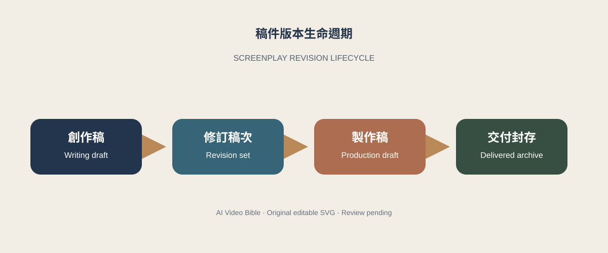
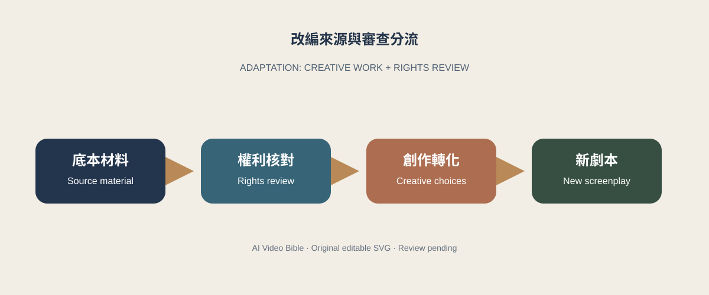

# 劇本格式、改編與版本管理 {#CH10-S00}

> 編輯狀態：繁體中文研究草稿；英文為工作譯稿。來源僅支持明列範圍；頁碼、全文解讀、電影版本／時間碼待查。圖稿為原創 SVG 草稿，權利及出版核准待辦。

## 學習目標與適用對象 {#CH10-S01}

完成本章後，讀者能夠：

1. 說明劇本格式如何服務閱讀、排演、估算和部門交接，並辨認不同市場與製作階段的差異。
2. 區分改編材料、已取得權利、創作轉化和待法律確認事項；完成劇本不代表已取得改編權。[R072]
3. 維護含日期、作者、稿次、修改摘要及影響場景的版本紀錄。
4. 以穩定場景 ID 比較稿件，將格式、連續性與創作決策分流處理。
5. 評估 Fountain 等文字標記格式是否適合作為特定專案交換檔，並先測試轉檔樣本。[R075]

適用於編劇、導演、製片、劇本統籌及跨部門稿件協作者。先備知識為基本場景標題、動作、角色名及對白；不假設所有人使用同一軟體或慣例。

## 先備知識 {#CH10-S02}

建議讀者熟悉場景、動作、角色名、對白及基本劇本閱讀。改編權利並非劇本格式課程的先備條件；涉及既有作品時，權利狀態應從研究開始單獨登錄。

## 核心概念與專業術語 {#CH10-S03}

| 術語 ID | 繁體中文 | English | 工作定義 |
|---|---|---|---|
| TERM-CH10-SCREENPLAY | 電影劇本 | screenplay | 供創作、閱讀及製作溝通的文本；格式服務於工作情境，不表示影像逐字照拍。[R070] |
| TERM-CH10-SCENE-HEADING | 場景標題 | scene heading | 標示內外景、地點、時間等資訊的場景起始行；欄位依採用規格或團隊約定。 |
| TERM-CH10-SLUGLINE | 場景行／slugline | slugline | 劇本場景標題的常見業界稱呼；地區與格式間用語可能不同。 |
| TERM-CH10-ADAPTATION | 改編 | adaptation | 將既有材料重新組織為另一作品形式；創作方法和權利狀態是不同問題。[R072] |
| TERM-CH10-DERIVATIVE-WORK | 衍生作品 | derivative work | 美國著作權法定義中，改編、轉換或改作既有作品的作品；不代表其他法域法律意見。[R072] |
| TERM-CH10-REVISION-SET | 修訂稿次 | revision set | 製作中標示特定稿次及其變更的工作慣例；顏色和標記須由劇組定義。[R073] |
| TERM-CH10-LOCKED-PAGES | 鎖定頁 | locked pages | 製作中維持頁碼參照的版本管理方式；時點及程序依工作流程而定。[R074] |
| TERM-CH10-SCREENPLAY-INTERCHANGE | 劇本交換格式 | screenplay interchange format | 在工具間傳遞劇本文字與結構的格式或約定；轉檔後須檢查元素、分頁及註記。[R075] |

詞條均為本書工作定義草案，待雙語術語編輯核定。Academy Nicholl 指出專業寫作者的格式存在差異；其指南是參考，不是全球強制標準。[R070]

## 歷史與基本原理 {#CH10-S04}

劇本頁面同時是敘事文本和協作介面。場景標題協助劇組定位內外景、地點與時間；動作、角色名及對白便於閱讀、排演和估算工作。格式可降低交接成本，不能取代導演、演員、美術、攝影、製片及剪輯的討論。Academy Nicholl 的公開資源整理常見美國格式並承認寫作者有差異；應先遵守委託方、比賽或製作方規格，再以通行格式作預設。[R070]

創作稿與製作稿任務不同。純文字標記便於差異比較和保存；專業軟體可能提供分頁、修訂顏色、鎖頁及部門交付。Fountain 以可讀標記表示場景行、角色、對白、轉場及註記，官方規格描述其語法；這不保證所有軟體完整支援或轉檔逐頁一致。[R075]

改編創作要決定哪些材料保留、重組、刪除或重新表達；權利審查則確認誰可授權哪些地區、期間、媒介、語言及用途。美國著作權法將翻譯、戲劇化、電影化等列作衍生作品例子，衍生作品權利不會自動涵蓋未獲授權的底本。[R072] 這是美國法條概述，不是全球法律意見或權利鏈證明。

## 傳統製作方法 {#CH10-S05}

1. **確認交付規格：**記錄媒介、語言、頁面或軟體格式、檔名、版本命名、收件人與期限；有明文要求時依其規格。
2. **整理創作稿：**以場景標題、動作、角色名和對白提供可讀稿件。只寫有助故事、表演或製作決策的資訊，避免把每個攝影想法或未定細節寫成硬性命令。
3. **準備製作資料：**另維護角色／場景清單、拍攝需求、修訂摘要和未決問題。需要場景編號時，指定負責人與編號時點。
4. **管理修訂：**Final Draft 文件描述 Revision Mode 的增刪標記、修訂色彩及修訂集；具體用法與色碼須由劇組定義。[R073]
5. **適時鎖頁：**Final Draft 建議不要過早鎖定頁面，並將鎖頁放在前期準備／製作流程中考量。[R074] 鎖頁不等於內容不可變更。
6. **交付封存：**保存可讀稿、修訂摘要、版本識別、送件日期、源檔與 SHA-256，便於辨認實際使用稿。

### 改編材料登錄

建立底本名稱與版本、作者／權利人、取得方式、授權文件位置、地區／期間／媒介／語言、宣傳用途、署名條件及限制清冊。未知欄位標為待確認。另用轉化表記錄保留、合併、刪除、重排及新增；該表是編輯工具，不是法律判定。

## AI 時代的技術轉換與限制 {#CH10-S06}

在團隊核准且資料權利確認後，程式或模型可協助抽取場景標題、角色、重複詞、版本差異、缺漏欄位及待查問題。這是可試驗的流程，不是任何當前工具功能保證。不可把未授權底本、保密劇本或個資送入未核准服務；先核對服務現行條款、資料保留政策與團隊安全規定。

- **程式檢查：**必要欄位、穩定場景 ID、版本標記、引用是否存在、作者／日期紀錄和輸出可讀性。
- **模型候選整理：**在允許的文本範圍內產生差異摘要或疑點，逐項指向原始行號／場景 ID；不得自動寫回主稿。
- **人類決策：**改編權利、人物再現、情節取捨、表演意圖、鎖頁及正式交付由作者、製片或法律專業人員決定。

模型可能把全大寫動作誤判成角色名、將縮寫誤認為場景標題或漏看手工修訂標記。差異摘要只能提供核查線索；文字相似度不能證明抄襲、授權或作者意圖。

## 詳細工作流程 {#CH10-S07}

| 步驟 | 負責與操作 | 產出及檢查 |
|---|---|---|
| 1. 收件 | 劇本統籌記錄提交人、日期、語言、來源檔雜湊及存取限制 | 唯讀來源副本、來源 ID、權利狀態 |
| 2. 確認格式 | 編劇／製片確認收件規格、模板、稿次規則與工具 | 格式決策紀錄；歧義向收件方核實 |
| 3. 建立主檔 | 作者使用選定工具寫作，建立穩定場景 ID 或對照表 | 可編輯主檔、修訂 ID、日期 |
| 4. 登錄改編依據 | 製片／權利窗口核對權利人與書面授權；作者建轉化表 | 權利文件位置及待辦；完成稿不等於獲授權 |
| 5. 檢查稿件 | 助理／程式檢查格式、角色名、重複場景、引用和交付包 | 可重現檢查報告；疑點人工確認 |
| 6. 記錄修訂 | 作者命名稿次；製作期由指定人管理色彩、頁碼和鎖頁 | 變更摘要、差異、頁碼及受影響部門 |
| 7. 交換格式 | 以代表樣本測試 Fountain、FDX、PDF 等轉換，檢查場景、對白、註記、字元和分頁 | 轉檔清單及工具相容矩陣 |
| 8. 交付封存 | 製片指定正式包並保存源檔、PDF、版本識別及收件紀錄 | 可回復檔案包、雜湊清單、存取權限 |

建議最小 JSON 版本欄位：`project_id`、`document_id`、`revision_id`、`parent_revision`、`author`、`created_at`、`change_summary`、`changed_scene_ids`、`rights_basis`、`approval_state`、`source_hash`。這是本章示範，不是跨軟體標準。

## 提示詞與技術參數 {#CH10-S08}

以下為模型中立示範，不代表任何服務實測或特定參數。只輸入獲准使用的最小文本。

```text
角色：劇本版本整理助理，不改寫或核准稿件。
輸入：兩份已獲准比較的稿件、版本 ID、穩定場景 ID 對照表。
任務：列出新增、刪除、移動與文字變更，附場景 ID 及來源行號。
限制：不補寫故事、不推斷作者意圖、不判定抄襲或權利；無法配對則回報 unknown；原稿唯讀。
輸出 JSON：
{"from_revision":"...","to_revision":"...","changes":[{"scene_id":"...","kind":"added|removed|moved|text-change|format-change","source_lines":["..."],"summary":"...","human_review":"required"}],"unmatched_items":[],"limitations":[]}
```

先以 3–5 個代表場景試跑並逐項比對；記錄工具、版本、日期、輸入範圍及錯誤。程式 diff 也須記錄編碼、換行、正規化和工具版本。

## 電影案例分析 {#CH10-S09}

### 《綠野仙蹤》（The Wizard of Oz, 1939）

AFI Catalog 將 1939 年電影連結至 L. Frank Baum 的 1900 年小說 *The Wonderful Wizard of Oz*，並記錄多位編劇和製作過程的改動線索。[R076] 這提供研究問題：人物動機如何改變、段落如何重組、哪些表達由文字轉為電影媒介。本文只根據目錄的書目及製作史資訊，不宣稱已觀看片源、確認個別作者意圖或取得完整劇本。

**分析練習：**使用合法取得的小說和電影版本，選短段落建立「底本事件／影片對應／媒介轉換／保留或刪除／效果假設」五欄表，逐項記頁碼或時間碼。權利狀態另行核查；某版本可取得不代表已獲電影改編權。

比較任何改編作品時，可分開研究底本事件、劇本結構、視聽表達與權利脈絡。鏡頭／表演分析須指定版本和觀片紀錄；法律結論須由適用法域專業人士審查。片目摘要或 AI 摘要不能代替全文或作品本身。

{#CH10-FIG-001 fig-alt="四個稿件版本節點以箭頭連接，呈現創作稿、修訂稿、製作稿和交付封存。"}

**圖 10-1｜版本需追溯來源、作者、變更和交付狀態；流程是本書工作模型。本圖為原創可編輯 SVG 示意圖，非電影劇照；署名、權利及出版核准待審。**

{#CH10-FIG-002 fig-alt="流程圖分列底本材料、權利審查、創作選擇及新劇本，並標示法律審查閘門。"}

**圖 10-2｜創作轉化紀錄與權利審查分開留存；圖示不構成法律意見。本圖為原創可編輯 SVG 示意圖，未描繪特定作品；權利與出版核准待審。**

{#CH10-FIG-003 fig-alt="流程圖比較同一場景 ID 的前稿和改稿，產生差異摘要後交由人員判讀。"}

**圖 10-3｜差異工具提供核對線索，作者判斷是否採納及影響部門。本圖為原創可編輯 SVG 示意圖，非正式劇本頁面；權利及出版核准待審。**

## 常見錯誤與品質驗證 {#CH10-S10}

| 錯誤 | 風險 | 檢查 |
|---|---|---|
| 將單一格式當全球規則 | 不符合收件規定 | 確認要求並記錄格式決策。[R070] |
| 過早鎖頁或重編號 | 部門頁碼／場次參照失效 | 設定鎖頁時點，逐稿核對。[R074] |
| 將修訂色彩當通用標準 | 劇組誤讀稿次 | 在交付說明定義色彩及版本識別。[R073] |
| 把改編表當授權證明 | 權利及發行風險 | 由法律專業人員核對權利人、範圍及文件。[R072] |
| 轉檔只看字數 | 場景、對白、註記或分頁遺失 | 抽查代表場景、雙語字元、標記和頁面。[R075] |
| AI 差異摘要自動寫回主稿 | 未核准建議進入正式稿 | 分開保存分析結果；指定作者修改並留紀錄。 |

**可自動驗證：**metadata、S01–S12 對齊、引用與術語 ID、圖片路徑／雜湊／SVG XML、雙語圖說和 alt、網站路由及草稿格式。**需人工判斷：**收件方格式符合度、改編創作效果、案例解讀、文化再現、權利鏈、頁面校樣、英文語感及作者核准。不得將人工項目報為自動 PASS。

## 練習、評量與延伸研究 {#CH10-S11}

1. **格式拆解：**用合法可取得的一頁劇本，標示場景、動作、角色、對白、轉場與版本資訊，記錄來源，不大量複製文本。
2. **改編對照：**選有合法文本與看片來源的作品，完成五欄轉化表，註明版本和頁碼／時間碼；未核實處保留未知。
3. **版本差異：**為兩段自有短稿建立場景 ID，比較增刪、移動、格式修正與敘事改變。
4. **交換測試：**建立含內外景、中文角色名、雙語對白、括號、場景編號和註記的小樣，實測兩工具轉換並記錄損失。
5. **權利演練：**以虛構底本填寫來源／授權清單，未知欄位標待確認；不作法律建議。

評量各項 0–2 分：交付與版本可追溯；創作轉化與權利狀態分開；差異連回場景 ID；轉檔測試指出實際損失；人機責任和待辦明確。0 無證據、1 部分可追溯、2 步驟來源限制完整。此量表評估紀錄，不衡量藝術品質。

延伸研究：比較不同國家／媒介的交付規則；查閱劇本工具現行匯入／匯出文件並記錄版本；合法取得底本與影片後作場景比較；研究版本管理對劇組交接和創作決策的影響。

## 參考資料 {#CH10-S12}

- [R070] Academy of Motion Picture Arts and Sciences, “Nicholl Screenwriting Resources,” https://www.oscars.org/nicholl/screenwriting-resources. 格式指引與格式差異說明，僅在該頁範圍內引用。
- [R071] Writers Guild of America West, “WGAW Registry,” https://www.wgawregistry.org/. 官方登記說明；不是法律意見。
- [R072] U.S. Copyright Office, *Copyright Law of the United States (Title 17)*, Chapter 1, §§101–103, https://www.copyright.gov/title17/92chap1.html. 美國法條；不可外推至其他法域。
- [R073] Final Draft Knowledge Base, “How do I use Revision Mode?”, https://kb.finaldraft.com/hc/en-us/articles/27813588722708-How-do-I-use-Revision-Mode. 軟體官方文件；依實際版本核對。
- [R074] Final Draft Knowledge Base, “How do I lock or unlock script pages and use the locking tools?”, https://kb.finaldraft.com/hc/en-us/articles/27817054455828-How-do-I-lock-or-unlock-script-pages-and-use-the-locking-tools. 軟體流程說明，不代表每劇組皆採用。
- [R075] Fountain, “Syntax,” https://fountain.io/syntax/. 格式規格語法；工具支援及互轉效果須實測。
- [R076] American Film Institute, AFI Catalog, *The Wizard of Oz* (1939), https://catalog.afi.com/Film/7892-THE-WIZARDOFOZ. 片目與製作史線索，不代替觀片或權利審查。

線上來源查閱日期：2026-10-22。完整書籍定位、電影版本／時間碼、軟體互通實測均待人工查核。
